# 好物周刊#168：GitHub 球星卡

> 作者：[村雨遥](https://github.com/cunyu1943)
> 
> 不要哀求，学会争取，若是如此，终有所获
> 
> 原文：https://mp.weixin.qq.com/s/DSSEmn2q-T1nn4uefKI_AA

## 🎈 号外 

最近，公众号之外，建立了微信交流群，不定期会在群里分享各种资源（影视、IT 编程、考试提升……）&知识。如果有需要，可以**扫码或者后台添加小编微信备注入群**。进群后**优先看群公告**，**呼叫群中【资源分享小助手】**，还能免费帮找资源哦～

## 一、项目

### 1. [Muyang Flat Animation](https://github.com/yokel1121/muyang-flat-animation)

把一句中文口播、观点或抽象概念，制作成适合知识讲解视频的 “纸上钢笔线稿 + 选择性彩铅填色” 动画素材。

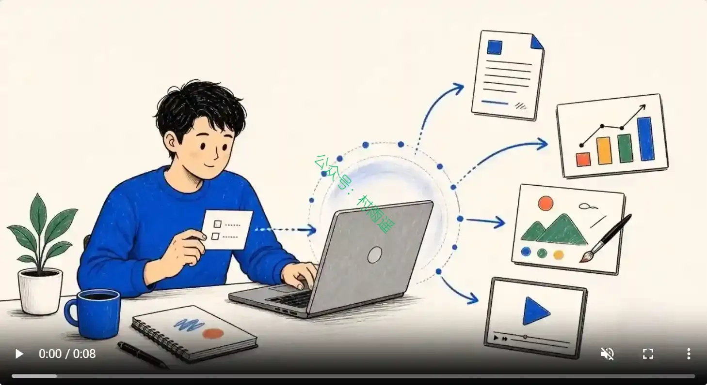

### 2. [workbuddy-auto-signin](https://github.com/88lin/workbuddy-auto-signin)

一个自包含的 Python 脚本，每天自动帮你领取 WorkBuddy（腾讯 AI 编程助手）的每日签到积分。只读取你自己机器上的登录态，零内置密钥，可安全分享。

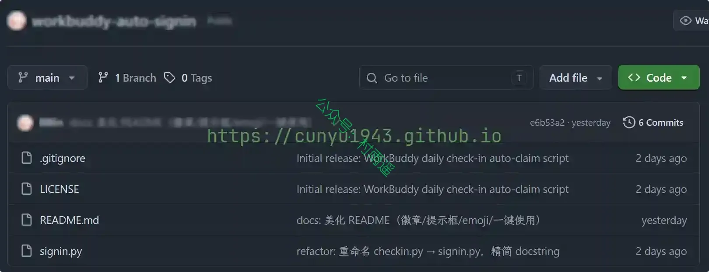

### 3. [GitFut](https://github.com/Younesfdj/gitfut)

一款趣味网页工具，它抓取 GitHub 账号数据换算成 FIFA 世界杯球星卡样式卡片，给出满分 99 的综合评分与速度、射门等六项足球属性，生成可嵌入 README 的实时球星卡图片。

## 二、软件

### 1. [QuickLook](https://github.com/QL-Win/QuickLook)

将 macOS 上最受欢迎的「空格键快速预览」功能完美带到了 Windows 系统。

只需选中任意文件，然后按一下空格键，即可瞬间弹出美观、流畅的预览窗口，而无需打开原生应用。

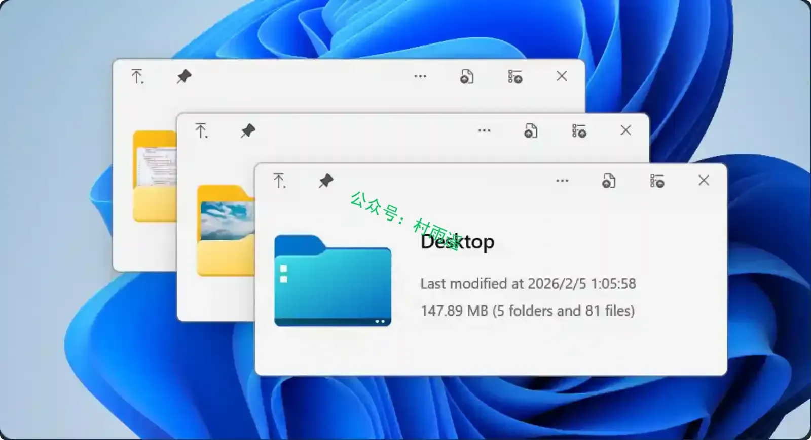

### 2. [Otty](https://otty.sh)

Typora 团队推出、面向 AI Agent 时代的 macOS 原生 GPU 加速高颜值终端，兼具多标签分屏、会话恢复、丰富美化能力与原生 AI 编程代理集成能力，macOS 免费无账号，Windows 版本尚在开发中。

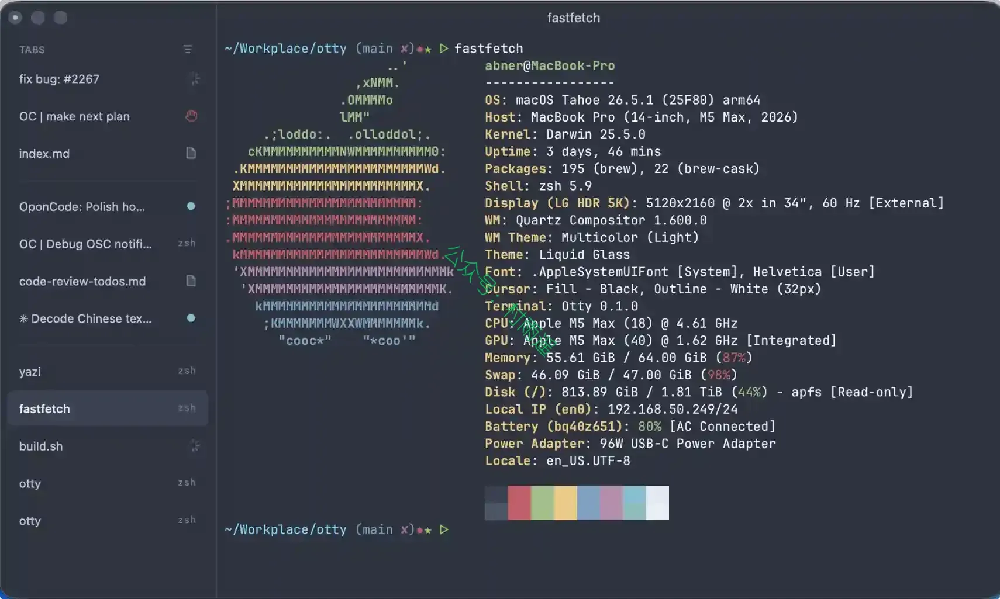

### 3. [md2wechat](https://github.com/geekjourneyx/md2wechat-skill)

一键排版发布到微信公众号：支持 40+ 排版样式和专业主题 、AI 配图 、批量发布 、多账号管理。

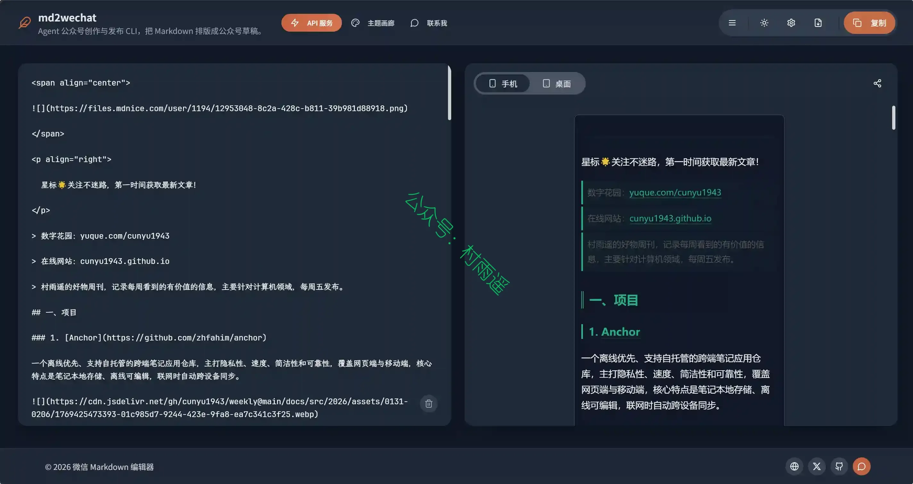

## 三、网站

### 1. [彼岸图网](https://www.netbian.com)

提供海量高清电脑壁纸、2K 桌面壁纸，包含日历、风景、动漫、游戏、美女等高清壁纸免费下载。

### 2. [混剪侠](https://www.yugaopian.cn)

自媒体剪辑师网址导航，为您提供全网最全的自媒体剪辑师服务导航，帮助您找到优秀的自媒体剪辑师，快速提升自媒体影视剪辑水平。

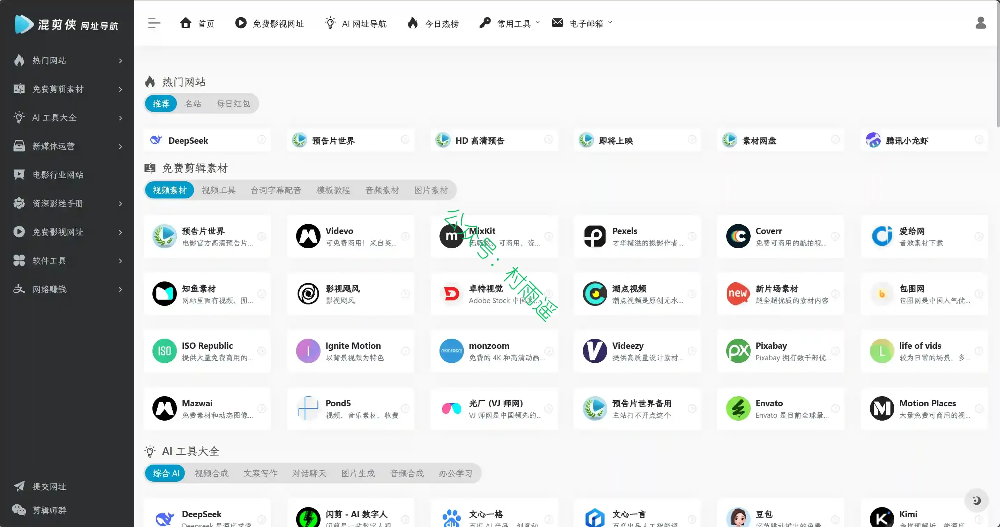

### 3. [Picllery](https://www.picllery.com)

沉浸式看图神器，为你带来沉浸式的看图体验。发现精彩作品，一直刷一直爽。上传你的原创图片，和朋友们一起探索视觉之美吧。

## 四、插件

### 1. [橘猫起始页](https://github.com/mumingfang/jvmaoTab)

一个极简、简单的浏览器新标签页插件，注重细节与用户体验。

### 2. [DeepSeek++](https://chromewebstore.google.com/detail/deepseek++/kdmpkkahkhdmdhfkdihkopikgcocbpbf?hl=zh-CN&authuser=0)

为 DeepSeek 网页应用增强了持久记忆、可复用技能、系统提示预设、MCP 工具执行和计划自动化。

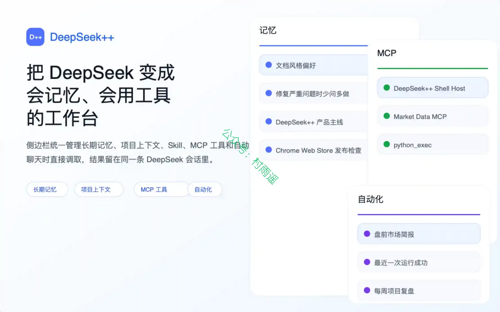

### 3. [OpenBiliClaw](https://github.com/whiteguo233/OpenBiliClaw)

一个纯本地、私有、开源的自进化跨平台内容发现 Agent：从你的跨平台使用、反馈和对话中持续深化心理画像，带着对你的理解主动去 B 站、小红书、抖音、YouTube、X、知乎、Reddit、Linux.do、Bangumi、V2EX、微博与开放 Web 找内容。

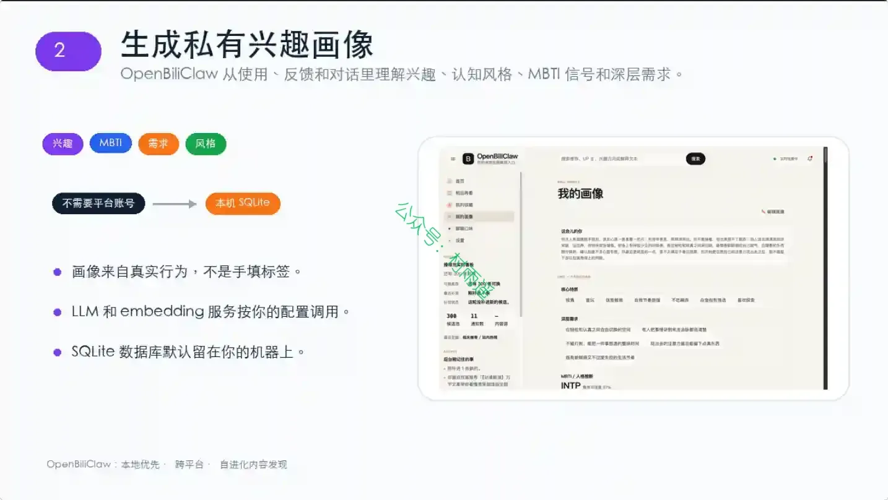

## 五、资料

### 1. [Harness Engineering 学习指南](https://github.com/deusyu/harness-engineering)

一个不断生长的学习项目。Harness Engineering（驭缰工程）是 OpenAI 在 2026 年 2 月提出的工程范式：工程师不再写代码，而是设计环境、明确意图、构建反馈回路，让 AI 智能体可靠地完成工作。仓库记录了从阅读原文、拆解概念、形成思考、动手实践到输出作品的完整学习过程。

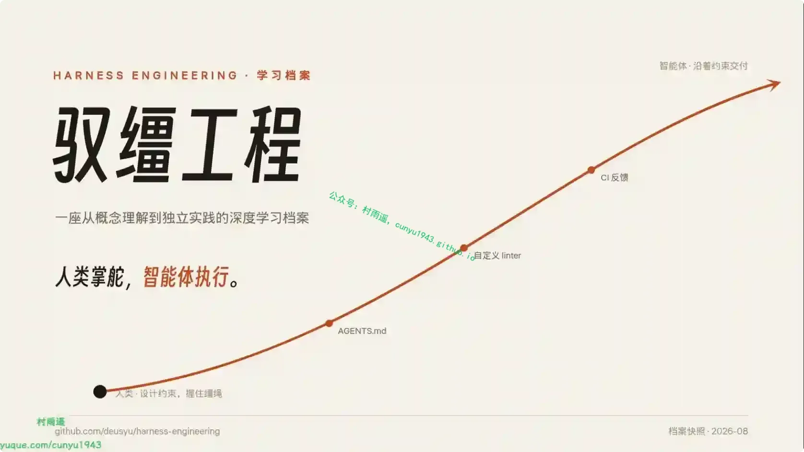

### 2. [Awesome DeepSeek Harness (DSH) Plugin](https://github.com/awesome-dsh-plugin/awesome-dsh-plugin)

收录 571 款 DeepSeek Harness（DSH）全品类插件的中英双语精选导航网站，按 UI、工具、记忆、工作流等多维度分类展示插件功能与安装方式，是 DSH 生态一站式插件查询、选用资源站。

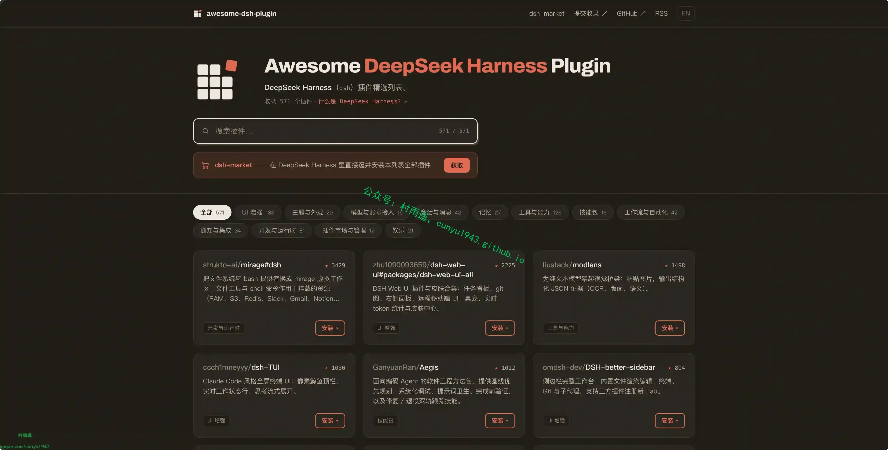

### 3. [Linux Basics for Hackers](https://github.com/ahegazy0/linux-basics-for-hackers-notes)

基于 OccupyTheWeb 所著书籍《黑客Linux基础》的个人学习笔记整理而成的结构化课程。每个模块都用通俗易懂的语言拆解核心概念、命令以及实操示例——对新手足够浅显易懂，内容详实也具备实际使用价值。

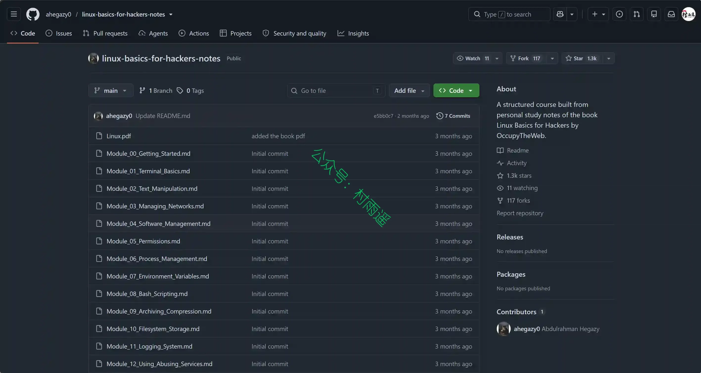

## ✍️ 说明

周刊专栏相关信息：

- **项目地址**：[Github](https://github.com/cunyu1943/weekly)，觉得不错麻烦给我一个**Star**，感谢 ❤️
- **浏览地址**：公众号 | [电子书](https://cunyu1943.github.io/weekly) | [语雀](https://yuque.com/cunyu1943/weekly) | [ima 知识库](https://ima.qq.com/wiki/?shareId=860487e32c6cc8d6c9070cd7f00caedf3cbf4102f695862d9c82f463b92417af)

如果你阅读到这里，说明我的工作没有白费。如果你想推荐项目/网站/软件/资源，欢迎提交 **[issue](https://github.com/cunyu1943/weekly/issues)** 或者添加我 **个人微信：coder_cunYu** 与我交流。

