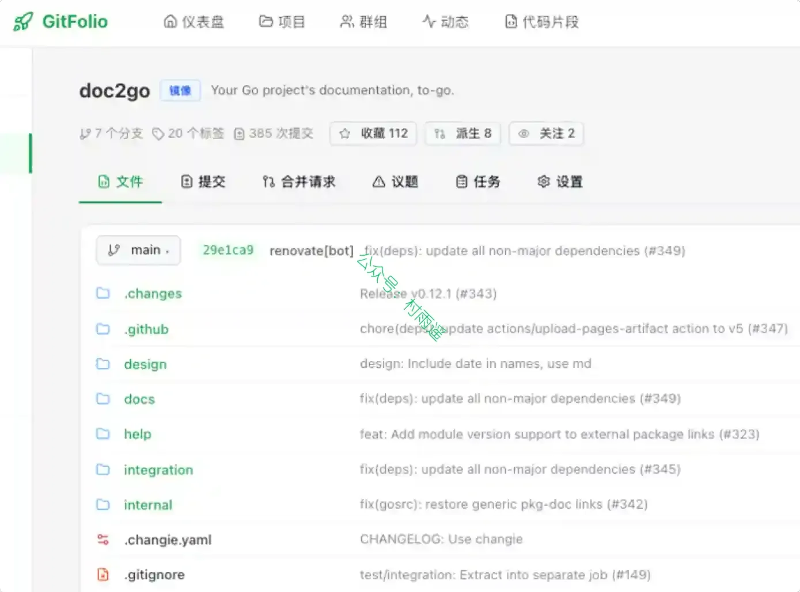
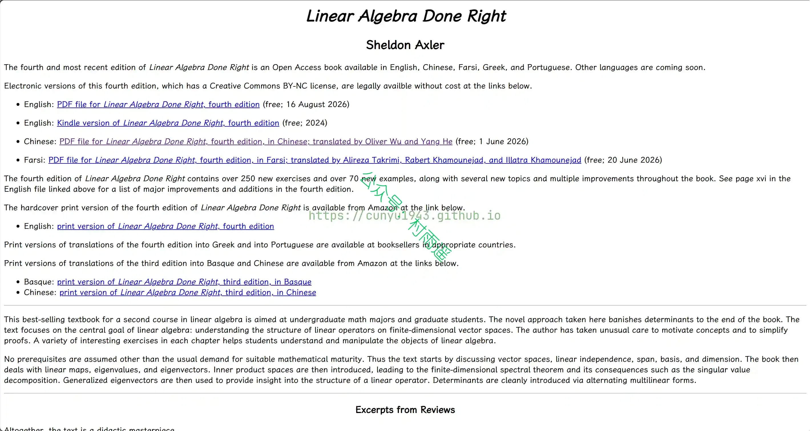

# 好物周刊#169：一句话问多个 AI

> 作者：[村雨遥](https://github.com/cunyu1943)
> 
> 不要哀求，学会争取，若是如此，终有所获
> 
> 原文：https://mp.weixin.qq.com/s/6HBLYu6b5MI1j83PR0qGbg

## 🎈 号外 

最近，公众号之外，建立了微信交流群，不定期会在群里分享各种资源（影视、IT 编程、考试提升……）&知识。如果有需要，可以**扫码或者后台添加小编微信备注入群**。进群后**优先看群公告**，**呼叫群中【资源分享小助手】**，还能免费帮找资源哦～

## 一、项目

### 1. [GitFolio](https://github.com/azhai/gitfolio)

一个轻量级的 Git 仓库管理系统，采用 Go + React 开发，支持从 GitHub 镜像同步仓库数据。

### 2. [Article Tools](https://github.com/eternityspring/article-tools)

一套封面制作和 x、微信公众号排版工具。你只需要按照 draft.md 的格式规范写作，其他的交给工具。

### 3. [Ruyu-Blog](https://github.com/kuailemao/Ruyu-Blog)

基于 SpringBoot3 + Vue3 + TypeScript+ Mysql + Redis + RabbitMQ + SpringSecurity 的前后台个人博客系统。

## 二、软件

### 1. [MarkerOn](https://github.com/ifer47/markeron)

轻量级屏幕标注工具，按下快捷键，即可随时在桌面上自由绘画、标注。适用于课堂演示/会议讲解/录屏批注。

### 2. [Coday](https://coday.cc)

跨平台物品成本管理工具，可自动计算物品日均 / 单次使用成本，搭配桌面小组件、分类统计与海量 3D 图标，帮你看清消费真实价值、理性消费。

### 3. [虾传](https://xiachuan.net)

在复杂网络环境下也能稳定互传。对方不用安装也能在浏览器接收，大文件断网可续传，酒店 Wi-Fi、校园网、运营商 NAT 下仍可用。

## 三、网站

### 1. [计算器 3000](https://jsq3000.com)

房贷、个税、工资、车贷、复利、BMI、单位换算、年龄日期等数千款免费在线计算器，你要算什么这里都有。

### 2. [古文岛](https://www.gushiwen.cn)

作为传承经典的网站，专注于古诗服务，致力于让古诗爱好者更便捷地发表及获取古诗相关资料。

### 3. [WiseMindAI](https://www.wisemindai.app)

一款本地优先的 AI 学习与知识工作台，帮你把文档、网页和音视频变成可对话、可复习、可分享的长期知识资产。

## 四、插件

### 1. [Simple Chat Hub](https://chromewebstore.google.com/detail/simple-chat-hub/dpfkgaedamhcmkkgeiajeggihmfjhhlj)

集合各大主流AI模型聊天平台，支持多平台同屏同步聊天的浏览器扩展。一键发送消息至多个平台并且同步获得回复，方便在各平台之间参考和对比

### 2. [全提问](https://chromewebstore.google.com/detail/phlefbnhphgfijeabpgjlbcpedpdonef?utm_source=item-share-cb)

一键同时向 DeepSeek、GPT、豆包等 12 个 AI 助理 发送消息，并排对比答案。同时问多个 AI，多 AI 对比答案，更准、更全，输入问题后，工具将自动分发查询任务，快速汇聚不同模型的原生回答。你可直观对比多份结果，自主甄别信息差异、规避单一模型幻觉风险，让技术探索、知识检索的每一次提问，都拥有更全面的视角与更扎实的信息支撑，打破单一 AI 的信息局限。

### 3. [Litestart](https://github.com/XingYueFox/Litestart)

一个可自定义的新标签页扩展，将浏览器默认的新标签页转化为简洁、轻量且个性化的起始页体验。它围绕简洁、快速访问和视觉清晰度构建，每当你创建新标签页时都会打开自己的界面，整体设计保持了原生浏览器起始页的质感，同时让你对页面的外观和功能有更多控制。

## 五、资料

### 1. [WorkBuddy 实战蓝皮书](https://github.com/AlephAITech/WorkBuddyGuide)

开源的 WorkBuddy 实战蓝皮书：教程、真实工作流、Skills、MCP、自动化与多智能体实践。

### 2. [Awesome AI Art Pics Prompts](https://github.com/Jermic/awesome-aiart-pics-prompts)

精选 12,000+ Gemini、ChatGPT、Midjourney、Stable Diffusion 提示词。覆盖文案、设计、绘画全场景，免费复制，激发 AI 创作灵感。

### 3. [线性代数应该这样学](https://linear.axler.net)

《线性代数应该这样学》第四版，新增 250 + 习题、70 + 示例，加入若干新主题，全书多处内容优化。面向数学专业本科生与研究生，适合线性代数进阶课程。

## ✍️ 说明

周刊专栏相关信息：

- **项目地址**：[Github](https://github.com/cunyu1943/weekly)，觉得不错麻烦给我一个**Star**，感谢 ❤️
- **浏览地址**：公众号 | [电子书](https://cunyu1943.github.io/weekly) | [语雀](https://yuque.com/cunyu1943/weekly) | [ima 知识库](https://ima.qq.com/wiki/?shareId=860487e32c6cc8d6c9070cd7f00caedf3cbf4102f695862d9c82f463b92417af)

如果你阅读到这里，说明我的工作没有白费。如果你想推荐项目/网站/软件/资源，欢迎提交 **[issue](https://github.com/cunyu1943/weekly/issues)** 或者添加我 **个人微信：coder_cunYu** 与我交流。

---

