# 好物周刊#170：写完还要手动搬？3 个插件让一篇文章同时发到所有平台

> 作者：[村雨遥](https://github.com/cunyu1943)
> 
> 不要哀求，学会争取，若是如此，终有所获
> 
> 原文：https://mp.weixin.qq.com/s/eGmNYmQe06nqupqLKcEMqA

## 🎈 号外 

最近，公众号之外，建立了微信交流群，不定期会在群里分享各种资源（影视、IT 编程、考试提升……）&知识。如果有需要，可以**扫码或者后台添加小编微信备注入群**。进群后**优先看群公告**，**呼叫群中【资源分享小助手】**，还能免费帮找资源哦～

## 一、项目

### 1. [git filter-repo](https://github.com/newren/git-filter-repo)

Git 官方推荐、用来替换老旧 git filter-branch 的高速开源工具，可安全批量改写 Git 仓库历史（删文件、改邮箱、剥离目录、清理敏感数据等）。

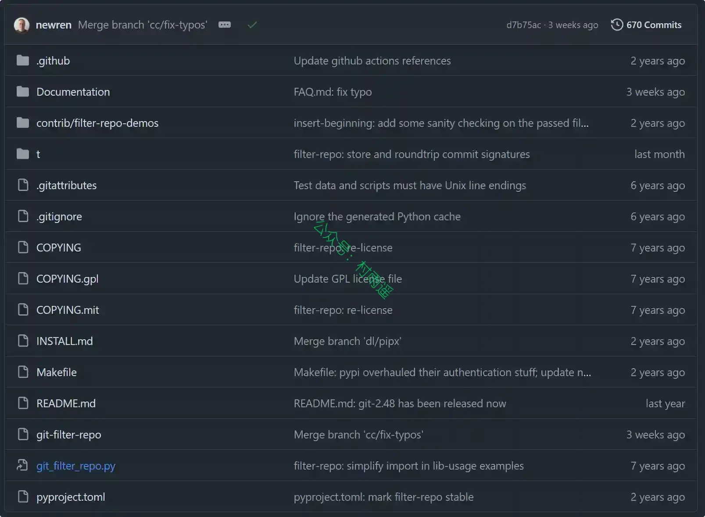

### 2. [NaviDash](https://github.com/wtfllix/navidash)

每天打开浏览器时，你真正需要的通常只有几件事：进入最常用的网站、搜索一个内容、看一眼时间和天气，或者临时记下一段信息。NaviDash 把它们放在一张安静、自由、属于你的首页上。

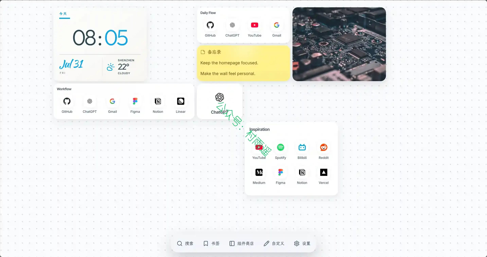

### 3. [OpenDataLoader PDF](https://github.com/opendataloader-project/opendataloader-pdf)

一款 Apache 2.0 开源、本地优先、基准测试综合排名第一的 PDF 解析工具，专为 RAG 大模型流水线打造，可输出带坐标边界框的结构化数据，支持高精度表格/多栏文本提取、多语言 OCR、AI 安全过滤，还提供完整 PDF 无障碍自动打标合规方案。

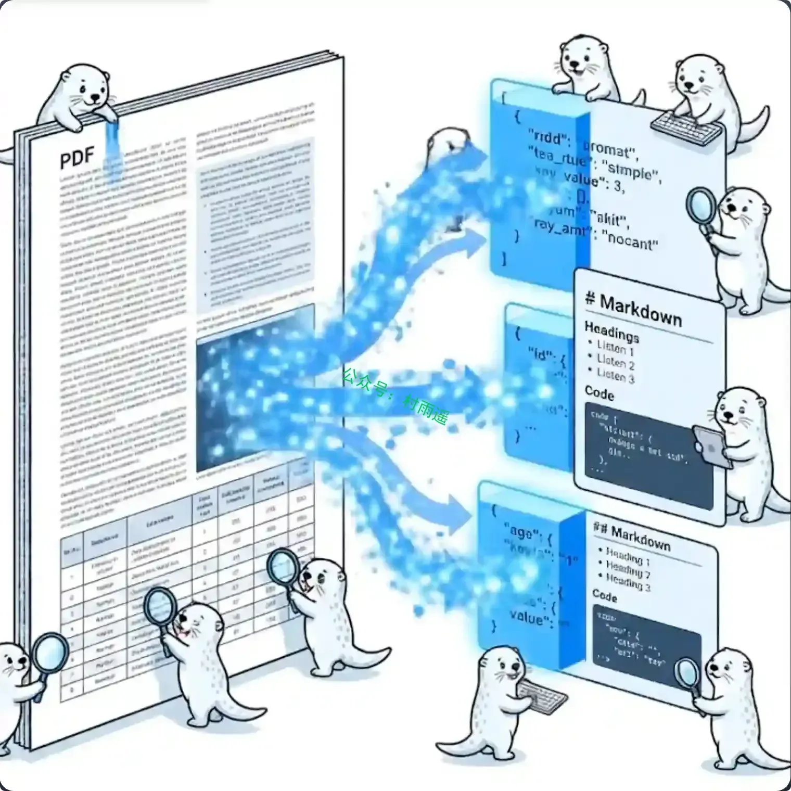

## 二、软件

### 1. [Idea Note](https://github.com/Liubsyy/idea-note)

一款轻量、简洁的所见即所得 Markdown 笔记应用，内置 AI 笔记助手，可用自然语言编辑你的笔记，支持 Git 远程同步，兼容 Windows、MacOS 和 Linux 平台。

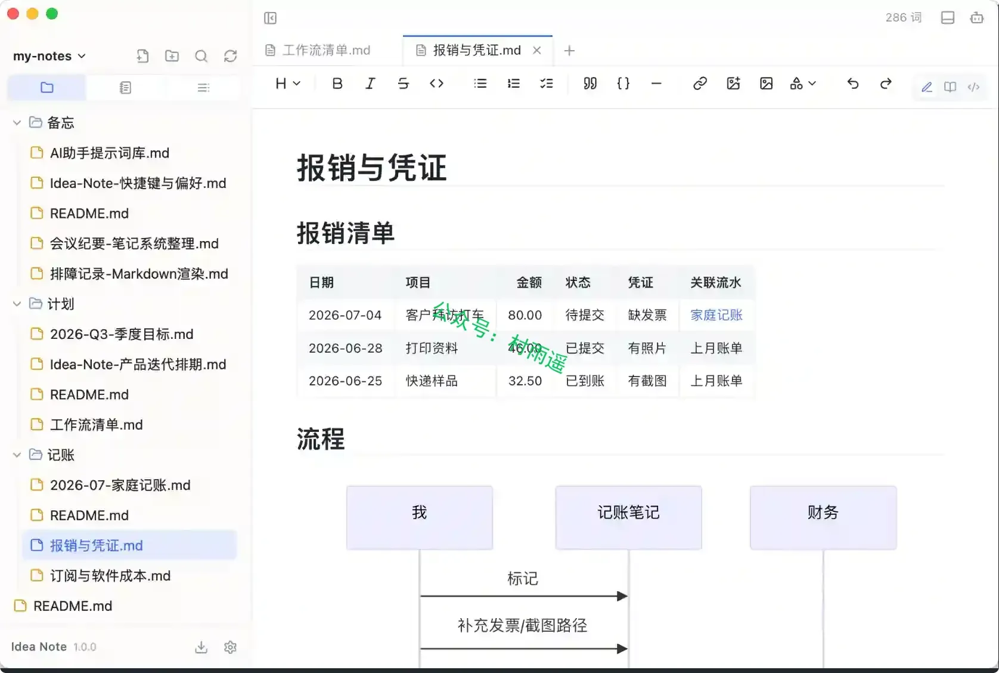

### 2. [MarKing](https://github.com/l06066hb/MarKing)

一款桌面端 Markdown 编辑器，注重原生性能与稳定性。
本地优先、零追踪、无广告 — 文字始终保存在你自己的设备上。

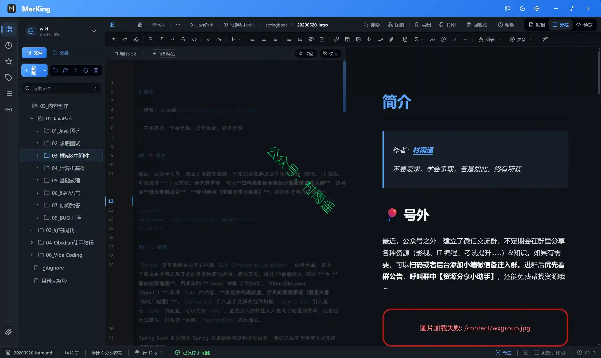

### 3. [MantisZip](https://gitee.com/mantis3d/MantisZip)

一款现代开源的 Windows 压缩包管理器。与传统压缩工具不同，我们的项目非常注重通过两个核心功能来提升用户体验：压缩包内文件即时无缝预览，以及针对加密文件的内置安全密码管理。

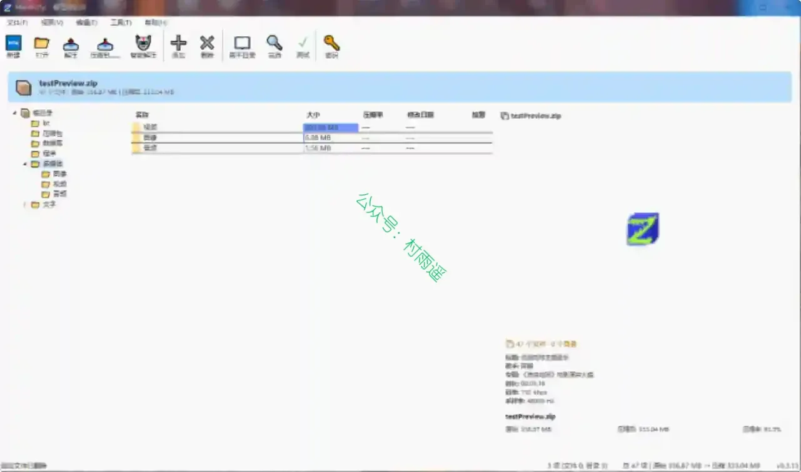

## 三、网站

### 1. [Iconify Design](https://iconify.design)

一款开源统一图标框架平台，聚合超 30 万个各类开源矢量图标，提供图标浏览、开发接入文档等功能，项目主体采用 MIT 协议，各图标集拥有独立开源授权，适配开发者与设计师使用。

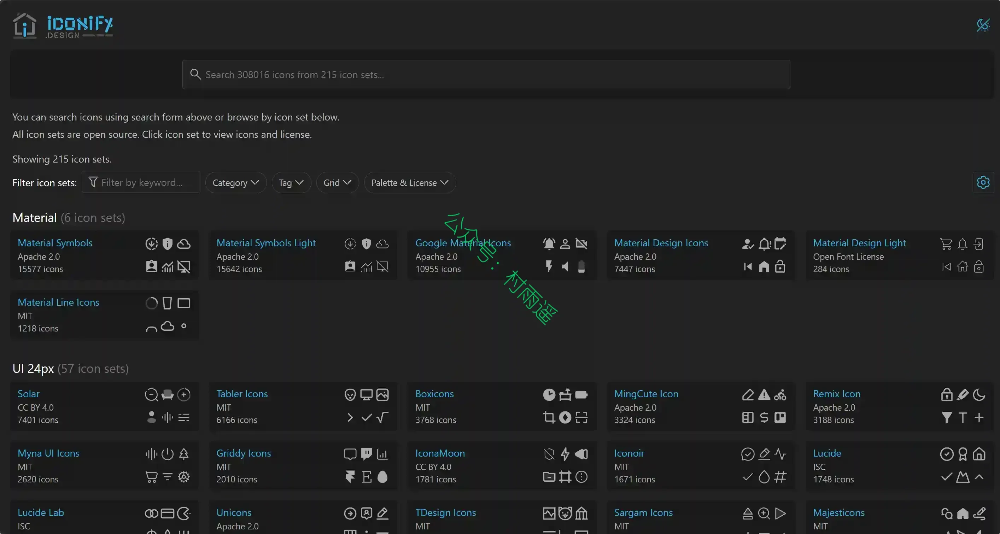

### 2. [Remix Icon](https://remixicon.com)

一套面向设计师和开发者的开源图标库。项目在设计之初将图标风格定义为中性风格，以便适用于各种用户群的项目。与拼凑混搭的图标库不同，Remix Icon 的每一枚图标都是由设计师按照统一规范精心绘制的，并确保每一枚图标在拥有完美像素对齐的基础上风格一致且简洁易读。图标以 24x24 网格为基准，分为 “线性图标” 和 “面型图标” 两种风格。所有的图标均可免费用于个人项目和商业项目。

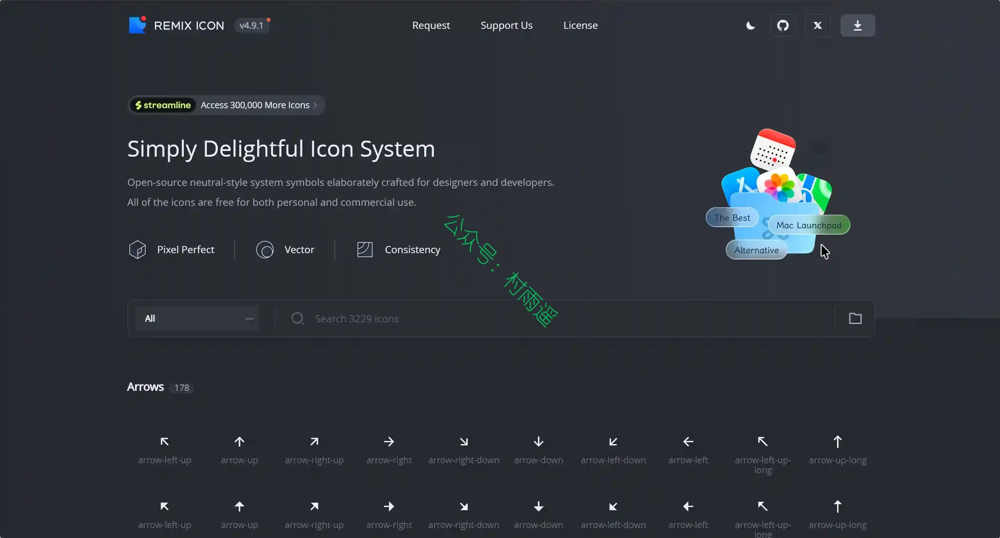

### 3. [皮影数字博物馆](https://shadow.caa.edu.cn)

中国美术学院打造、国家艺术基金资助的公益皮影数字博物馆网站，汇聚海量皮影影像、剧目、唱腔、文献等数字化资源，免费向大众展示、保存与研究皮影非遗艺术。

## 四、插件

### 1. [COSE - 多平台文章同步](https://chromewebstore.google.com/detail/ilhikcdphhpjofhlnbojifbihhfmmhfk?utm_source=item-share-cb)

一款专为内容创作者打造的浏览器扩展，配合 Doocs MD 编辑器使用，让你一次编辑，多平台同步发布。

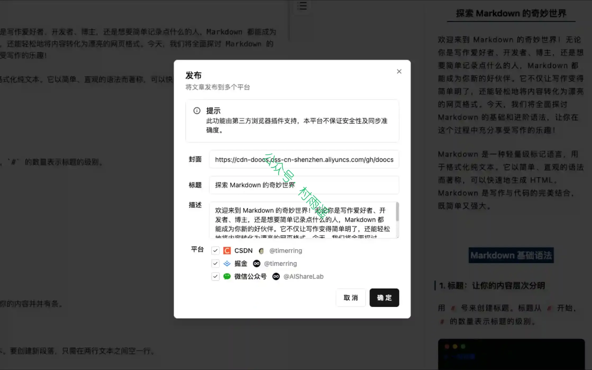

### 2. [文章同步助手](https://github.com/wechatsync/Wechatsync)

一键同步文章到多个内容平台，支持今日头条、WordPress、知乎、简书、掘金、CSDN、typecho 各大平台，一次发布，多平台同步发布，解放个人生产力。

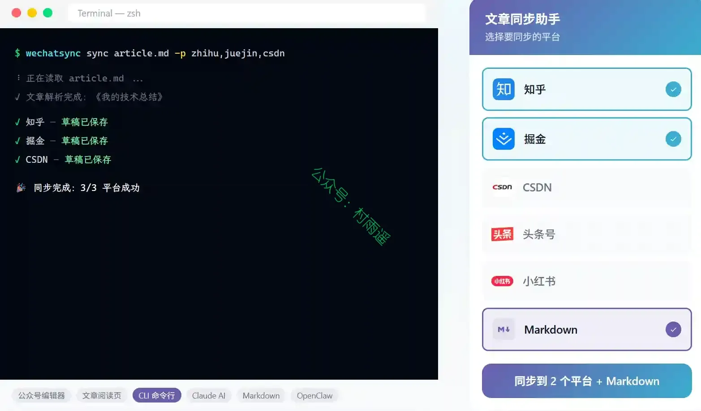

### 3. [CSDN 同步助手](https://chromewebstore.google.com/detail/ncjocoihljjgjgopejkmcjbgaeaaomjj?utm_source=item-share-cb)

一款功能强大且易于使用的浏览器扩展，专为在 CSDN 社区平台发布内容的博文创作者设计。它解决了在多个内容平台之间高效管理和分发博客文章的常见难题，通过一键同步功能，帮助用户在 CSDN 博客文章和微信公众平台等多个热门平台之间的文章无缝同步。

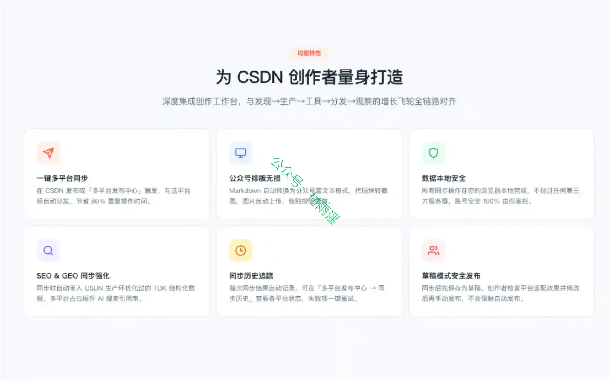

## 五、资料

### 1. [DeckForge](https://deckforge.gtio.work)

一个装进 Claude Code、Codex 工作流的 CLI。它给你的 Agent 一整套 design system、一个强制的视觉 QA 闭环、一支自研 OOXML 写入器。然最后落到你手里的，是每个对象都能继续编辑的 PPTX，不是一叠截图。

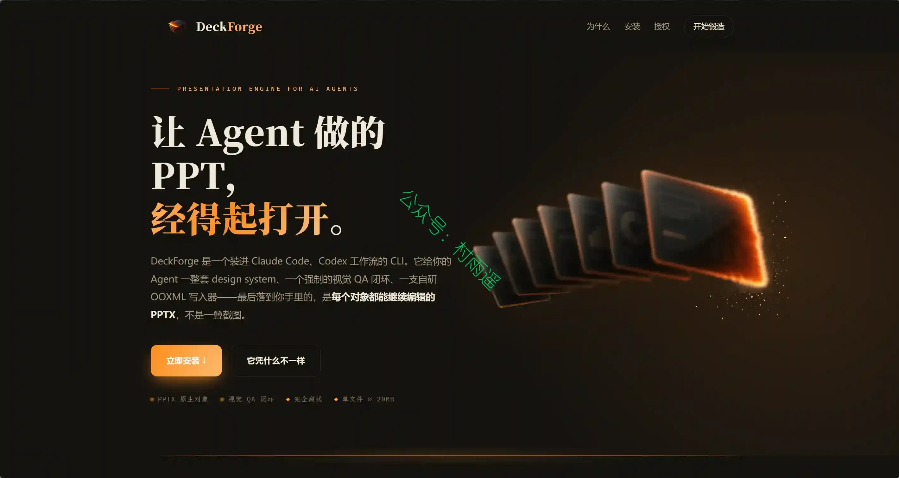

### 2. [BOSS 直聘岗位爬取与智能投递助手](https://github.com/zhansan379/boss-crawler-skill)

一套完整的 BOSS 直聘求职自动化工具：爬取岗位 → 解析简历 → 智能匹配 → 可视化报告 → 自动生成优化简历图片 → 自动投递。帮助你更好精投简历。

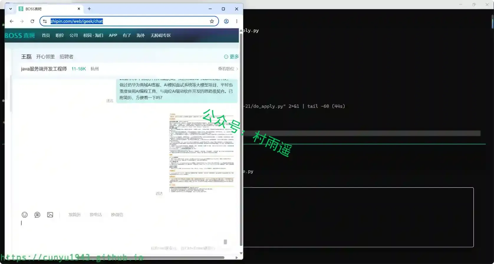

### 3. [裁员应对卡](https://github.com/shaozhengmao/get-my-fucking-money)

提供裁员应对实用指引，教你区分签字前后不同处理方式，帮劳动者核对补偿、留存证据。

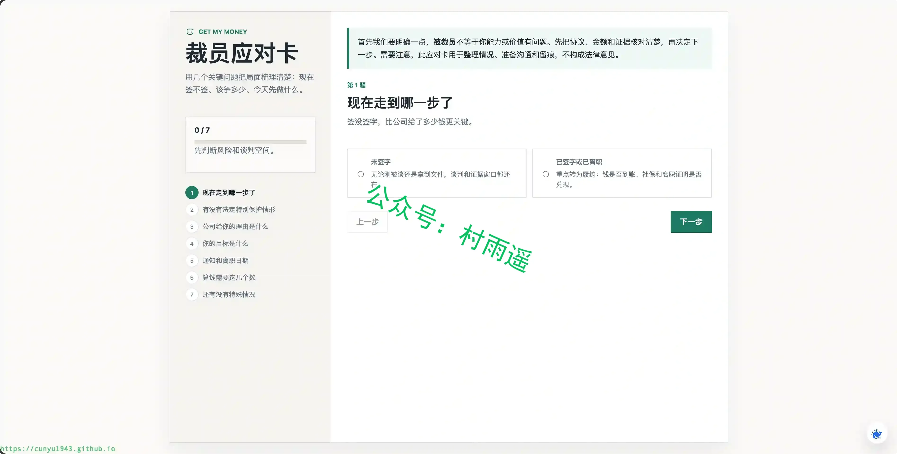

## ✍️ 说明

周刊专栏相关信息：

- **项目地址**：[Github](https://github.com/cunyu1943/weekly)，觉得不错麻烦给我一个**Star**，感谢 ❤️
- **浏览地址**：公众号 | [电子书](https://cunyu1943.github.io/weekly) | [语雀](https://yuque.com/cunyu1943/weekly) | [ima 知识库](https://ima.qq.com/wiki/?shareId=860487e32c6cc8d6c9070cd7f00caedf3cbf4102f695862d9c82f463b92417af)

如果你阅读到这里，说明我的工作没有白费。如果你想推荐项目/网站/软件/资源，欢迎提交 **[issue](https://github.com/cunyu1943/weekly/issues)** 或者添加我 **个人微信：coder_cunYu** 与我交流。

---

