# 好物周刊#171：妙笔生花

> 作者：[村雨遥](https://github.com/cunyu1943)
> 
> 不要哀求，学会争取，若是如此，终有所获
> 
> 原文：https://mp.weixin.qq.com/s/p-76-ziB-9hP0Fxnb6JGKw

## 🎈 号外 

最近，公众号之外，建立了微信交流群，不定期会在群里分享各种资源（影视、IT 编程、考试提升……）&知识。如果有需要，可以**扫码或者后台添加小编微信备注入群**。进群后**优先看群公告**，**呼叫群中【资源分享小助手】**，还能免费帮找资源哦～

## 一、项目

### 1. [Magic Resume](https://github.com/JOYCEQL/magic-resume)

一个现代化的在线简历编辑器，让创建专业简历变得简单有趣。基于 TanStack Start 和 Motion 构建，支持实时预览和自定义主题。

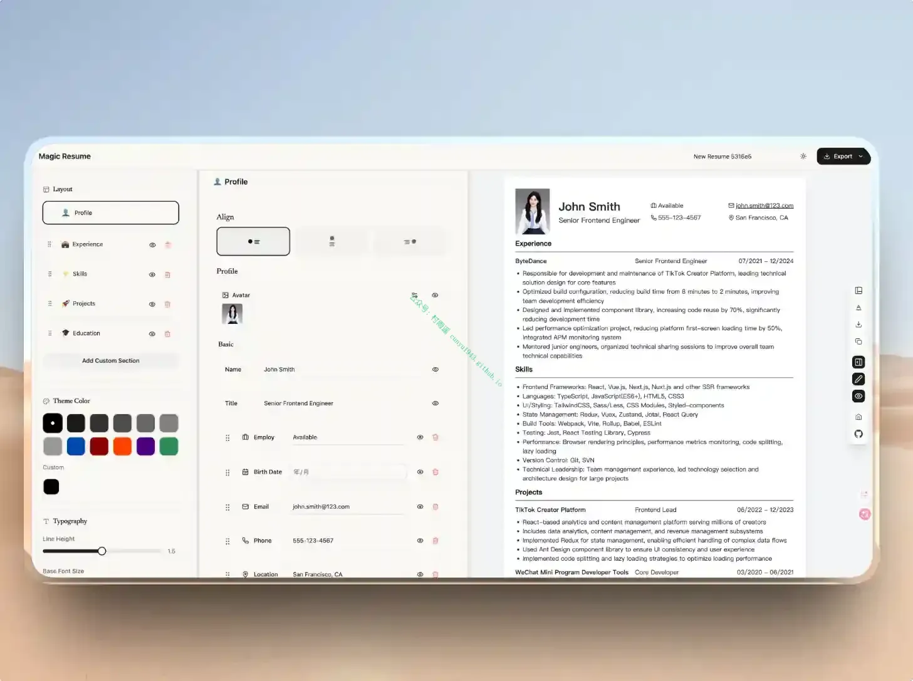

### 2. [EMBY 工具箱](https://github.com/hbq0405/emby-toolkit)

一款基于 Emby 开发的强大管理工具，支持实时监控、智能追剧、演员订阅、自建合集、封面生成、302 直链、Strm、集成 115 网盘等功能。

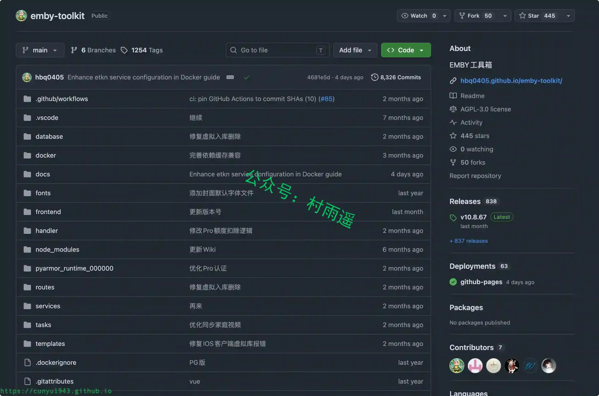

### 3. [蓄拼 AI 输入法](https://github.com/sxzxs/Real-time-translation-typing)

基于 AutoHotkey v2 开发的 Windows 开源工具，支持实时打字翻译、语音转译，兼容有道 / 百度 / 搜狗等翻译 API，附带 LOL 游戏语音输入能力，依靠全局快捷键完成翻译文本输出。

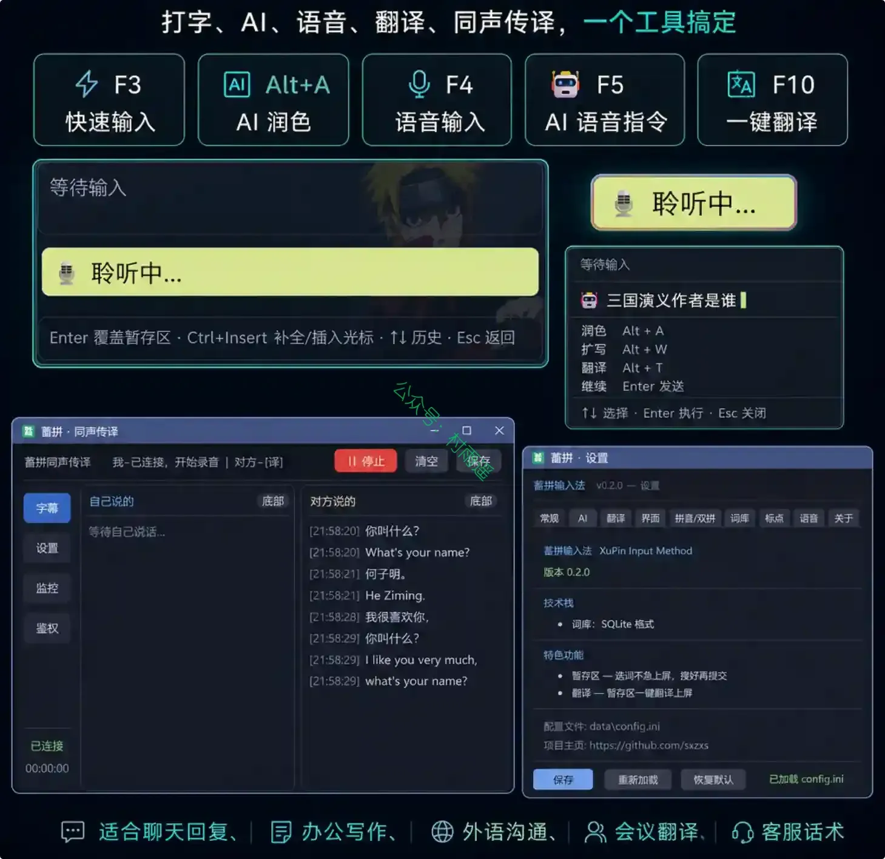

## 二、软件

### 1. [PxCook](https://www.pxcook.cn)

又名像素大厨，是一款交互流畅、全平台支持的切图设计工具，专为 UI 设计师所设计。pxcookUI 设计师必备的标注切图神器，可以有效解决作图过程中的透明图、尺寸、标尺等问题，支持 PSD 文件的文字、颜色，距离自动智能识别等功能。pxcook 还支持对 PS、Sketch 设计元素尺寸、颜色的智能标注，从设计到代码让团队高效协作，生成前端代码，是设计研发协作利器。

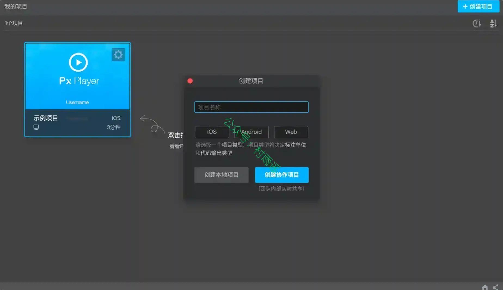

### 2. [妙笔](https://www.tominlab.com/wonderpen)

一款专业的写作软件，致力于为作者提供专注且流畅的写作体验。

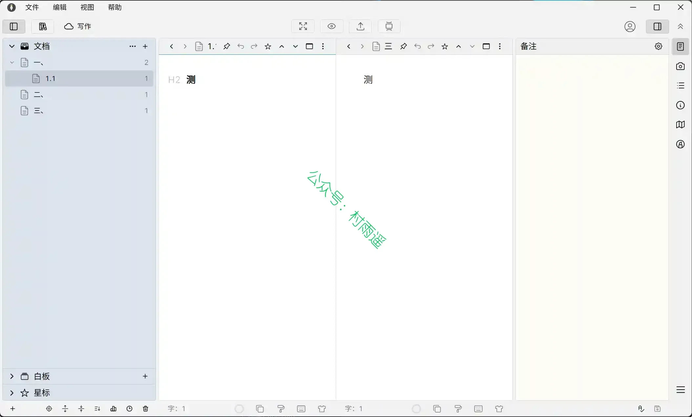

### 3. [图几](https://tuji.app)

一款强大易用的截图应用，您可以使用它对屏幕进行截图，并根据需要为截图添加标注、水印、边框以及漂亮的背景等等。

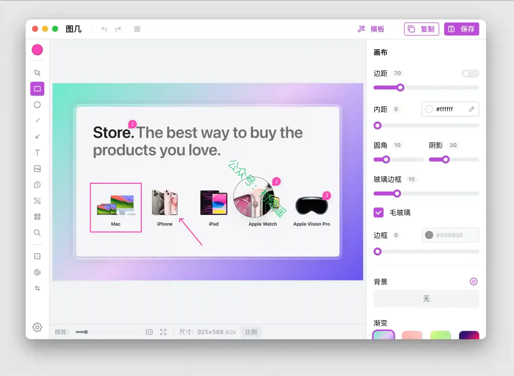

## 三、网站

### 1. [Pomo](https://pomo.mom)

汇集海内外各类影视海报、影片简介，提供 4K 蓝光原盘影视资源免费下载的影视资源站点。

### 2. [星贝工具箱](https://www.tools.goodssoft.com)

面向开发者、设计师和效率爱好者的免费在线工具平台，收录 400 余款 JSON 格式化、Base64 编码、正则测试、图片处理、金融计算等实用工具。无广告、纯本地计算、无需注册，打开即用，数据不上传服务器。

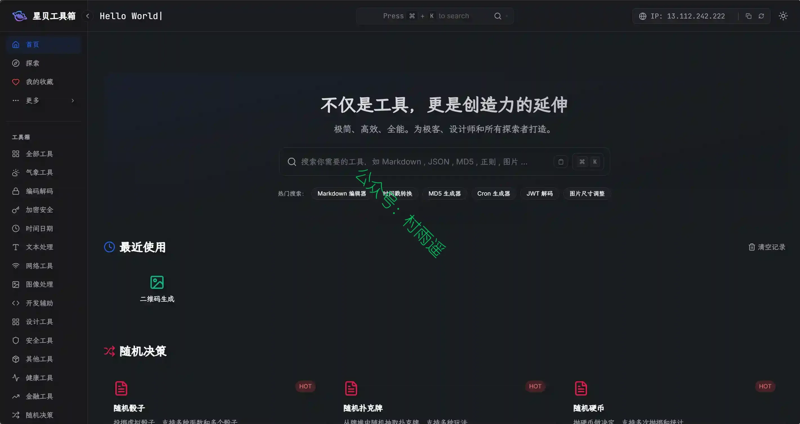

### 3. [水印大王](https://www.wbcxc.com)

批量图片加水印工具。本地处理不上传任何数据，支持图片水印/文字水印、平铺、裁剪、导出。

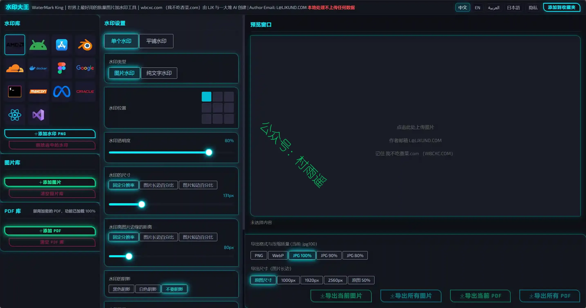

## 四、插件

### 1. [Analytics Debugger](https://chromewebstore.google.com/detail/ilnpmccnfdjdjjikgkefkcegefikecdc?utm_source=item-share-cb)

面向开发、分析、营销人员，用于调试分析代码、简化埋点调试工作并提供深度数据洞察的一站式工具。

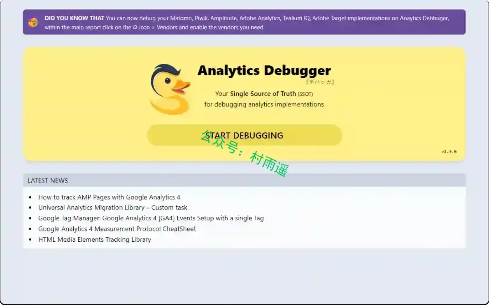

### 2. [Color Tab](https://chromewebstore.google.com/detail/color-tab/hchlgfaicmddilenlflajnmomalehbom)

一款新标签页插件，每次打开新标签都会展示来自 Color Hunt 精选的精美随机配色方案。

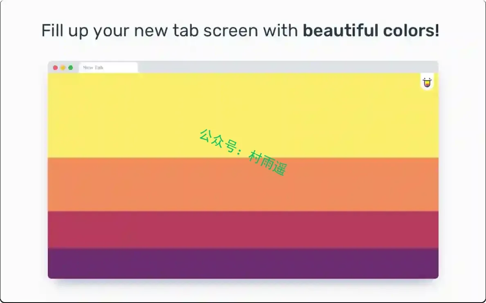

### 3. [Odoo Debug](https://chromewebstore.google.com/detail/odoo-debug/hmdmhilocobgohohpdpolmibjklfgkbi)

一款简洁轻快的 Odoo 插件，支持鼠标点击与快捷键一键切换 Odoo 调试模式和带资源的调试模式，快捷键可自定义。

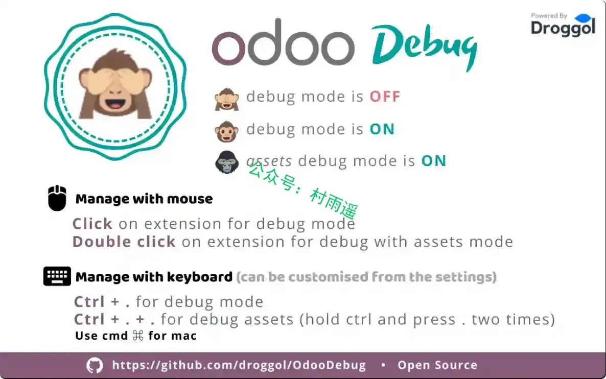

## 五、资料

### 1. [Tidings RSS](https://github.com/fuxiaoai/tidings-rss)

把真正值得长期订阅的内容，整理成可以直接导入阅读器的 RSS 合集。精选包兼顾中文和英文内容，覆盖 AI、工程、安全、科技媒体、周刊、科研、新闻、产品、商业、博客、社区、文化、视频和播客。

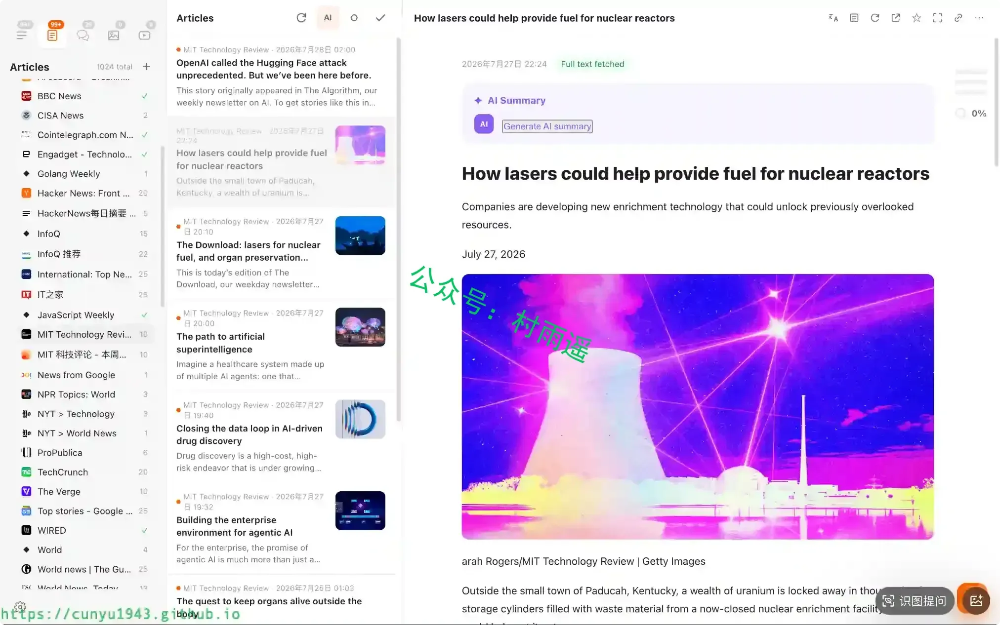

### 2. [Cybersecurity-Projects](https://github.com/CarterPerez-dev/Cybersecurity-Projects)

汇集 70 个分 4 个难度等级的网络安全实战项目，附带完整源码、文档、10 条职业认证路线与学习资源，帮助学习者从零动手编写各类攻防安全工具，用于网络安全技能练习与能力构建。

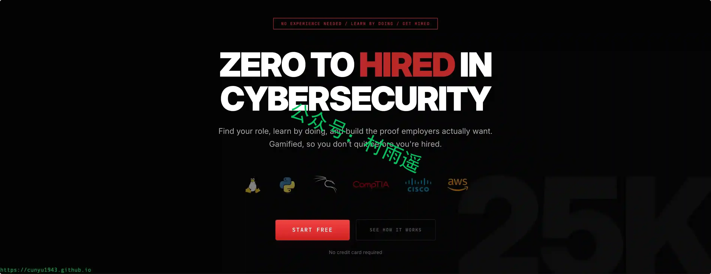

### 3. [从零开始手搓数据库（Go）](https://systems-programming.org/database_zh)

从 0 开始实现 KV 存储引擎、SQL、LSM 树索引等。教程由几十个循序渐进的小步骤组成，每步几十行代码，配有通俗化的讲解，人人都能上手并学习底层原理。

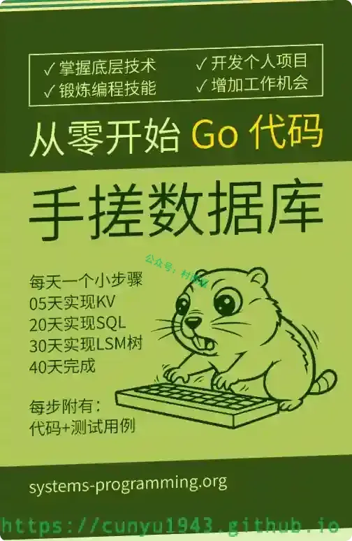

## ✍️ 说明

周刊专栏相关信息：

- **项目地址**：[Github](https://github.com/cunyu1943/weekly)，觉得不错麻烦给我一个**Star**，感谢 ❤️
- **浏览地址**：公众号 | [电子书](https://cunyu1943.github.io/weekly) | [语雀](https://yuque.com/cunyu1943/weekly) | [ima 知识库](https://ima.qq.com/wiki/?shareId=860487e32c6cc8d6c9070cd7f00caedf3cbf4102f695862d9c82f463b92417af)

如果你阅读到这里，说明我的工作没有白费。如果你想推荐项目/网站/软件/资源，欢迎提交 **[issue](https://github.com/cunyu1943/weekly/issues)** 或者添加我 **个人微信：coder_cunYu** 与我交流。

---

