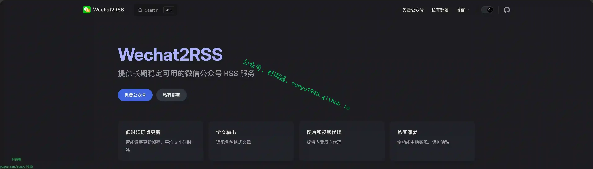
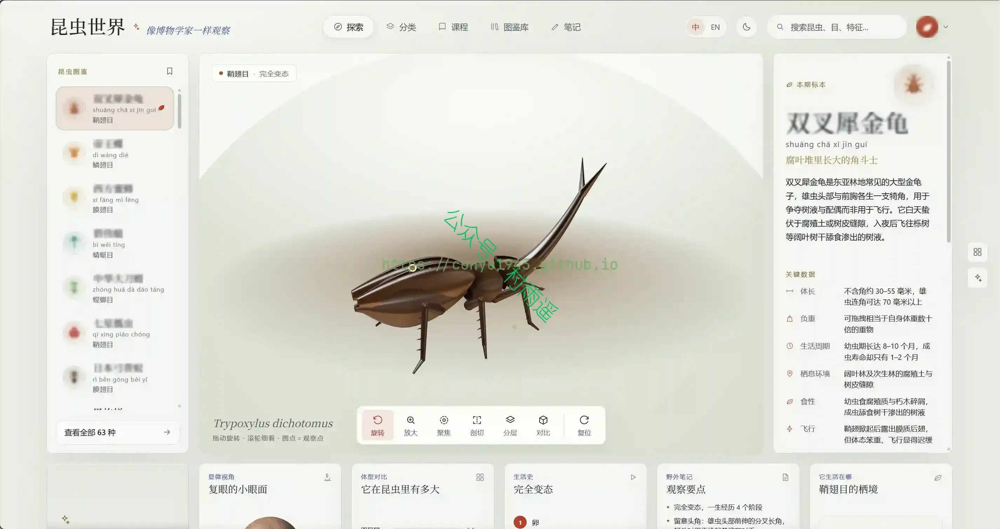
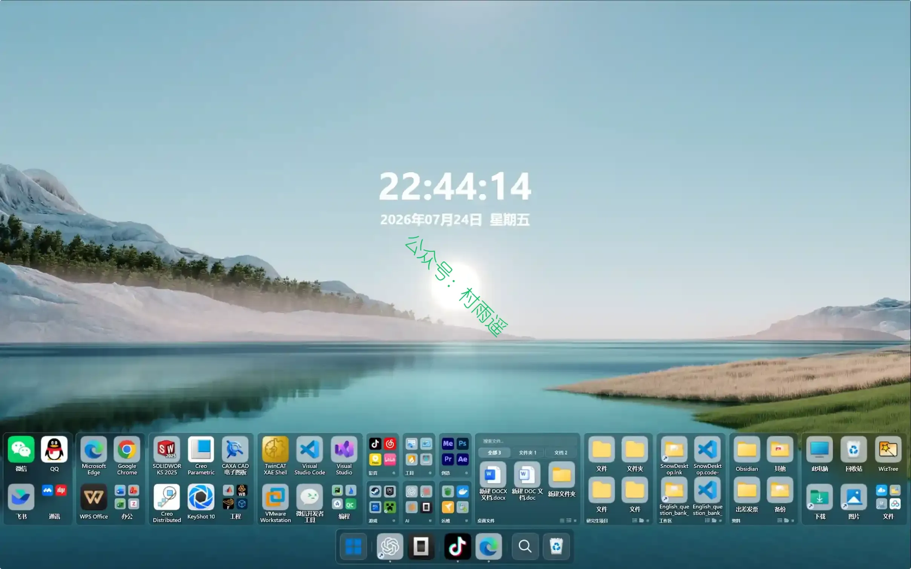
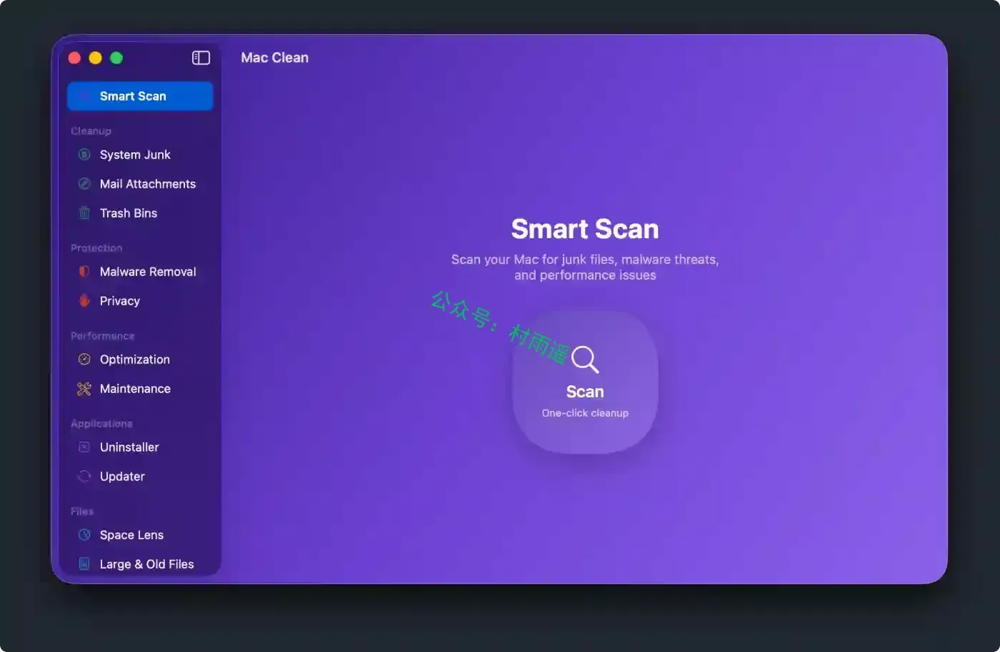
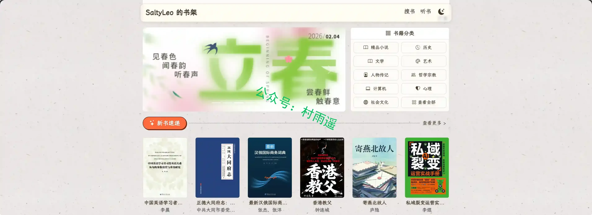
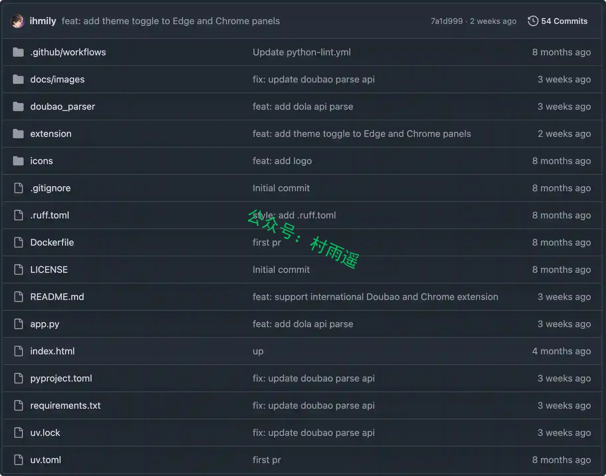
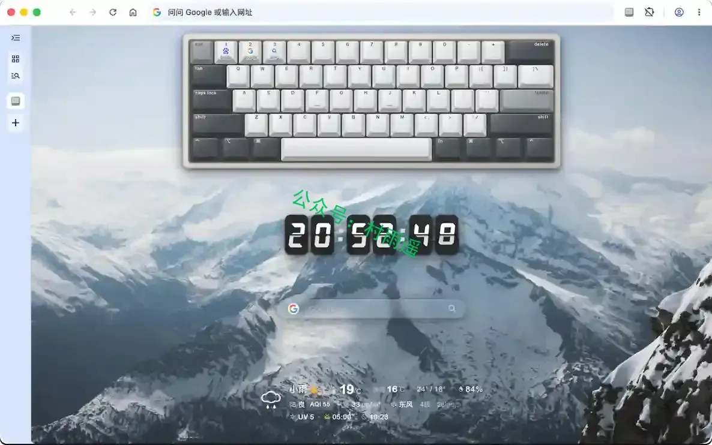
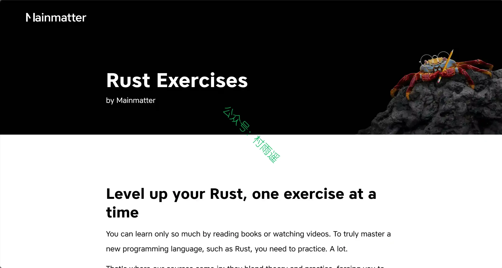
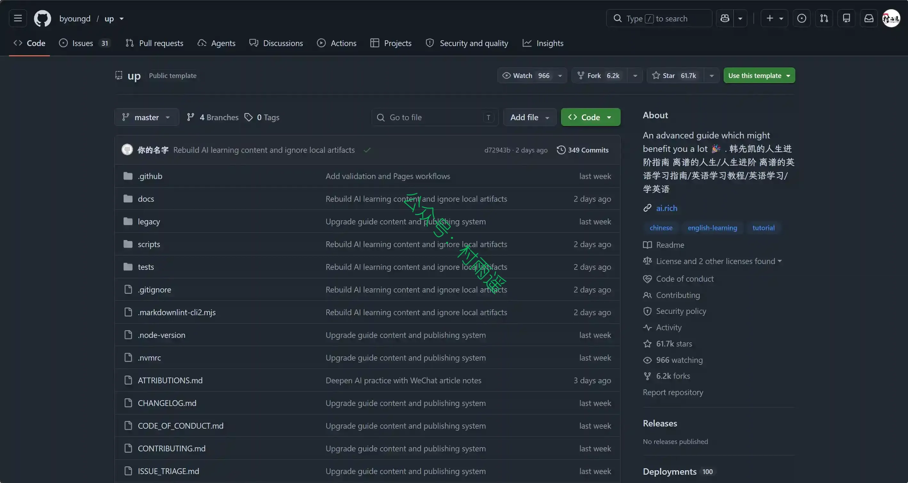
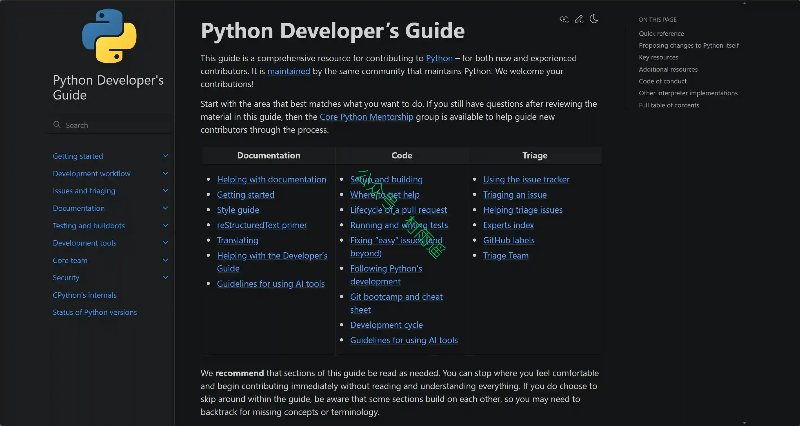

# 好物周刊#172：无印豆包

> 作者：[村雨遥](https://github.com/cunyu1943)
> 
> 不要哀求，学会争取，若是如此，终有所获
> 
> 原文：https://mp.weixin.qq.com/s/g1O_xXWYllJRYCZdDVK0lg

## 🎈 号外 

最近，公众号之外，建立了微信交流群，不定期会在群里分享各种资源（影视、IT 编程、考试提升……）&知识。如果有需要，可以**扫码或者后台添加小编微信备注入群**。进群后**优先看群公告**，**呼叫群中【资源分享小助手】**，还能免费帮找资源哦～

## 一、项目

### 1. [微信公众号 RSS](https://github.com/ttttmr/Wechat2RSS)

提供长期稳定可用的微信公众号 RSS 服务，尽力确保文章更新周期在 24 小时内（从作者发布到 RSS 收录）。

### 2. [昆虫世界](https://github.com/xr843/insect-world)

可交互的 3D 昆虫图鉴：旋转、缩放、点击标注点，认识每一种昆虫的身体构造与生活史。

### 3. [SnowDesktop](https://github.com/FreeFallingSnow/SnowDesktop)

一款 Windows 桌面整理美化工具：用 Direct2D 渲染的自定义桌面，替代 Explorer 原生图标，支持多显示器网格布局、可嵌入组件和 Lua 脚本扩展。

## 二、软件

### 1. [MacSai](https://github.com/iliyami/MacSai)

一款免费、开源的 macOS 应用，可以清理垃圾文件、清除恶意软件、优化性能、彻底卸载应用，并将磁盘占用可视化，全部集成在一个精美统一的界面中。它复刻了 CleanMyMac 的每一项主要功能，同时完全透明、由社区驱动。

### 2. [Abu (阿布)](https://github.com/PM-Shawn/Abu-Cowork)

你的 AI 桌面办公搭子 — 交给阿布就行啦。本地运行的 AI 桌面办公助手，灵感来自 Claude Code 的 Cowork 模式。 你说需求，阿布干活 — 读文件、跑命令、写文档、做报表，全在本地完成。

### 3. [千问输入法](https://ime.qianwen.com)

阿里出品的语音输入法，最快 300 字 / 分，AI 自动润色，说话秒变工整文字。支持 9 种方言，纯净无广告。

## 三、网站

### 1. [色影无忌](https://ww.xitek.com)

中文影像生活门户，发布最及时的影像和摄影行业动态新闻和权威的器材评测和产品资讯，提供高质量的摄影作品发布，摄影技巧交流与分享，拥有活跃度极高的摄影论坛，全球最完整的器材库，摄影器材购买和交易平台，以及汽车、旅游、音响等影像生活内容。

### 2. [Zlibrary 发布页](https://zlibrary.me)

Zlibrary 最新网址发布页，在这里你能找到可用的 Zlibrary 网址。

### 3. [SaltyLeo 的书架](https://tstrs.me)

无需注册、访问需人机验证的免费电子书聚合搜索网站，整合多家图书资源站，可检索多格式电子书并跳转第三方站点获取资源，已收录
2267502 本书，祝你找到心仪之作！

## 四、插件

### 1. [ToolSide — 浏览器超级工具箱](https://chromewebstore.google.com/detail/abdemmkdojnhkolphjgcimgdbjfcggbn?utm_source=item-share-cb)

浏览器右侧的超级工具箱：图片压缩、OCR、PDF 合并、JSON 格式化等 30+ 工具随手可用，不搜索、不切 Tab。

### 2. [无印豆包](https://github.com/ihmily/doubao-nomark)

一键提取豆包 / 国际版无水印原图原视频的浏览器扩展 + 解析 API 工具，本地解析不上传内容，支持批量与打包下载。

### 3. [NaiveTab](https://chromewebstore.google.com/detail/hhfebdcoeoddbdhgcgflblcjcgogijem?utm_source=item-share-cb)

可视化键盘展示书签和浏览器指令，肌肉记忆一键直达。支持自由拖拽、深度自定义外观、专注模式、云同步。

## 五、资料

### 1. [Learn Rust, one exercise at a time](https://github.com/mainmatter/100-exercises-to-learn-rust)

边学习，边练习。内含约 100 道 Rust 练习题和答案，带你从 0 到 1 学习。

### 2. [AI 时代终身学习指南](https://github.com/byoungd/up)

一份面向普通人的终身学习指南。它不要求你先成为天才、专家或意志坚定的人，也不许诺某个工具会替你改变命运。它想做的，是陪你在变化加速的时代里，一次次重新学习：面对陌生问题，借助 AI，也保留自己的判断；完成一件真实的事，再把经验带到下一段路。

### 3. [Python 开发人员指南](https://github.com/python/devguide)

面向开发者的 CPython 官方贡献指南网站，讲解参与 Python 项目代码、文档、Issue 处理等开源贡献的完整流程与规范。

## ✍️ 说明

周刊专栏相关信息：

- **项目地址**：[Github](https://github.com/cunyu1943/weekly)，觉得不错麻烦给我一个**Star**，感谢 ❤️
- **浏览地址**：公众号 | [电子书](https://cunyu1943.github.io/weekly) | [语雀](https://yuque.com/cunyu1943/weekly) | [ima 知识库](https://ima.qq.com/wiki/?shareId=860487e32c6cc8d6c9070cd7f00caedf3cbf4102f695862d9c82f463b92417af)

如果你阅读到这里，说明我的工作没有白费。如果你想推荐项目/网站/软件/资源，欢迎提交 **[issue](https://github.com/cunyu1943/weekly/issues)** 或者添加我 **个人微信：coder_cunYu** 与我交流。

---

