# 好物周刊#173：薪跳

> 作者：[村雨遥](https://github.com/cunyu1943)
> 
> 不要哀求，学会争取，若是如此，终有所获
> 
> 原文：https://mp.weixin.qq.com/s/398XKREZxGv9_KB0cNGlGw

## 🎈 号外 

最近，公众号之外，建立了微信交流群，不定期会在群里分享各种资源（影视、IT 编程、考试提升……）&知识。如果有需要，可以**扫码或者后台添加小编微信备注入群**。进群后**优先看群公告**，**呼叫群中【资源分享小助手】**，还能免费帮找资源哦～

## 一、项目

### 1. [PaperGrid](https://github.com/xywml/PaperGrid)

一个基于 Next.js App Router 的轻量化个人博客与后台管理系统。内置认证、文章管理、评论与系统设置，支持中文 / 英文与深色模式。

### 2. [Sequoia-X](https://github.com/sngyai/Sequoia-X)

Sequoia-X V2 是面向 A 股市场的量化选股系统，基于现代 Python 工程化标准从零重构。 系统以 OOP 架构、向量化计算和增量数据更新为核心设计原则，每日收盘后自动选股并推送至飞书群。

数据层使用 baostock（免费、无需注册、无限流）拉取历史及增量日 K 数据（后复权）， 存储于本地 SQLite，彻底规避东方财富反爬问题。

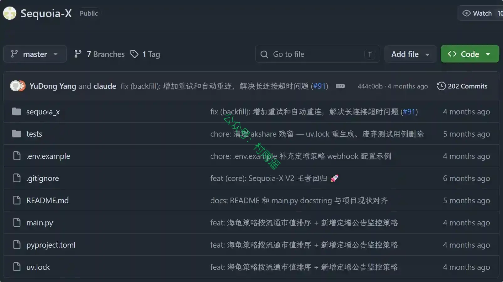

### 3. [zlib](https://github.com/heartleo/zlib)

把 Z-Library 装进命令行，让你在终端就可以进入 Z-Library 进行图书下载。

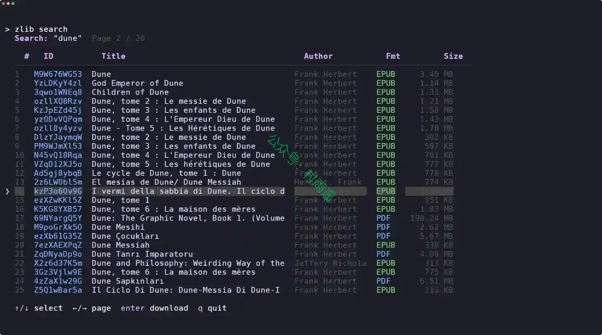

## 二、软件

### 1. [薪跳 PayDance](https://github.com/MrBaoboer/PayDance)

一款桌面实时工资看板。配置薪资与上下班时间后，今日入账就会安静地常驻在桌面上，随工作时间实时增长。

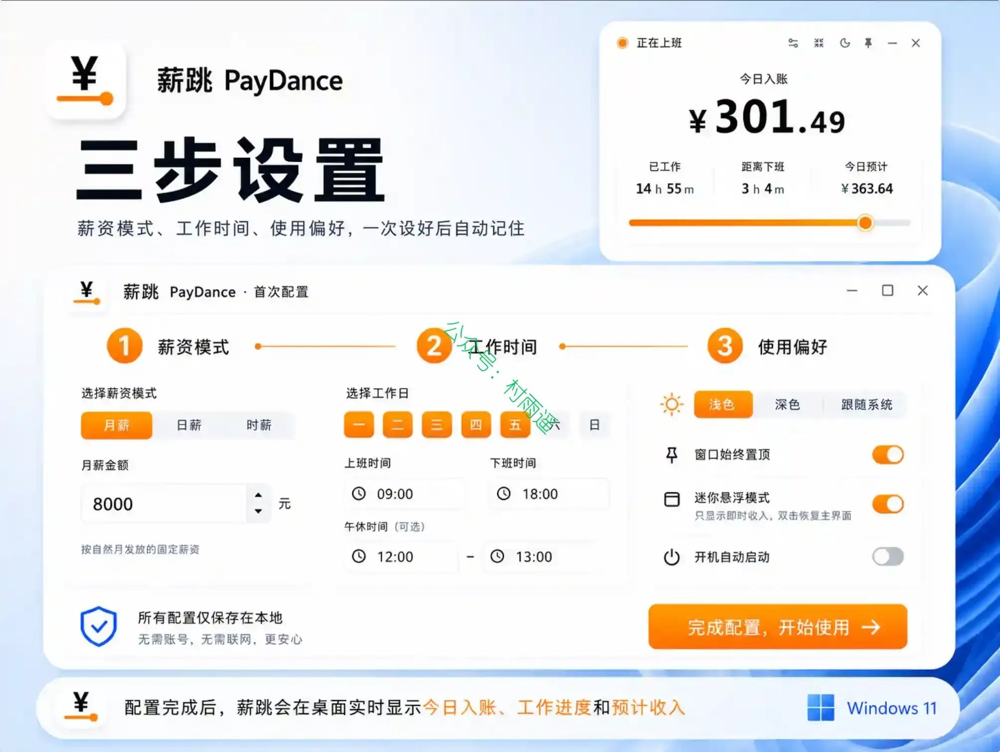

### 2. [PDFgear](https://www.pdfgear.com)

完全免费的 PDF 软件。阅读、编辑、转换、合并和跨设备签署 PDF 文件，且无需注册，可满足您的所有需求。

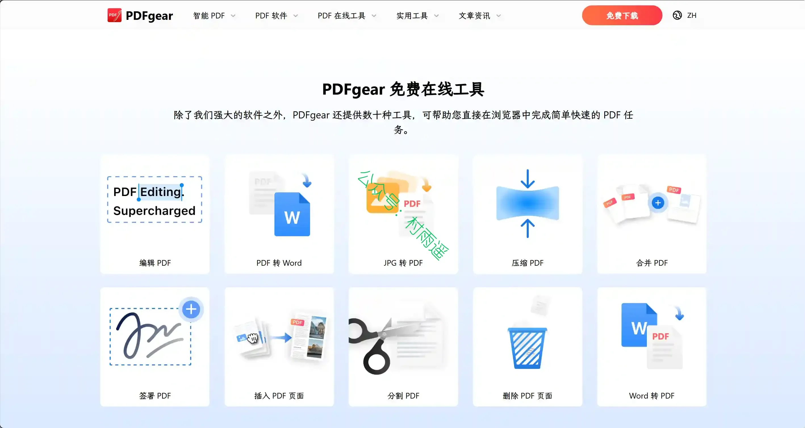

### 3. [EasyRecovery](https://www.easyrecoverychina.com)

一款操作简单、功能强大数据恢复软件，通过 EasyRecovery 可以从硬盘、光盘、U盘、数码相机、手机等各种设备中恢复被删除或丢失的文件、图片、音频、视频等数据文件。

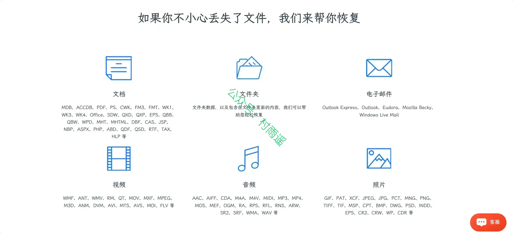

## 三、网站

### 1. [官网下](https://guanwangxia.com)

官网下人工核验软件厂商的官方 HTTPS 下载来源，快速找到 Windows、macOS、Linux 和移动端软件的官方下载入口。

### 2. [六一库](https://www.61ku.com)

收录开源及小众软件，覆盖桌面端、移动端与在线工具。提供分类索引、月度精选与横向评测，整理可长期使用的软件目录。

### 3. [免费在线图片格式转换工具](https://jianzhitong.cloud)

免费在线批量将 HEIC、 HEIF、WebP、AVIF 图片转为 JPG、PNG 格式，纯本地浏览器处理，文件不上传服务器、无水印、无需注册登录，支持批量转换与打包下载。

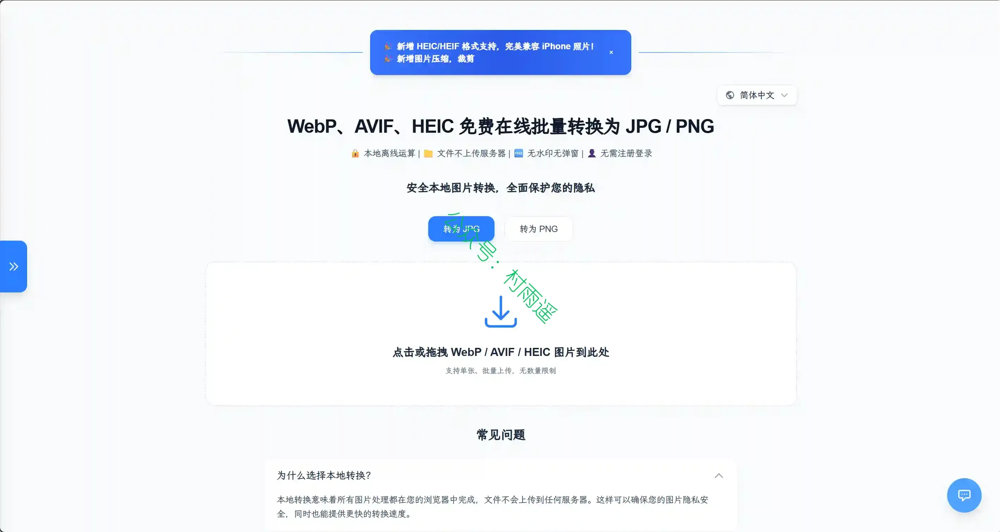

## 四、插件

### 1. [LumiList - 智能书签管理器](https://chromewebstore.google.com/detail/pcekakljniocipfpmjmpmgaleigcbhlh?utm_source=item-share-cb)

为你的浏览器打造的书签管理器，将您的浏览器新标签页变成可视化书签管理器，提供拖放式看板、本地优先存储、云同步，以及快速整洁的体验。

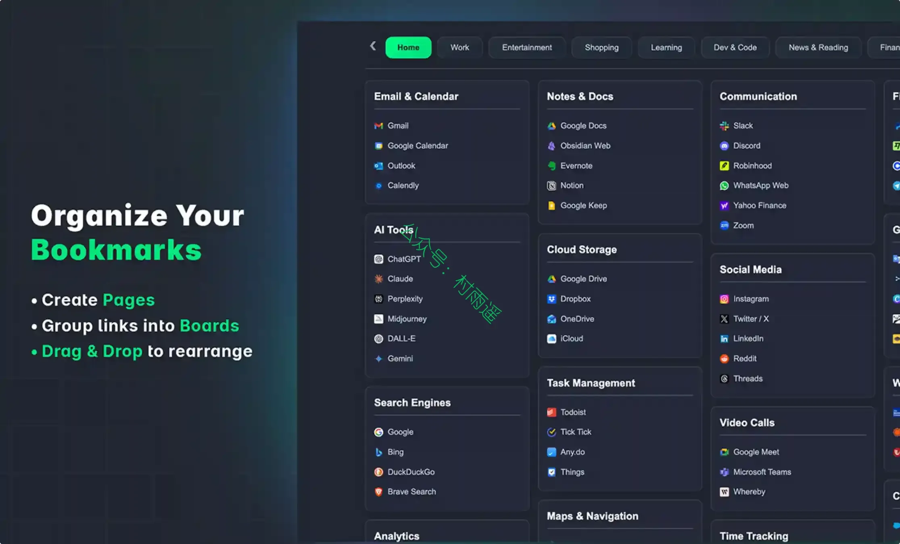

### 2. [Side Notepad](https://chromewebstore.google.com/detail/side-notepad-notes-note-t/jnajbdnopbhnfjjhkpichjdbfobeokjh)

一款随时跟随你的记事本，无论你在网络的哪里。始终只需一个快捷键，Pro 添加云同步、全文搜索和网页仪表板，让你的笔记随处可得。

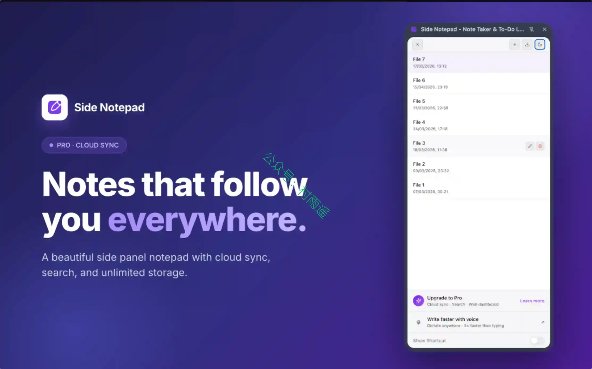

### 3. [PDF Viewer](https://chromewebstore.google.com/detail/pdf-viewer/oemmndcbldboiebfnladdacbdfmadadm?hl=zh-CN)

基于 Mozilla PDF.js 的 Chrome 官方 PDF Viewer 扩展，使用 HTML5 技术，可在 Chrome 浏览器内直接渲染查看本地与在线 PDF 文档，支持自定义配置、快捷键等阅读功能。

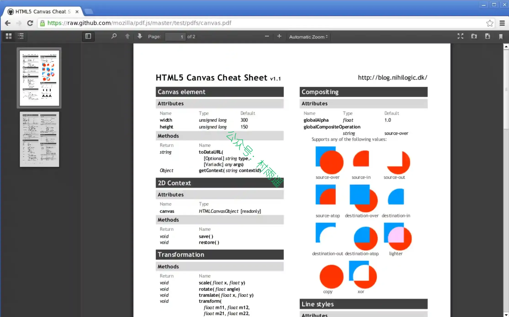

## 五、资料

### 1. [Dashi PPT Skill](https://github.com/chuspeeism/dashi-ppt-skill)

一个真正适合职场人的 PPT Skill。把文档丢给你的 AI Agent，每一页都自带编辑控制台的 PPT Skill，不满意的地方直接在浏览器里改，改完还能一键导出成真实的、可编辑的 PPTX。

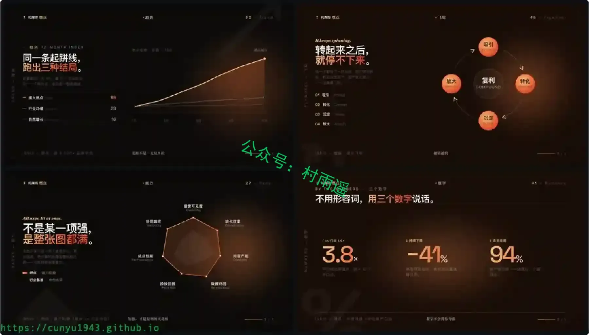

### 2. [Guizang Social Card Skill](https://github.com/op7418/guizang-social-card-skill)

一个适配 Claude Code / Codex 等 Agent 环境的图文卡片技能, 用于从文章、文案、截图、产品笔记、字幕、照片或用户视频生成小红书 / Rednote 图文组图、Live Photo 动态卡与公众号 21:9 + 1:1 封面对。

### 3. [AI 时代的价值投资研究框架](https://github.com/xbtlin/ai-berkshire)

一套同时兼容 Claude Code 与 Codex 的投资研究 Skill 合集，将巴菲特、芒格、段永平、李录四位价值投资大师的方法论系统化、结构化，通过 AI Agent 实现专业级投资研究。

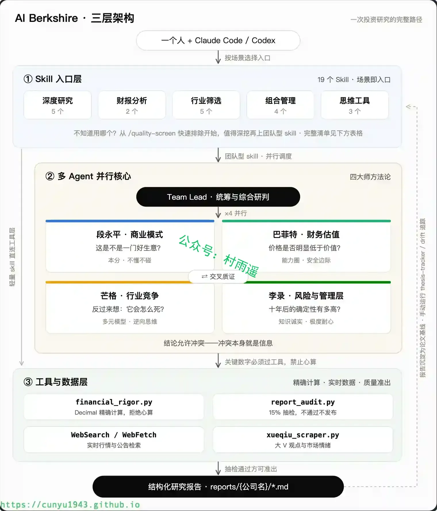

## ✍️ 说明

周刊专栏相关信息：

- **项目地址**：[Github](https://github.com/cunyu1943/weekly)，觉得不错麻烦给我一个**Star**，感谢 ❤️
- **浏览地址**：公众号 | [电子书](https://cunyu1943.github.io/weekly) | [语雀](https://yuque.com/cunyu1943/weekly) | [ima 知识库](https://ima.qq.com/wiki/?shareId=860487e32c6cc8d6c9070cd7f00caedf3cbf4102f695862d9c82f463b92417af)

如果你阅读到这里，说明我的工作没有白费。如果你想推荐项目/网站/软件/资源，欢迎提交 **[issue](https://github.com/cunyu1943/weekly/issues)** 或者添加我 **个人微信：coder_cunYu** 与我交流。

---

