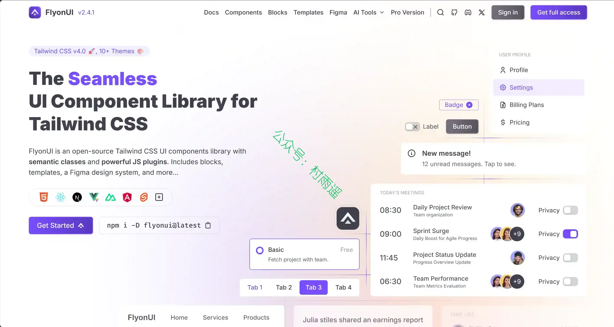
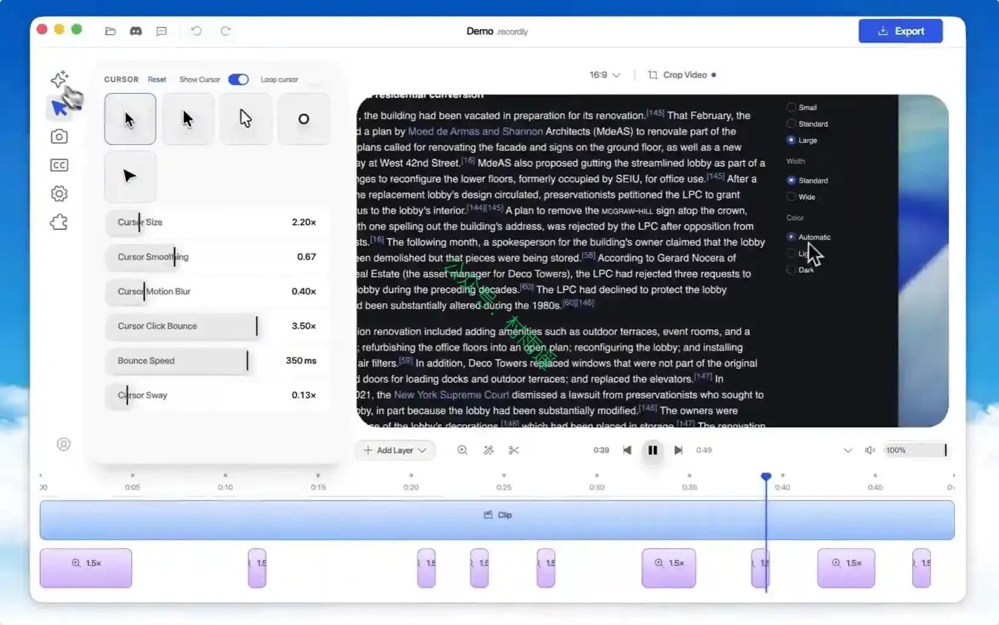
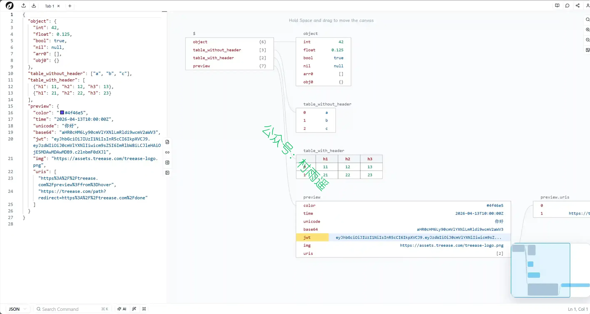
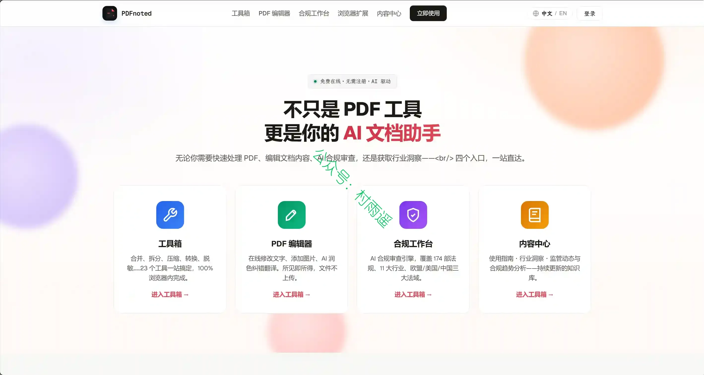
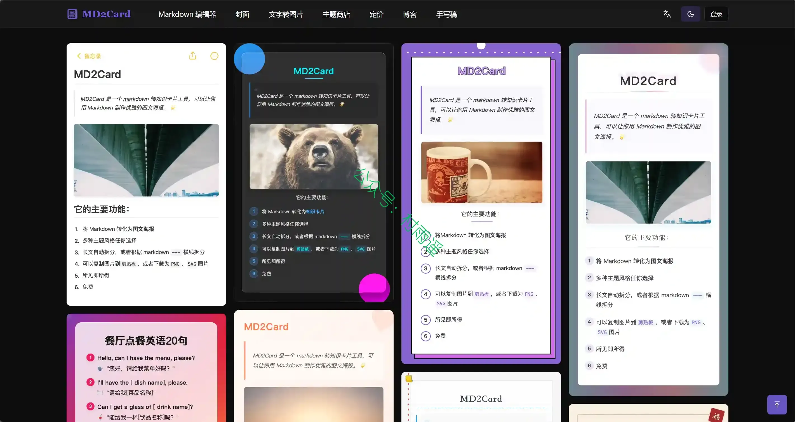
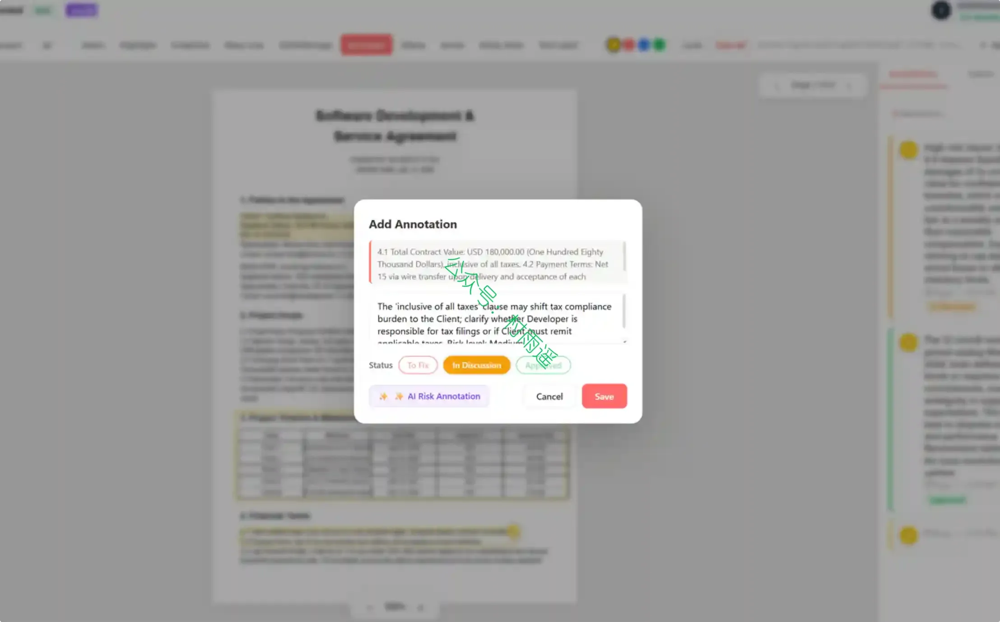
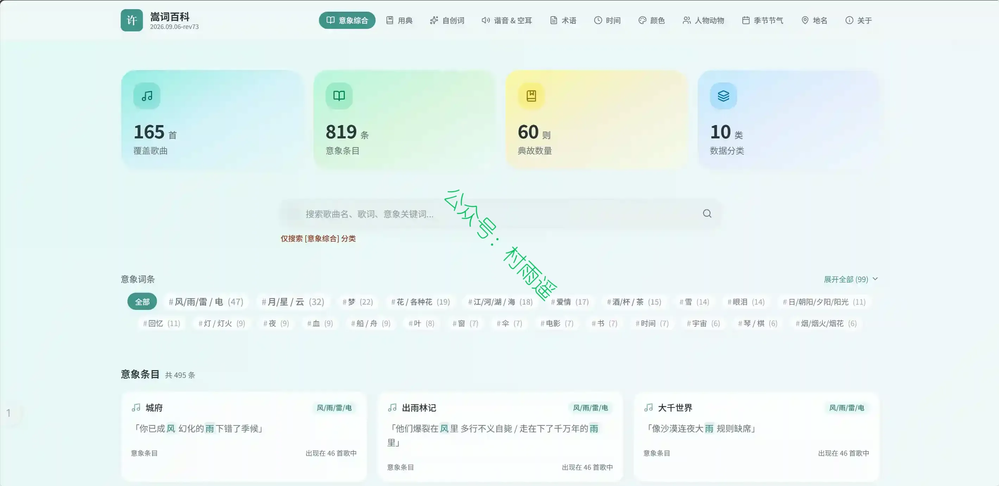
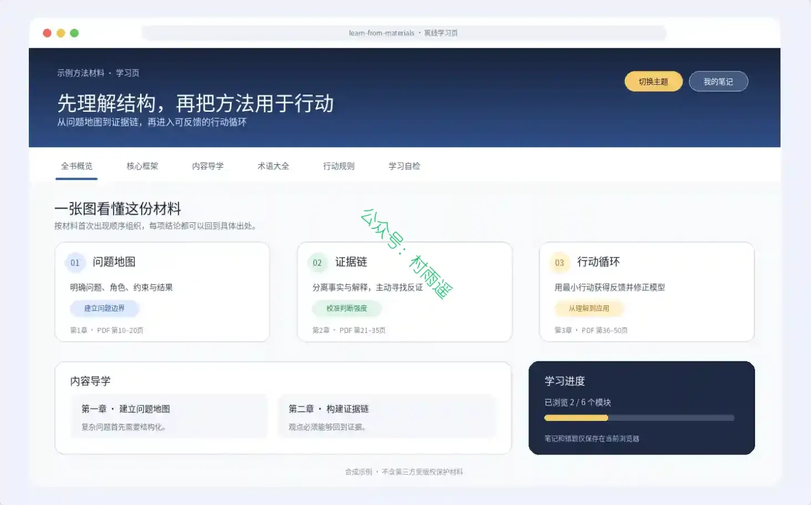

# 好物周刊#174：高性价比人生

> 作者：[村雨遥](https://github.com/cunyu1943)
> 
> 不要哀求，学会争取，若是如此，终有所获
> 
> 原文：https://mp.weixin.qq.com/s/TFzaQ6q4QyEKpdMoiDajYg

## 🎈 号外 

最近，公众号之外，建立了微信交流群，不定期会在群里分享各种资源（影视、IT 编程、考试提升……）&知识。如果有需要，可以**扫码或者后台添加小编微信备注入群**。进群后**优先看群公告**，**呼叫群中【资源分享小助手】**，还能免费帮找资源哦～

## 一、项目

### 1. [Biscuit Studio](https://github.com/kkkoaoa/biscuit-studio)

小饼干英语视频工坊：从英语知识点到 30 秒竖屏教学视频的一站式 AI 创作工具。

### 2. [FlyonUI](https://github.com/themeselection/flyonui)

一款 MIT 协议开源、适配 Tailwind CSS v4 的 UI 组件库，采用语义化类名搭配 JS 交互插件，兼容 React/Vue/Next 等多框架，内置大量组件、页面块、模板与多套主题，帮助开发者快速搭建界面。

### 3. [小羊贴纸铺](https://github.com/xw-meow/mie-iconner)

一款 macOS 文件夹图标修改工具: 把喜欢的图片设为文件夹图标, 也可以随时还原为系统默认。挑一张贴纸, 贴到文件夹上——就像逛贴纸铺一样简单。

## 二、软件

### 1. [Recordly](https://github.com/webadderallorg/recordly)

一款开源屏幕录制器和编辑器，适合制作操作讲解、演示、产品视频等内容。

### 2. [当贝播放器](https://www.dangbei.com/player)

一款专为智能电视，盒子，投影仪打造的播放器，专业电视播放软件，支持所有主流视频格式、具备解码能力、自动匹配电影海报封面，一款安卓好用的本地播放器。

### 3. [烟雨 OTA 工具箱](https://www.rainyweb.cn)

面向 Android 玩机的 多功能刷机工具箱。适配全机型，针对 小米 / 真我 / 一加 / OPPO 等机型深度优化。

## 三、网站

### 1. [Treease](https://treease.com)

一款可将 JSON、YAML、TOML、CSV 等结构化数据转为可视化关系图谱，支持双向同步编辑、结构对比、格式转换导出、日志数据提取，同时配套 CLI 命令行工具，分免费与 Pro 付费档位的在线结构化数据可视化编辑工具。

### 2. [PDFnoted](https://pdfnoted.com)

提供免费在线 PDF 编辑、批注、转换与 AI 合规审查。支持 18+ 工具：PDF 转 Word/Excel/PPT、合并拆分压缩、AI 脱敏。覆盖 174 部法规，欧盟/美国/中国三法域。

### 3. [MD2Card](https://md2card.com)

一个免费的 Markdown 转知识卡片工具，支持一键生成小红书风格海报、社交媒体文案排版，让创作者轻松制作精美的图文内容。支持多种主题风格、长文自动拆分、一键导出图片，让你的创作更加高效。

## 四、插件

### 1. [PDFnoted 浏览器插件](https://chromewebstore.google.com/detail/blhmpgkbnbpjpceoooabjpoihcenkcfp?utm_source=item-share-cb)

一款浏览器内 PDF 处理工具，让你在已打开的 PDF 页面上直接完成查看、批注和格式转换，无需下载安装软件。

### 2. [轻量翻译](https://microsoftedge.microsoft.com/addons/detail/轻量翻译/plfbmngcicglhdfblhakkpflibgcmoba)

一个很简单的、开源的浏览器翻译插件。无需注册登陆，没有增值功能，只是集成了 SiliconFlow 提供的 API 服务，内置了三个免费模型，Hunyuan-MT-7B、GLM-4-9B-0414、Qwen3.5-4B。

### 3. [AutoVerify](https://chromewebstore.google.com/detail/autoverify/jgcfgcdociopaedpeiacalnccfiaeeej?utm_source=sspai)

全自动、高精度的验证码识别与填写解决方案。提高您的工作效率，解放您的双手。

## 五、资料

### 1. [许嵩歌词意象百科](https://github.com/laokuke/vae-lyrical)

一个静态网页应用，整理许嵩歌词中的意象、用典、自创词、谐音空耳、术语、时间、颜色、人物动物、季节节气、地名等分类。

### 2. [learn-from-materials](https://github.com/dmoshehun-prog/learn-from-materials)

一个基于开放 Agent Skills 规范的跨 Agent 学习 Skill。它强调完整阅读、出处可核验、材料事实与模型补充分离，以及离线优先和最小权限。

### 3. [高性价比人生指南](https://github.com/eternity4719/HowToLiveBetter)

长寿防病、急救、省钱理财、法律红线、失业与工伤、医保社保、恋爱婚育、怀孕育儿、创业与做平台合规、出国与技能。每条写明成本、收益、证据等级和原始出处，只引期刊论文与官方文件。

## ✍️ 说明

周刊专栏相关信息：

- **项目地址**：[Github](https://github.com/cunyu1943/weekly)，觉得不错麻烦给我一个**Star**，感谢 ❤️
- **浏览地址**：公众号 | [电子书](https://cunyu1943.github.io/weekly) | [语雀](https://yuque.com/cunyu1943/weekly) | [ima 知识库](https://ima.qq.com/wiki/?shareId=860487e32c6cc8d6c9070cd7f00caedf3cbf4102f695862d9c82f463b92417af)

如果你阅读到这里，说明我的工作没有白费。如果你想推荐项目/网站/软件/资源，欢迎提交 **[issue](https://github.com/cunyu1943/weekly/issues)** 或者添加我 **个人微信：coder_cunYu** 与我交流。

---

