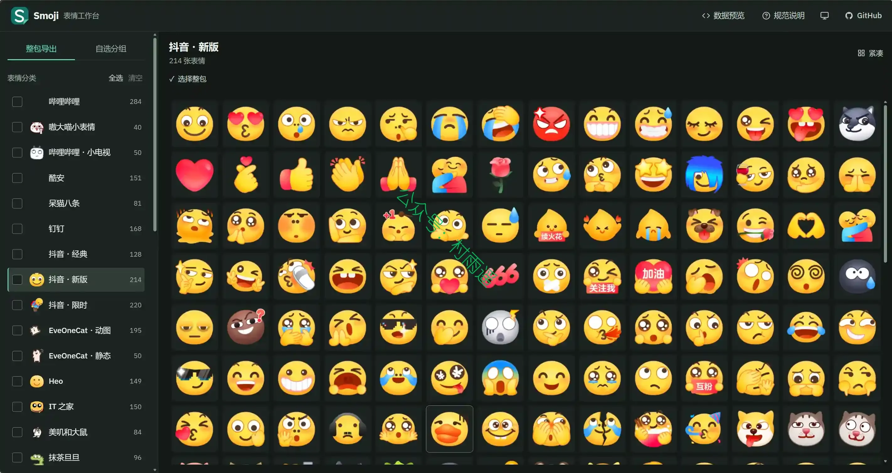
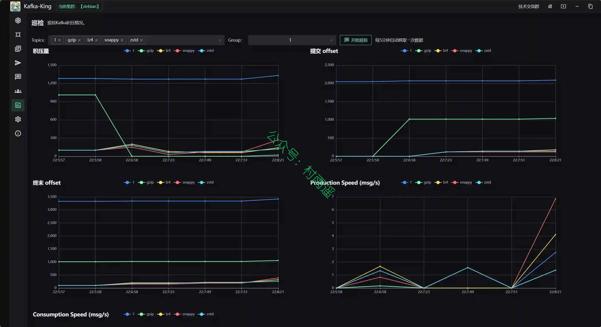
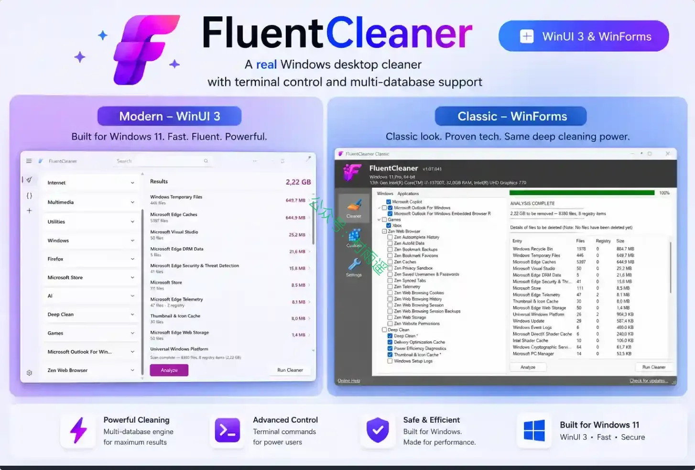
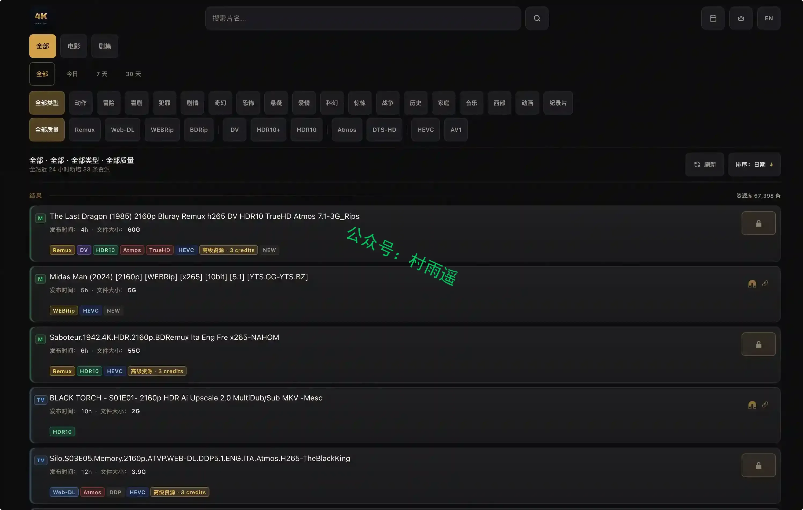
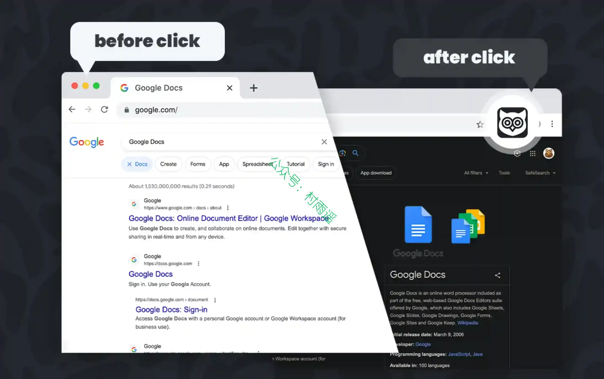
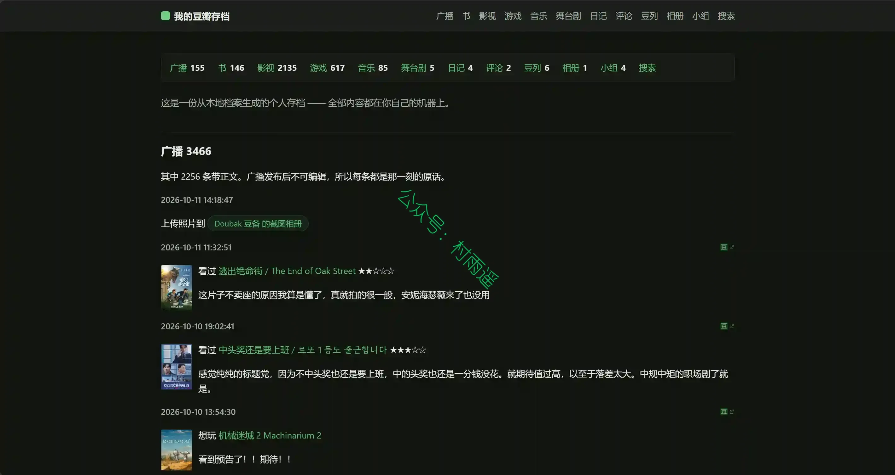
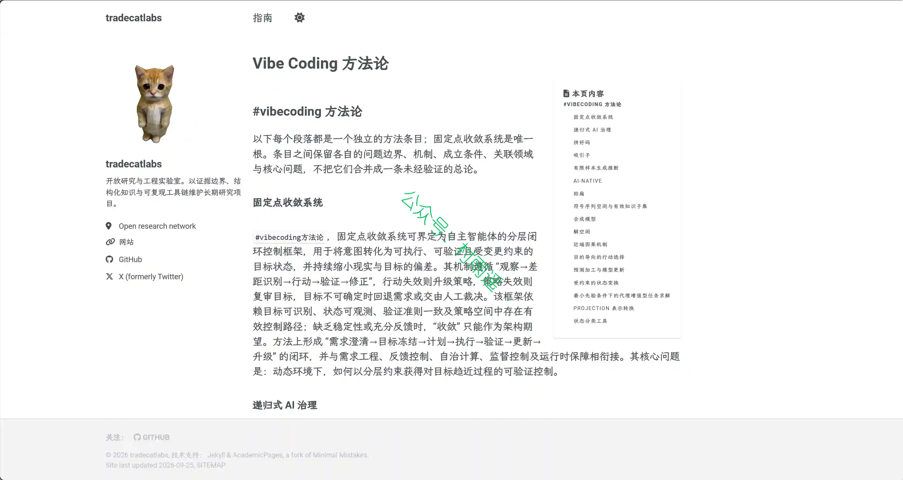
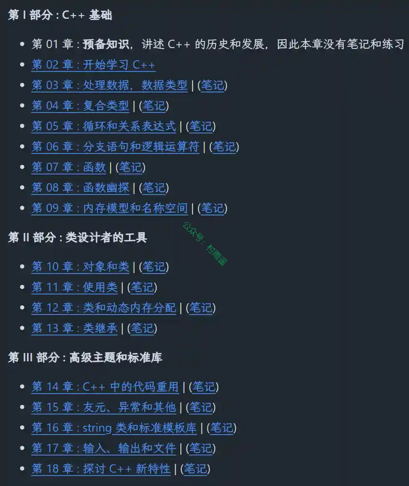

# 好物周刊#175：公文写作 DNA

> 作者：[村雨遥](https://github.com/cunyu1943)
> 
> 不要哀求，学会争取，若是如此，终有所获
> 
> 原文：https://mp.weixin.qq.com/s/3KxfkST2Bp-P-OWHO3H2Pg

## 🎈 号外 

最近，公众号之外，建立了微信交流群，不定期会在群里分享各种资源（影视、IT 编程、考试提升……）&知识。如果有需要，可以**扫码或者后台添加小编微信备注入群**。进群后**优先看群公告**，**呼叫群中【资源分享小助手】**，还能免费帮找资源哦～

## 一、项目

### 1. [ClawX](https://github.com/ValueCell-ai/ClawX)

连接强大 AI 智能体与普通用户之间的桥梁。基于 OpenClaw 构建，它将命令行式的 AI 编排转变为易用、美观的桌面体验——无需使用终端。

无论是自动化工作流、连接通讯软件，还是调度智能定时任务，ClawX 都能提供高效易用的图形界面，帮助你充分发挥 AI 智能体的能力。

### 2. [Smoji](https://github.com/DejavuMoe/Smoji)

一套面向个人博客、文档网站与社区论坛的开源图片表情管理与集成工具。提供直观、高效的表情浏览与挑选体验，支持鼠标拖拽、触控操作与全键盘交互。

### 3. [Kafka King](https://github.com/Bronya0/Kafka-King)

一款现代化、实用的 Kafka GUI 客户端，旨在通过直观的桌面界面简化 Apache Kafka 管理。作为一款跨平台应用程序，它为开发人员和管理员提供了强大的工具，可与 Kafka 集群交互，无需依赖命令行界面或基于 Web 的解决方案。

## 二、软件

### 1. [Loomy](https://loomy.xunfei.cn)

讯飞推出的的桌面级AI智能助理，兼容 Openclaw 技能，安装即用，适用于自媒体运营、远程办公、日程管理、文件整理、电商运营等场景，让你工作更轻松。使用邀请码还能得额外 5000 永久积分哦，邀请码：**NN2YKR**、**S9FQY4**、**24PXJ2**。

### 2. [Mineradio](https://github.com/XxHuberrr/Mineradio)

一款 Windows 桌面沉浸式音乐播放器，把搜索播放、歌词舞台、粒子视觉、3D 歌单架和完整桌面模式组合成一个更接近现场感的私人音乐空间。

### 3. [FluentCleaner](https://github.com/builtbybel/FluentCleaner)

一款开源免费、基于 winapp2.ini 规则、对标 CCleaner 的 Windows 系统垃圾清理工具，提供 WinUI 现代版与 WinForms 经典双版本，无广告捆绑、轻量化安全纯净。

## 三、网站

### 1. [4K Monitor](https://4kmonitor.org)

收录海量带杜比视界、HDR、全景声等高规格 4K 影视磁力资源的索引站点，实时更新电影剧集，区分蓝光 / 流媒体多种压制版本，部分优质资源需消耗积分解锁磁力链接。

### 2. [Ztrans](https://ztrans.xphub.dev)

一款 AI 驱动、支持多语种自动检测的在线实时文本翻译网站，主打精准流畅的跨语言翻译，开箱即用无需登录。

### 3. [502book](https://502book.com)

一个聚合了全网小说资源的小说搜索神器，致力于打造全网最极致的搜索体验和阅读体验。网站支持对全网各种类型的热门全本小说进行免费搜索，无论您喜欢玄幻小说、言情小说、穿越小说、悬疑小说还是其他类型的小说，都能帮助您快速找到您喜欢的免费小说。

## 四、插件

### 1. [暗色主题 - 网络暗色阅读器](https://chromewebstore.google.com/detail/ljjmnbjaapnggdiibfleeiaookhcodnl?utm_source=item-share-cb)

可以将任何网页切换到暗色模式。使用暗色阅读器或改变屏幕亮度，照顾你的眼睛。

### 2. [豆备 Doubak](https://chromewebstore.google.com/detail/hilmaopahndgbiolohgefnbeedobpafe?utm_source=item-share-cb)

一个从豆瓣上把你多年攒下来的数据备份出来的工具。它从设计之初就考虑了记录的完整性，它会整理并记录你从 想看-在看 - 看完 的所有记录，它甚至会有想看-在看-依然在看-看完-二刷看完-三刷看完 的记录！对怀旧的豆瓣用户来说这是最珍贵的记忆！

### 3. [易看图](https://chromewebstore.google.com/detail/photo-zoom/ihcmokloommhoalgdboldpnafcngaheo?hl=zh)

一款帮助你快速查看页面中缩略图对应“大图”的浏览器扩展。只需将鼠标悬停在缩略图上，即可展示相应的高分辨率图片。目前支持的网站包括淘宝、天猫、京东、微博、B站等多个网站，并且智能看图脚本会不断持续更新。

## 五、资料

### 1. [公文写作 DNA](https://github.com/larashero3-dotcom/lieflat-gongwen)

把公文写作风格变成可测量、可验收的量化数据，让 Agent 能更好复现 7 种典型的公文风格，包括调研报告、领导讲话、工作意见、经验材料、工作方案、经验总结和党建材料。

### 2. [Vibe Coding 从入门到精通教程](https://github.com/tradecatlabs/vibe-coding-cn)

中文 Vibe Coding 从入门到精通教程，从想法到产品的 AI 结对编程工作流标准：Prompt + Skill + Context + Quality Gate + 工程闭环。

### 3. [《C++ Primer Plus 第 6 版（中文版）》学习笔记](https://github.com/ShujiaHuang/Cpp-Primer-Plus-6th)

《C++ Primer Plus 第 6 版（中文版）》原书代码、习题答案和个人笔记，仅供学习和交流。

## ✍️ 说明

周刊专栏相关信息：

- **项目地址**：[Github](https://github.com/cunyu1943/weekly)，觉得不错麻烦给我一个**Star**，感谢 ❤️
- **浏览地址**：公众号 | [电子书](https://cunyu1943.github.io/weekly) | [语雀](https://yuque.com/cunyu1943/weekly) | [ima 知识库](https://ima.qq.com/wiki/?shareId=860487e32c6cc8d6c9070cd7f00caedf3cbf4102f695862d9c82f463b92417af)

如果你阅读到这里，说明我的工作没有白费。如果你想推荐项目/网站/软件/资源，欢迎提交 **[issue](https://github.com/cunyu1943/weekly/issues)** 或者添加我 **个人微信：coder_cunYu** 与我交流。

---

