# 好物周刊#176：文译

> 作者：[村雨遥](https://github.com/cunyu1943)
> 
> 不要哀求，学会争取，若是如此，终有所获
> 
> 原文：https://mp.weixin.qq.com/s/--ENN9zc_BsbG9UA22GTvA

## 🎈 号外 

最近，公众号之外，建立了微信交流群，不定期会在群里分享各种资源（影视、IT 编程、考试提升……）&知识。如果有需要，可以**扫码或者后台添加小编微信备注入群**。进群后**优先看群公告**，**呼叫群中【资源分享小助手】**，还能免费帮找资源哦～

## 一、项目

### 1. [capcut-cli](https://github.com/renezander030/capcut-cli)

在终端里创建和编辑真正的 CapCut / 剪映项目，在 CapCut 中打开成果，每条轨道依然可编辑。capcut-cli 直接操作本地草稿存储：JSON 进、JSON 出，没有上传、没有 API、没有 MCP 服务，也没有 HTTP 守护进程。

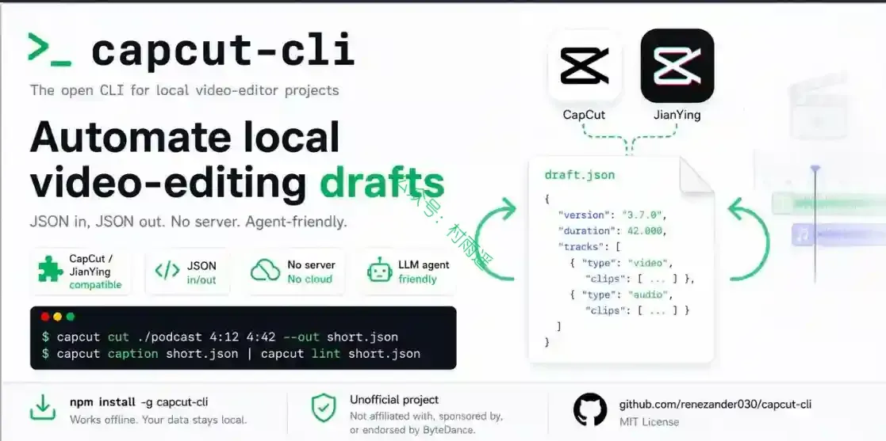

### 2. [Ecoku](https://github.com/DejavuMoe/Ecoku)

自托管，多站点。专注文字讨论。给博客与个人网站的评论系统，访客无需注册，评论提交即公开，数据由你保管。

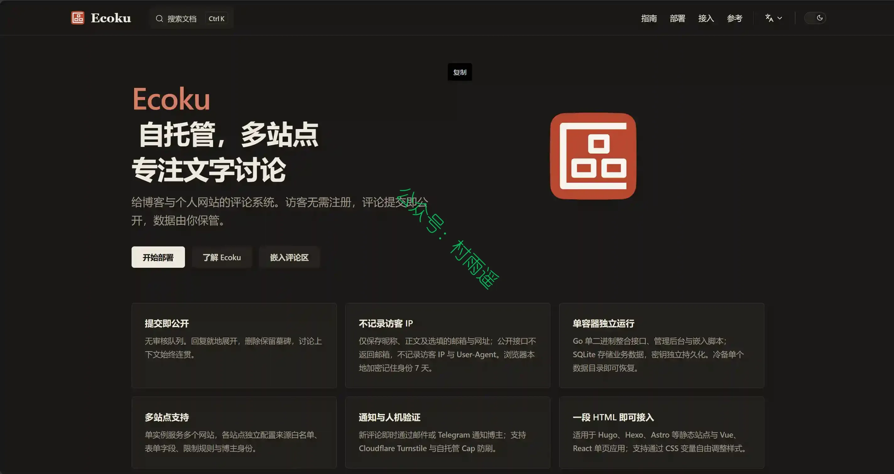

### 3. [Naive Ui Admin](https://github.com/jekip/naive-ui-admin)

一款基于 Vue3、Vite3 和 TypeScript 的先进中后台解决方案，集成了前沿的前端技术栈和典型业务模型。它拥有二次封装组件、动态菜单、权限校验、粒子化权限控制等核心功能，旨在帮助企业快速构建高质量的中后台项目。无论在新技术运用或业务实践层面，都能为您提供有力支持，并将持续更新，以满足您不断变化的需求。

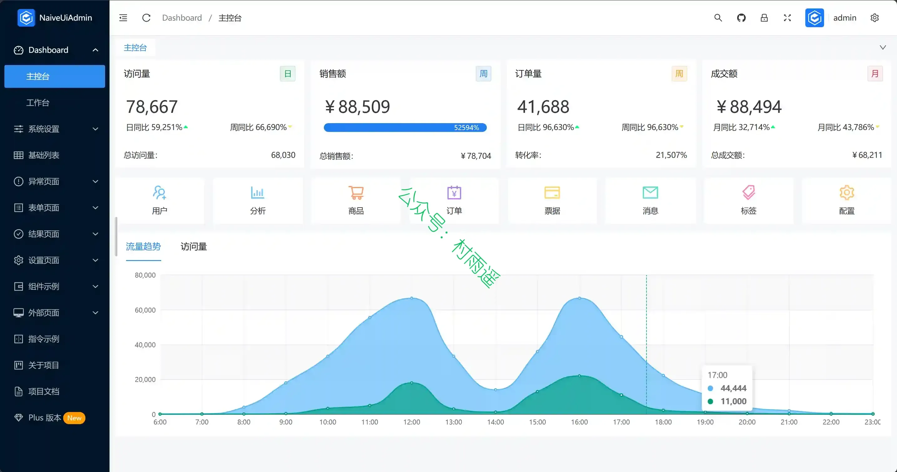

## 二、软件

### 1. [文译](https://github.com/BigDawnGhost/wenyi)

一条命令，从 EPUB 到可读的中文译本。通过全书预扫、实时术语闭环、多阶段审校等方式，提升长篇小说、社科专著、纪实文学翻译和可读性。

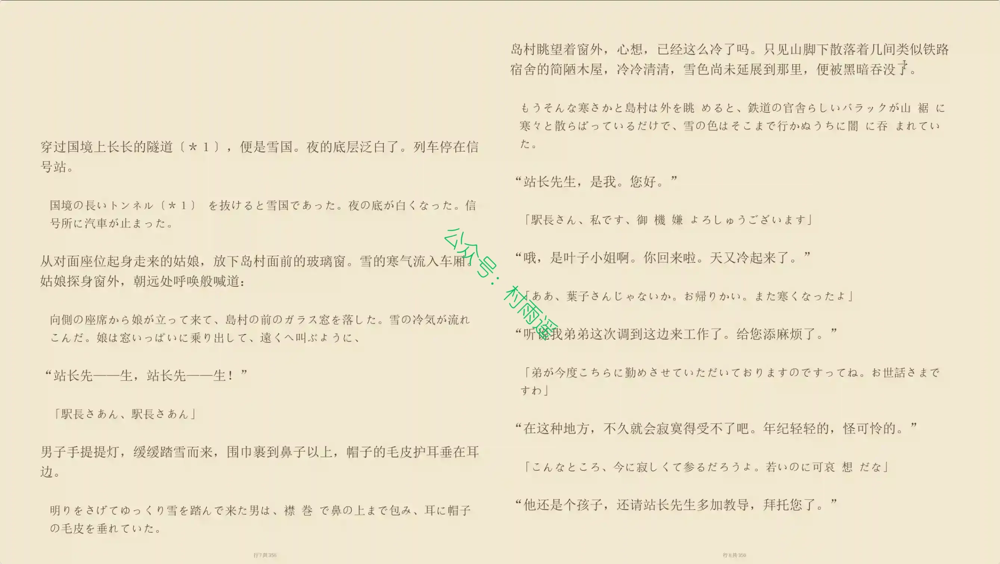

### 2. [Turbo Browser](https://tbrowser.cn)

一款纯粹的高效浏览器，加油启动快、占用低的特点。支持 Chrome / Edge 一键迁入，鼠标手势、老板键、截图、垂直标签、沉浸模式等多数功能开箱即用。

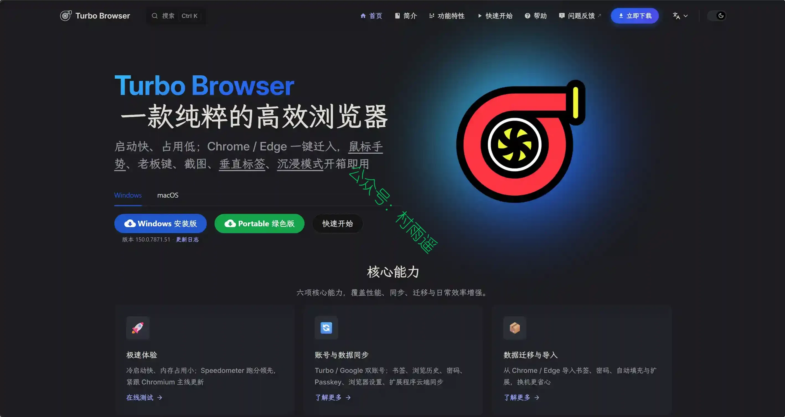

### 3. [AI 好记](https://aihaoji.com)

专为学习者打造的 AI 知识库，一键生成 “图文并茂” 的结构化笔记，多端实时同步。

## 三、网站

### 1. [LetCompress](https://letcompress.com)

免费在线压缩、转换、编辑和优化文件。支持图片、PDF、媒体、文本和压缩包，所有处理都在浏览器中完成，文件不会离开您的设备。无需注册、无需上传，可不限次数使用。

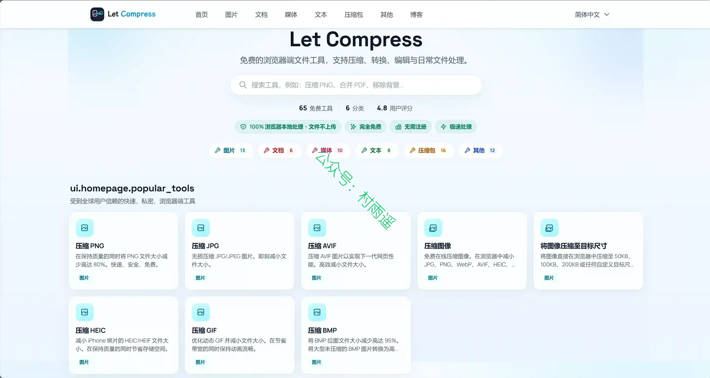

### 2. [Free PDF Translator Online](https://pdftranslator.org)

繁琐注册全免！使用 AI 驱动的高精度 PDF 翻译神器，在保留原版排版的同时，瞬间翻译英语等 100 多种语言。100% 免费使用，立刻体验！

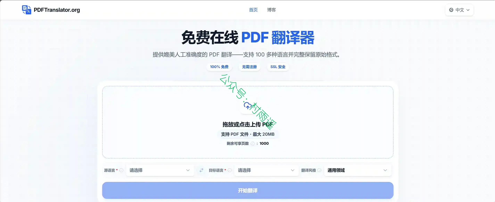

### 3. [零度导航](https://lingdus.cc)

收录 AI 工具、影视动漫、博客新闻、体育资讯、财经热点等全渠道优质网站，每日更新前沿工具推荐。找好网站就上零度导航。

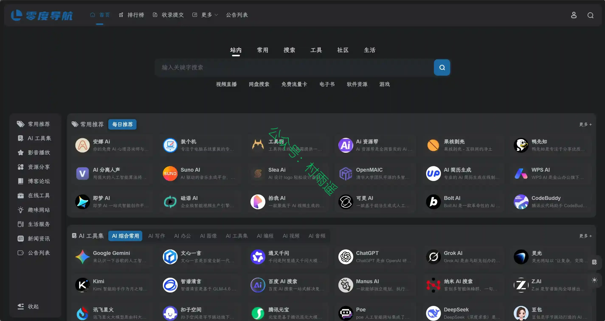

## 四、插件

### 1. [Ruai](https://github.com/OmniMindNB/ai-assistant-for-browsers)

浏览器侧边栏里的 AI 助手：一句话自动填表、操作网页、总结翻译当前页面。已知页面操作自动执行，只有检测到的表单提交会逐次请求确认。对话历史只保存在本地；你发起请求后，当前提示词、近期对话上下文和相关页面结果会直接发送到你配置的 AI Provider。

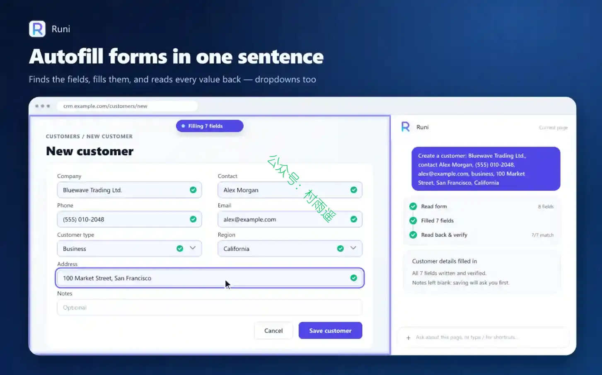

### 2. [Lumi](https://chromewebstore.google.com/detail/ackkdapdaaemdljhmgpilbbbojmkmdad?utm_source=item-share-cb)

把 B 站和 YouTube 变成 AI 学习空间：双语字幕、智能断句、字幕转写、视频总结、沉浸式阅读与内容问答。登录即用 Lumi AI，也支持自定义模型。

### 3. [SwiftTab Pro](https://chromewebstore.google.com/detail/swifttab-pro/fdgbickfhnjefknaomamncmcjbfdijdd?authuser=0&hl=zh-CN)

一款标签页快速切换器。按下快捷键(默认 `Command+Shift+K` / `Ctrl+Shift+K`)或点击浏览器工具栏图标,即可呼出一个带实时缩略图的切换面板，快速找到并切换到任意标签页。它支持拼音/模糊搜索、三种视图布局、Vim 模式与批量操作。

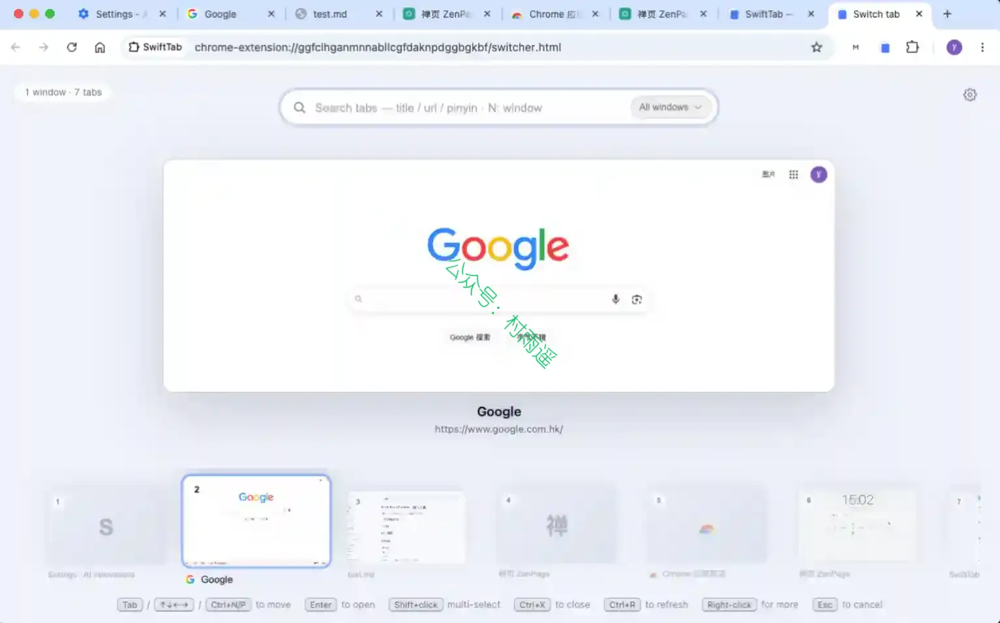

## 五、资料

### 1. [Opus 5.5 视频提示词 · Happy AI 中文精选](https://github.com/wutuobangai/happy-ai-opus55-video-prompts)

Opus 5.5 视频提示词中文精选：免费在线看 927 条案例，一键复制，带效果预览与原作者出处。

### 2. [历年高考数学真题](https://github.com/deekur/gaokaomath)

仓库汇聚了历年高考数学整体，时间跨度从 1952 ~ 2026，覆盖范围广、资料丰富，是目前中文互联网中较为完整的高考数学资料仓库之一。

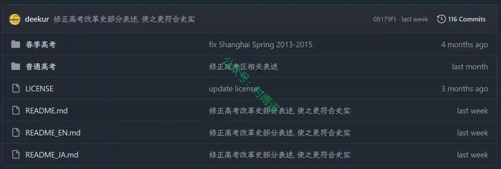

### 3. [日语语法指南](https://github.com/pizzamx/jpgramma)

帮大家以一种直观的方法学习日语，从日语而非英语的角度出发把语法讲明白。

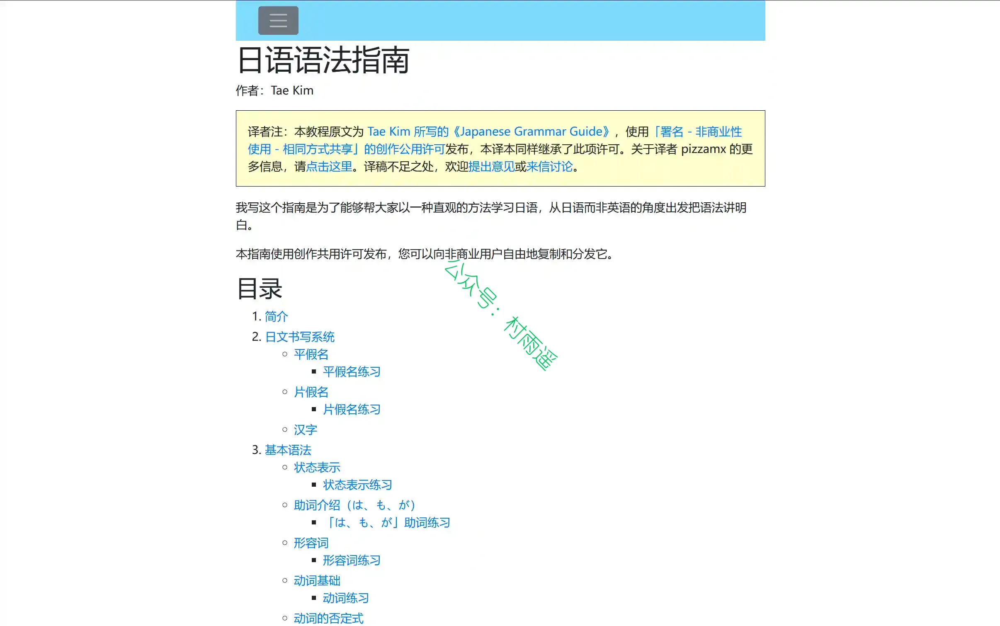

## ✍️ 说明

周刊专栏相关信息：

- **项目地址**：[Github](https://github.com/cunyu1943/weekly)，觉得不错麻烦给我一个**Star**，感谢 ❤️
- **浏览地址**：公众号 | [电子书](https://cunyu1943.github.io/weekly) | [语雀](https://yuque.com/cunyu1943/weekly) | [ima 知识库](https://ima.qq.com/wiki/?shareId=860487e32c6cc8d6c9070cd7f00caedf3cbf4102f695862d9c82f463b92417af)

如果你阅读到这里，说明我的工作没有白费。如果你想推荐项目/网站/软件/资源，欢迎提交 **[issue](https://github.com/cunyu1943/weekly/issues)** 或者添加我 **个人微信：coder_cunYu** 与我交流。

---

