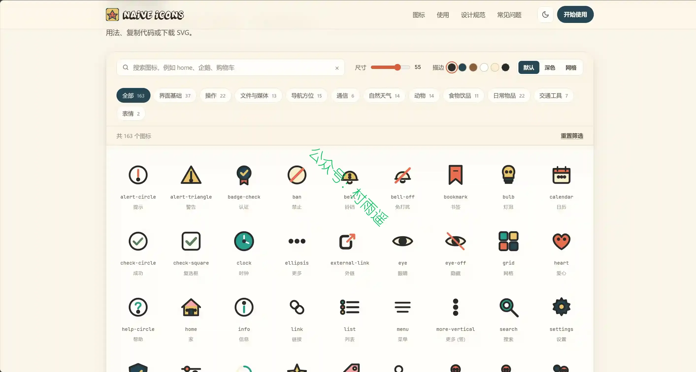
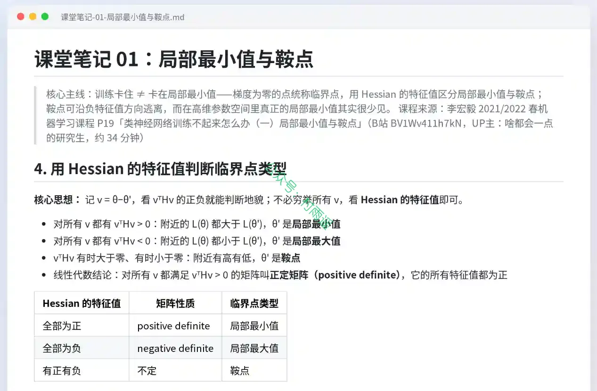
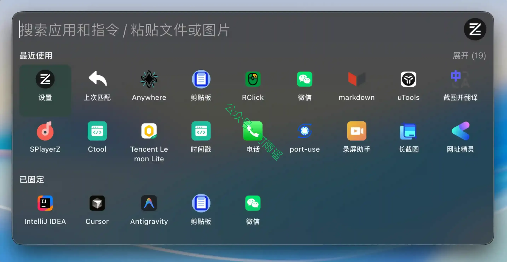
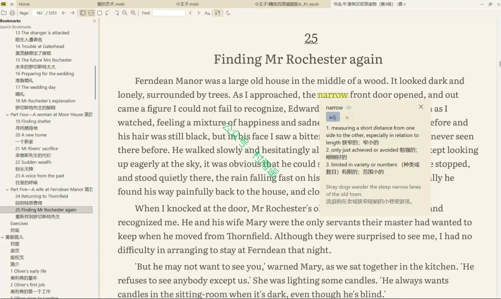
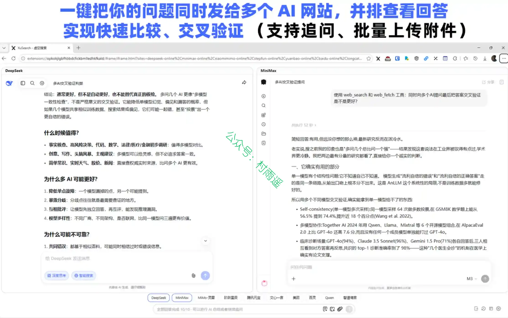
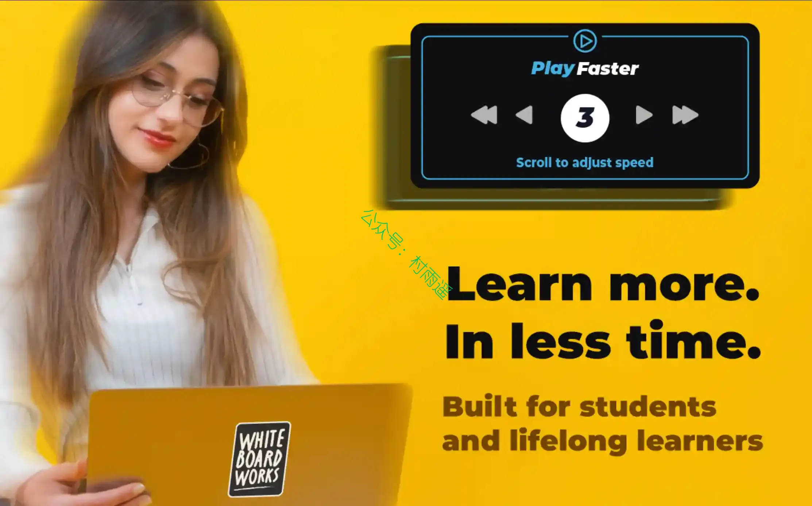
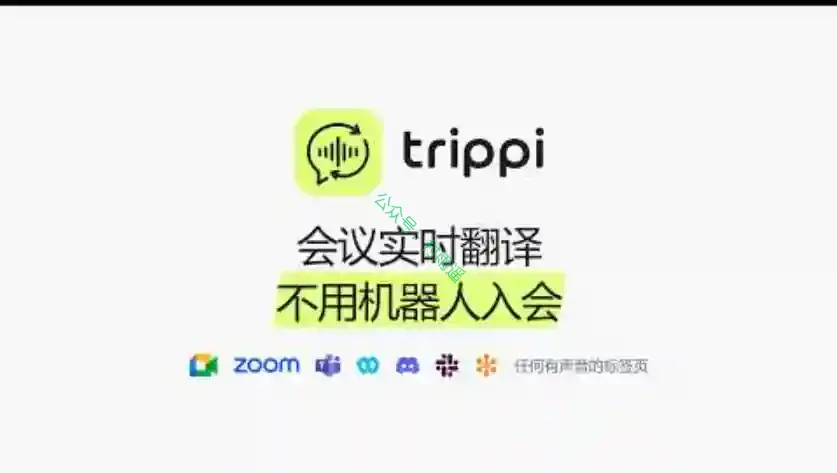
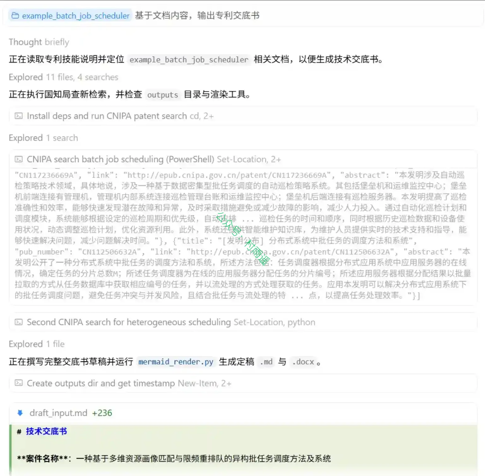
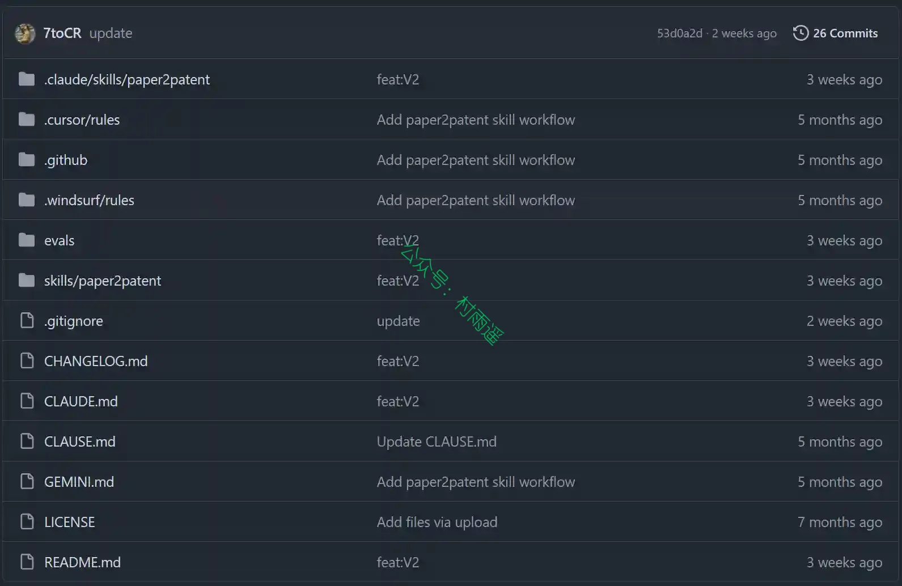

# 好物周刊#177：专利神器

> 作者：[村雨遥](https://github.com/cunyu1943)
> 
> 不要哀求，学会争取，若是如此，终有所获
> 
> 原文：https://mp.weixin.qq.com/s/tanzHQ0bAAjfc35wo2g6xg

## 🎈 号外 

最近，公众号之外，建立了微信交流群，不定期会在群里分享各种资源（影视、IT 编程、考试提升……）&知识。如果有需要，可以**扫码或者后台添加小编微信备注入群**。进群后**优先看群公告**，**呼叫群中【资源分享小助手】**，还能免费帮找资源哦～

## 一、项目

### 1. [Naive Icons](https://github.com/guokaigdg/naive-icons)

一套 naive folk art 风格的 SVG 图标库。统一的 48×48 画布、3.5 粗描边与复古调色板， 刻意保留手绘特有的笨拙感。

 

### 2. [一个字的一生](https://github.com/Ivan666jjj/yigezi)

展示了一个字从甲骨文 → 小篆 → 繁体 → 简体的演变过程，看一个汉字三千年中的样子。

### 3. [bilibili-douyin-notes](https://github.com/lucky-Luor/bilibili-douyin-notes)

把 B 站 / 抖音 / YouTube / 小红书视频一键整理成 Markdown 课堂笔记的 AI。

## 二、软件

### 1. [Ztools](https://github.com/ZToolsCenter/ZTools)

一个高性能、可扩展的应用启动器和插件平台 uTools 的开源实现，支持 macOS 和 Windows 平台。

### 2. [墨奇输入法](https://github.com/gaboolic/moqi-im-windows)

Windows 平台全新自研的现代化输入法前端，基于 TSF 框架（兼容所有软件与游戏），通过 moqi-ime 后端接入 Rime 引擎。

### 3. [Sumatra PDF Plus](https://github.com/dengxibo/sumatrapdf-plus)

Windows 下的 PDF / 电子书阅读器，相比于 Sumatra PDF，针对中文 EPUB/MOBI、离线查词、主题与 PDF 智能暗黑模式等做了增强。

## 三、网站

### 1. [WebTools](https://www.wtoolskit.com)

拥有 117 款浏览器端免费在线工具、无需注册、数据本地处理、支持 16 种语言，覆盖开发、设计、办公、多媒体、加密安全等多场景的一站式效率工具网站。

### 2. [蜻蜓工具](https://33tool.com)

一个在线工具网站，包含开发工具，转换工具，图片工具，视频工具，办公工具等，为大家提供免费的在线工具服务。

### 3. [殆知阁](https://daizhige.org)

免费开放的中国古典文献全文检索平台，收录一万七千余部经史子集、方志、佛道、医书等古籍，持续校勘增补、附刻本原书影像，供文史爱好者与研究者检索查阅古籍全文。

## 四、插件

### 1. [虚空搜索](https://chromewebstore.google.com/detail/xusearch-void-search/jhagfpadglmgcdenndafaaahfhhpflji)

让搜索更快、更全面。让你同时调用多个 AI 批量进行搜索提问、进一步总结多个回答，实现快速比较、交叉验证。

### 2. [PlayFaster](https://chromewebstore.google.com/detail/playfaster/fppcbkhpahkbgijkdcpjgjmhpfbmfiih)

一款免费的视频倍速扩展，可以设置 0.1x 到 16x 之间的任意速度，在自带播放器最高只到 2x 的在线学习平台上也同样有效。

### 3. [会议实时翻译字幕](https://chromewebstore.google.com/detail/live-meeting-translation/eaheoieoelghhmebennamldmjmmfppjk)

浏览器里的在线会议实时翻译工具。它把视频通话变成带翻译的字幕：在 Google Meet、Zoom（网页版）或 Microsoft Teams（网页版）的标签页中启动，选好你听到的语言和你阅读的语言，别人继续说话，你就能用自己的语言跟上整场通话。

## 五、资料

### 1. [中国专利.skill](https://github.com/handsomestWei/patent-disclosure-skill)

专利点挖掘与交底书（发明/实用/外观）编写，通俗解读专利，嗅探政策动向，辅助审查答复。

### 2. [Paper2Patent](https://github.com/7toCR/paper2patent)

面向科研成果转化的论文转专利智能模板库，提供 Flash/Pro Prompt、专利附图生成与 Agent Skills，辅助规范生成中国发明专利申请文本。

### 3.  [Learn Vim (the Smart Way)](https://github.com/iggredible/Learn-Vim)

一份兼顾新手与进阶用户的开源 Vim 及 Vimscript 学习教程，提炼核心要点帮你高效掌握 Vim 编辑器。

## ✍️ 说明

周刊专栏相关信息：

- **项目地址**：[Github](https://github.com/cunyu1943/weekly)，觉得不错麻烦给我一个**Star**，感谢 ❤️
- **浏览地址**：公众号 | [电子书](https://cunyu1943.github.io/weekly) | [语雀](https://yuque.com/cunyu1943/weekly) | [ima 知识库](https://ima.qq.com/wiki/?shareId=860487e32c6cc8d6c9070cd7f00caedf3cbf4102f695862d9c82f463b92417af)

如果你阅读到这里，说明我的工作没有白费。如果你想推荐项目/网站/软件/资源，欢迎提交 **[issue](https://github.com/cunyu1943/weekly/issues)** 或者添加我 **个人微信：coder_cunYu** 与我交流。

---

