# 每日推荐 · 2026 年 11 月 22 日

> 作者：[村雨遥](https://github.com/cunyu1943)
> 
> 不要哀求，学会争取，若是如此，终有所获

## 🎈 号外 

最近，公众号之外，建立了微信交流群，不定期会在群里分享各种资源（影视、IT 编程、考试提升……）&知识。如果有需要，可以**扫码或者后台添加小编微信备注入群**。进群后**优先看群公告**，**呼叫群中【资源分享小助手】**，还能免费帮找资源哦～

## 一、项目

### 1. [AgentGPT](https://github.com/reworkd/AgentGPT)

类似于 `ChatGPT-Next-Web`，拥有自己的 `OpenAI API` 的 `key` 之后，就能通部署自己的 `AI` 助理。该项目基于 `NextJs` + `Typescript` 技术栈开发，不仅支持自己手动部署，还支持 `Docker`，可以说是十分方便了！

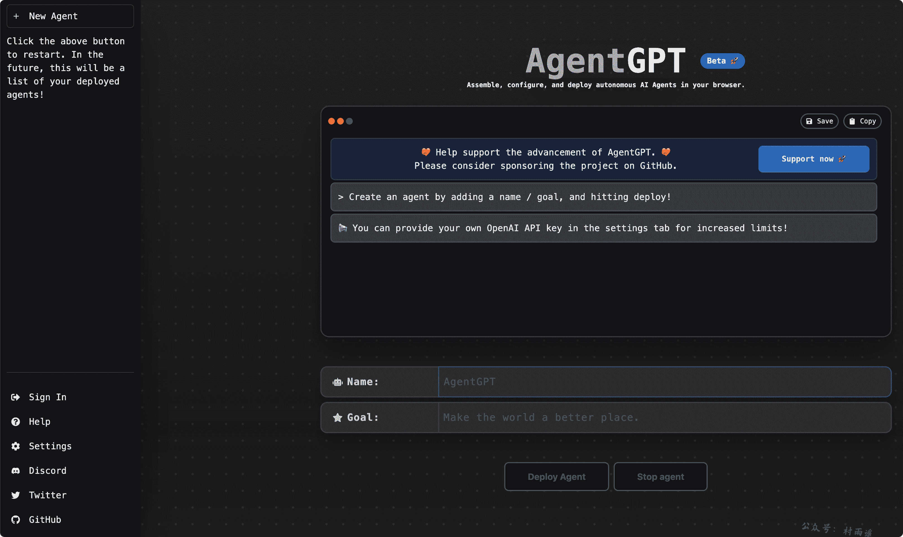

### 2. [DrawStampUtils.js](https://github.com/xxss0903/drawstamputils)

一个使用 TypeScript 制作电子印章的工具。仓库同时包含一个基于 Vue 3 + Vite 的本地示例界面，界面只保留一个基于 StampWorkspace.vue 的编辑器 Demo，用于在浏览器中交互式调整印章配置并导出图片，不再依赖任何后端接口或 Cloudflare Workers。

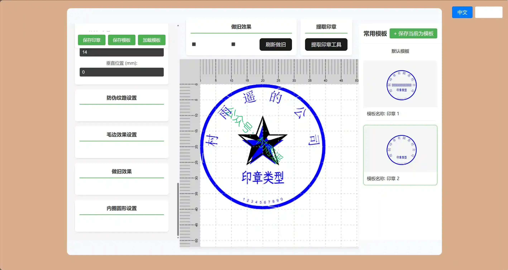

### 3. [Go Ldap Admin](https://github.com/eryajf/go-ldap-admin)

基于 Go + Vue 实现的 openLDAP 后台管理项目，旨在为 openLDAP 服务端提供一个简单易用，清晰美观的现代化管理后台。

## 二、软件

### 1. [Tai](https://github.com/Planshit/Tai)

在 Windows 上统计软件使用时长和网站浏览时长，帮助你了解自己把时间花在了什么地方，从而更好地做一些计划。或者，为了每周回顾自己的摸鱼成果。

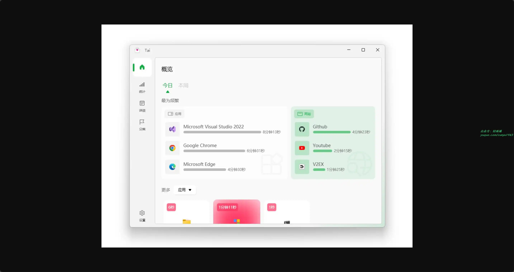

### 2. [微商截图侠](https://www.wsjtxia.com)

在线制作微信对话生成器和支付宝转账，微信聊天记录生成，免费微信对话在线制作，微信转账，支付宝聊天，微信余额，微信零钱，微信红包等截图，一款微商截图神器。

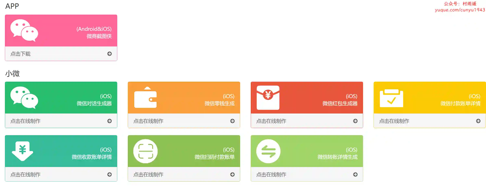

### 3. [卡巴斯基](https://www.kaspersky.com.cn/free-antivirus)

下载适用于 PC 、Android 和 iOS 的卡巴斯基安全云免费反病毒软件，并获得强大的保护，以防范病毒、勒索软件、间谍软件、网络钓鱼、木马和危险网站。畅享安全上网体验！

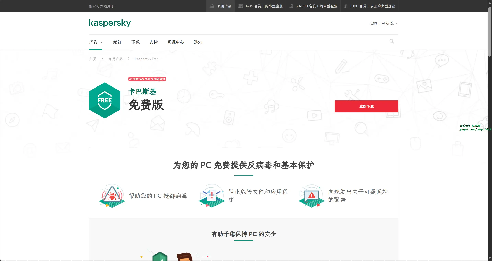

## 三、网站

### 1. [BYLO AI](https://bylo.ai)

免费 AI 文本生成图像，使用 Bylo.ai 的高级 AI 图像生成器，将您的想法转化为高质量图像，而且免费快速，支持定制化。

### 2. [轻工具导航](https://qinggongju.com)

一个专注收集分享优质免费资源的导航网站。

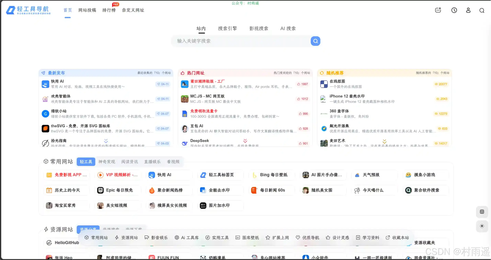

### 3. [逗比表情包](https://www.dbbqb.com/)

专业的表情包搜索网站，不仅有精选表情，还有精选套图以及表情自定义。

## 四、插件

### 1. [v2ex plus](https://chromewebstore.google.com/detail/v2ex-plus/daeclijmnojoemooblcbfeeceopnkolo)

优雅便捷的 V2EX 扩展，支持如下功能：

-   通知功能：更新提醒、未读消息
-   登录态判断：未登录 icon 提醒
-   半小时自动签到
-   主题列表预览及忽略功能
-   新窗口浏览主题
-   ……

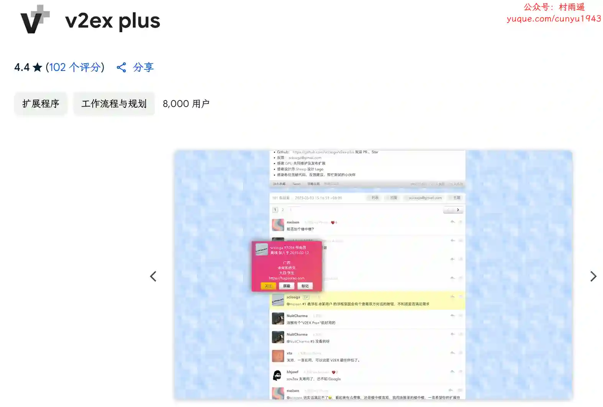

### 2. [FaceBook 视频下载器](https://chromewebstore.google.com/detail/kjnmedaeobfmoehceokbmpamheibpdjj?hl=zh-CN)

使用此扩展程序，您不仅可以从 `facebook.com` 下载 `Facebook` 视频，还可以从其他网站下载。 

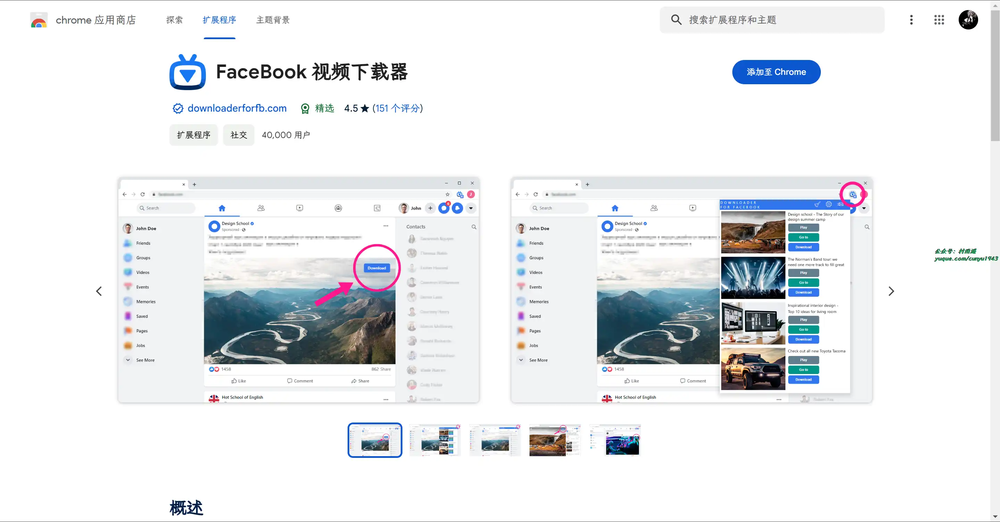

### 3. [冥想](https://chromewebstore.google.com/detail/andfohanhajengikbobaoblbdkmlkicp)

一款冥想计时器，可帮助您在任何地方进行冥想。简单、美观且易于使用。

## 五、资料

### 1. [网道](https://wangdoc.com/)

一个互联网开发文档网站，提供各种软件文档。目标是提供高质量、自主版权、可自由使用的中文软件文档。目前已有 `HTML`、`JavaScript`、`ES6`、`Web API`、`C 语言`、`Bash`、`SSH` 等诸多内容。

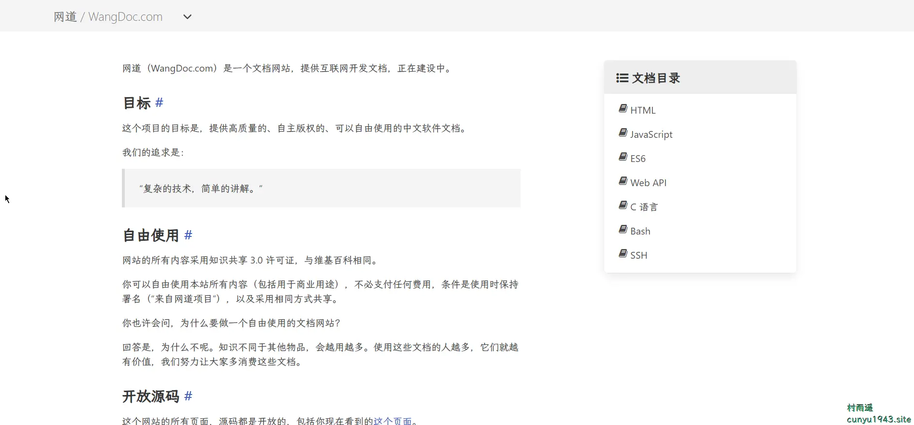

### 2. [springcloud-learning](https://github.com/macrozheng/springcloud-learning)

2024 最新微服务实战教程，Spring Cloud 组件、微服务项目实战、Kubernetes 容器化部署全方位解析。

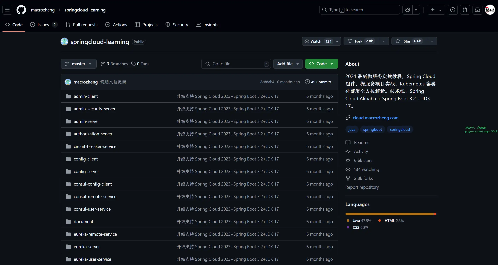

### 3. [SYSU_Notebook](https://github.com/ysyisyourbrother/SYSU_Notebook)

项目分享了中山大学计算机学院本科和研究生阶段的课程资料、笔记、期末考试卷和其他实用的相关资源。

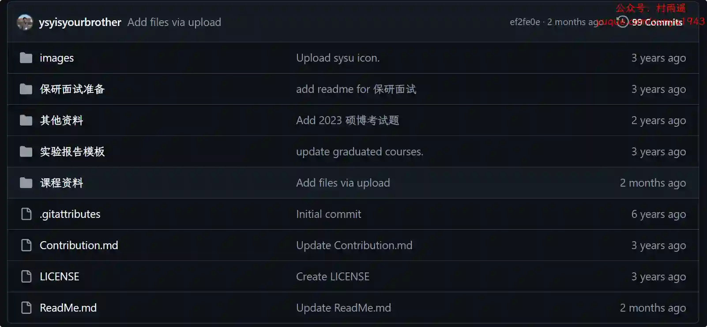

## ✍️ 说明

周刊专栏相关信息：

- **项目地址**：[Github](https://github.com/cunyu1943/weekly)，觉得不错麻烦给我一个**Star**，感谢 ❤️
- **浏览地址**：公众号 | [电子书](https://cunyu1943.github.io/weekly) | [语雀](https://yuque.com/cunyu1943/weekly) | [ima 知识库](https://ima.qq.com/wiki/?shareId=860487e32c6cc8d6c9070cd7f00caedf3cbf4102f695862d9c82f463b92417af)

如果你阅读到这里，说明我的工作没有白费。如果你想推荐项目/网站/软件/资源，欢迎提交 **[issue](https://github.com/cunyu1943/weekly/issues)** 或者添加我 **个人微信：coder_cunYu** 与我交流。

---

## ⏳ 联系

想解锁更多知识？不妨关注我的微信公众号：**村雨遥（id：JavaPark）**。

扫一扫，探索另一个全新的世界。

