# 每日推荐 · 2026 年 11 月 27 日

> 作者：[村雨遥](https://github.com/cunyu1943)
> 
> 不要哀求，学会争取，若是如此，终有所获

## 🎈 号外 

最近，公众号之外，建立了微信交流群，不定期会在群里分享各种资源（影视、IT 编程、考试提升……）&知识。如果有需要，可以**扫码或者后台添加小编微信备注入群**。进群后**优先看群公告**，**呼叫群中【资源分享小助手】**，还能免费帮找资源哦～

## 一、项目

### 1. [capcut-cli](https://github.com/renezander030/capcut-cli)

在终端里创建和编辑真正的 CapCut / 剪映项目，在 CapCut 中打开成果，每条轨道依然可编辑。capcut-cli 直接操作本地草稿存储：JSON 进、JSON 出，没有上传、没有 API、没有 MCP 服务，也没有 HTTP 守护进程。

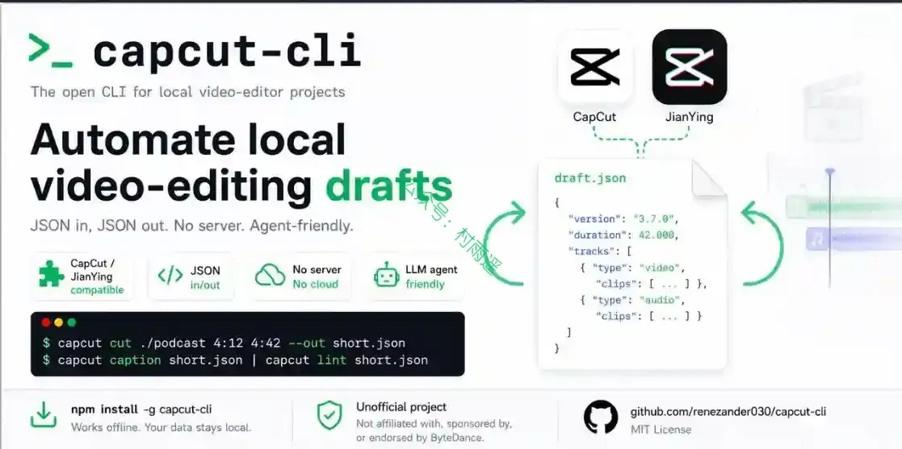

### 2. [uView-Pro](https://github.com/anyup/uView-Pro)

全面支持 Vue3.0、TypeScript 的 uni-app 生态框架，uView Pro 的基线版本是基于 uView 1.8.8 修改，使用 TypeScript 完全重构，已覆盖 Android、iOS、鸿蒙以及微信/头条/支付宝等主流小程序平台，真正实现 “一套代码，多端运行”，支持多主题系统、暗黑模式与国际化（i18n）。

### 3. [Vapor](https://github.com/vapor/vapor)

一个流行的 Swift 语言 Web 框架，基于非阻塞事件驱动库 SwiftNIO 构建。它提供了 ORM、模板引擎、用户身份验证等模块，使得开发者能够快速创建网站、接口等服务。

## 二、软件

### 1. [md2wechat](https://github.com/geekjourneyx/md2wechat-skill)

一键排版发布到微信公众号：支持 40+ 排版样式和专业主题 、AI 配图 、批量发布 、多账号管理。

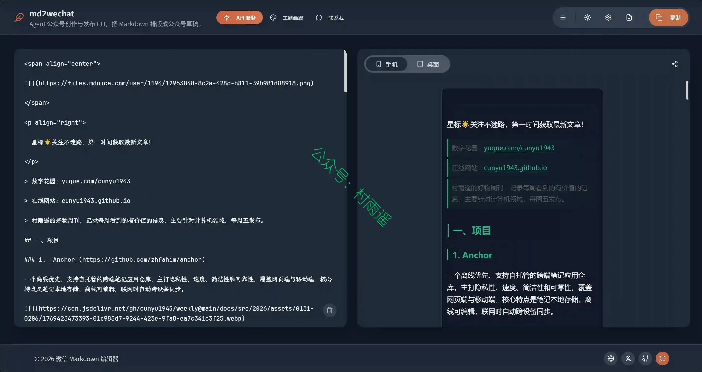

### 2. [知云文献翻译](https://www.zhiyunwenxian.cn/)

一款 Windows 平台下的划选翻译软件，自带 PDF 阅读器同时包含几乎所有主流翻译引擎，支持中英互译，帮助提高您的英语科研文献或书籍阅读效率！

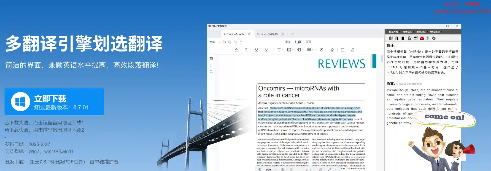

### 3. [OFPlayer](https://ofplayer.org)

一款本地优先的现代音乐播放器。支持 FLAC/MP3 无损播放、智能歌单管理、音频元数据解析，专为认真听歌的人设计。

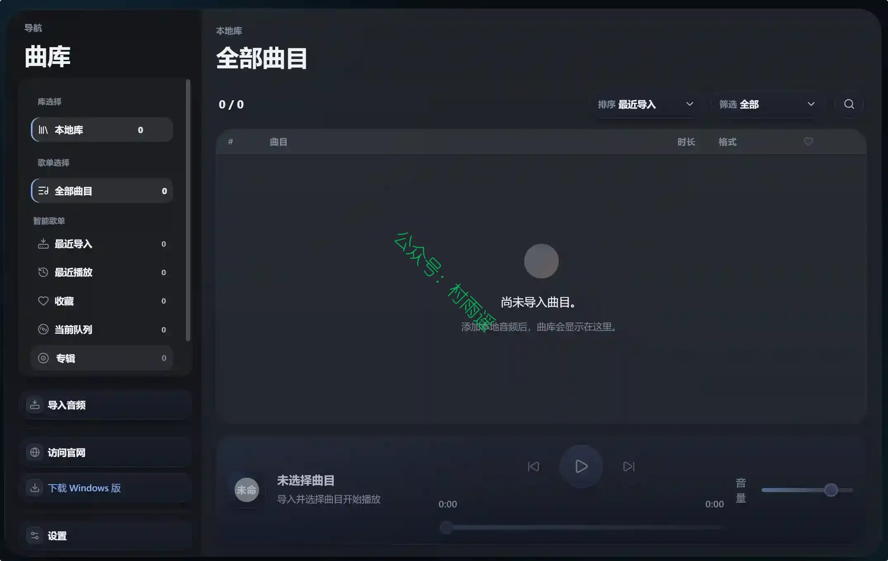

## 三、网站

### 1. [小众软件](https://www.appinn.com/)

一个分享、体验、评测电脑软件、手机应用、互联网产品的网站。

### 2. [工具王](https://www.toolsking.top)

功能强大的免费在线工具网站。

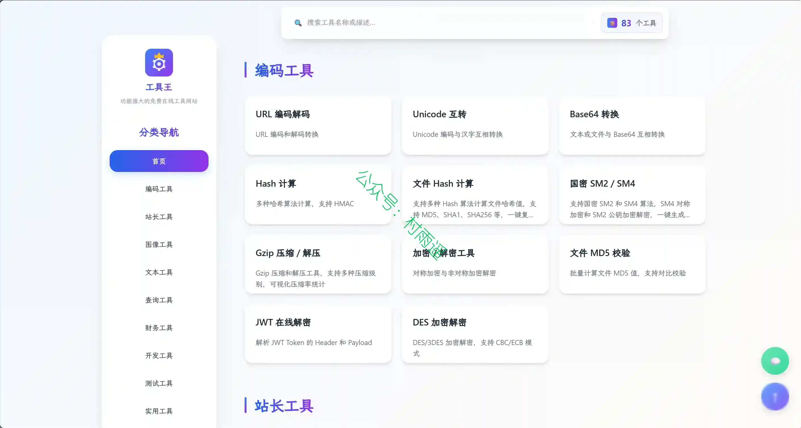

### 3. [劳动计算器](https://web.laofa.com/calculator/)

全国劳动法数据快速精确计算应用。根据用户输入的条件计算法定经济补偿金、法定年休假、工伤待遇等项目，并给出计算依据提示。已收录城市计算口径已经经过数万次计算验证。

## 四、插件

### 1. [Gemini to PDF](https://chromewebstore.google.com/detail/ai-chat-to-pdf/nlfkaldinolmacagmiddfpnfaeclfibn)

将你的 Gemini AI 对话转换为精美格式的 PDF，使用该工具来保存和分享宝贵的 Gemini 交互内容。无论是存档研究讨论、保存创意思维碰撞，还是记录技术解决方案，Gemini to PDF 都能每次都呈现完美结果！  

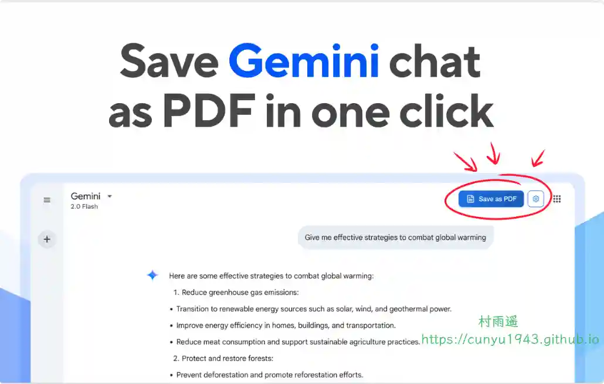

### 2. [Ctool 程序开发常用工具](https://chromewebstore.google.com/detail/ipfcebkfhpkjeikaammlkcnalknjahmh?utm_source=item-share-cb)

程序开发常用工具，支持哈希/加解密/编码转换/时间戳/二维码/拼音/IP查询/代码优化/Unicode/正则等功能，同时支持离线使用。

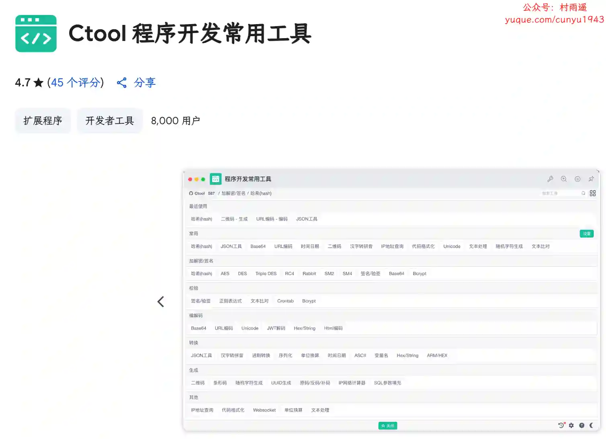

### 3. [飞书剪存](https://chromewebstore.google.com/detail/飞书剪存/mofcmpgnbnnlcdkfchnggdilcelpgegn)

使用飞书剪存将网页正文一键保存到飞书云文档，告别手动复制粘贴。同时支持智能去除网页广告，告别无用干扰信息。

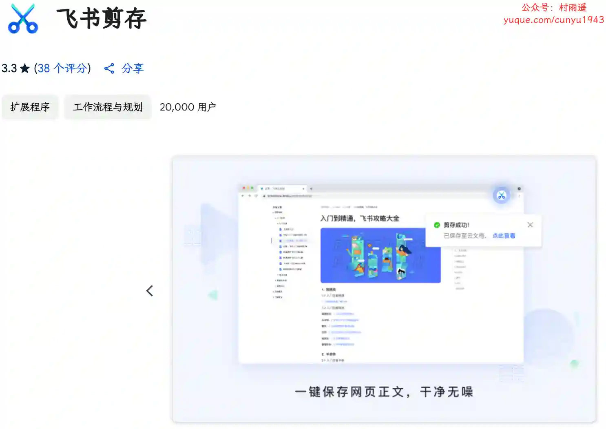

## 五、资料

### 1. [JavaHome](https://github.com/whx123/JavaHome)

一份超级详细的 Java 面试题【大厂面试真题 + Java 学习指南 + 工作总结】。

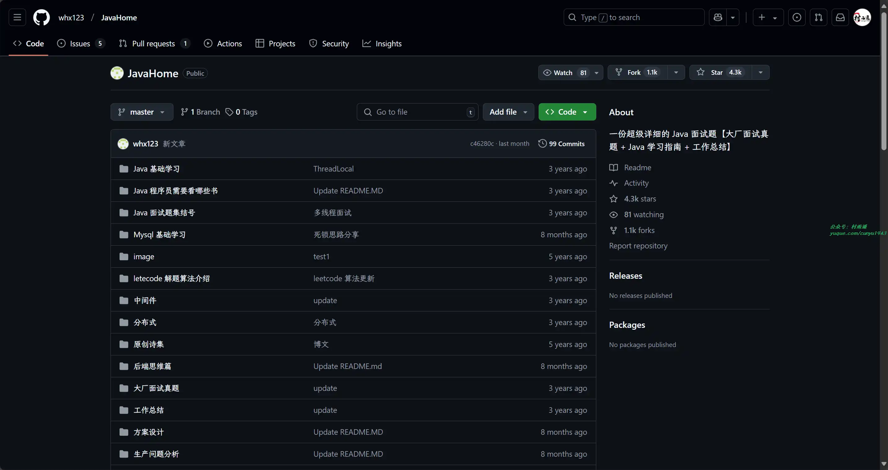

### 2. [Modern Java](https://github.com/Together-Java/ModernJava)

面向初学者的现代 Java 教程，内容基于 Java 21。

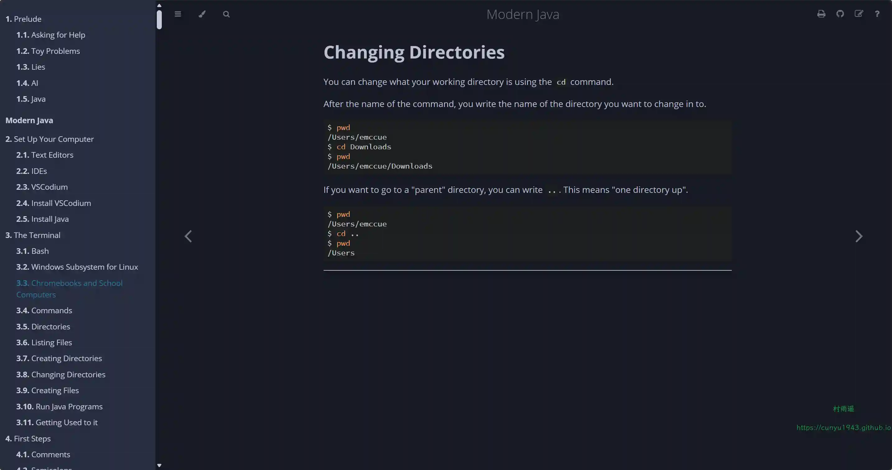

### 3. [程序员英语词汇宝典](https://github.com/Wei-Xia/most-frequent-technology-english-words)

本列表中的单词是英语类计算机书籍、文档、文章中高频常见的技术词汇，也是程序员工作中常见的英语词汇，最终目的是希望程序员集合自身的英语基础，在掌握列表中的词汇后，可以无障碍阅读英语技术文章和文档。

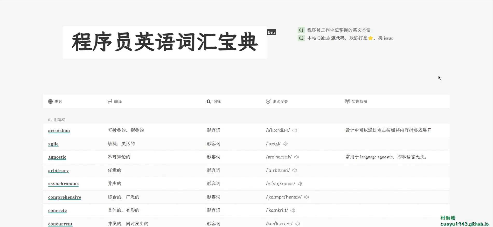

## ✍️ 说明

周刊专栏相关信息：

- **项目地址**：[Github](https://github.com/cunyu1943/weekly)，觉得不错麻烦给我一个**Star**，感谢 ❤️
- **浏览地址**：公众号 | [电子书](https://cunyu1943.github.io/weekly) | [语雀](https://yuque.com/cunyu1943/weekly) | [ima 知识库](https://ima.qq.com/wiki/?shareId=860487e32c6cc8d6c9070cd7f00caedf3cbf4102f695862d9c82f463b92417af)

如果你阅读到这里，说明我的工作没有白费。如果你想推荐项目/网站/软件/资源，欢迎提交 **[issue](https://github.com/cunyu1943/weekly/issues)** 或者添加我 **个人微信：coder_cunYu** 与我交流。

---

## ⏳ 联系

想解锁更多知识？不妨关注我的微信公众号：**村雨遥（id：JavaPark）**。

扫一扫，探索另一个全新的世界。

