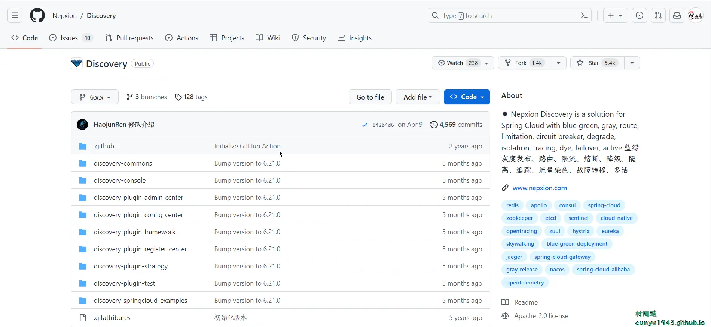
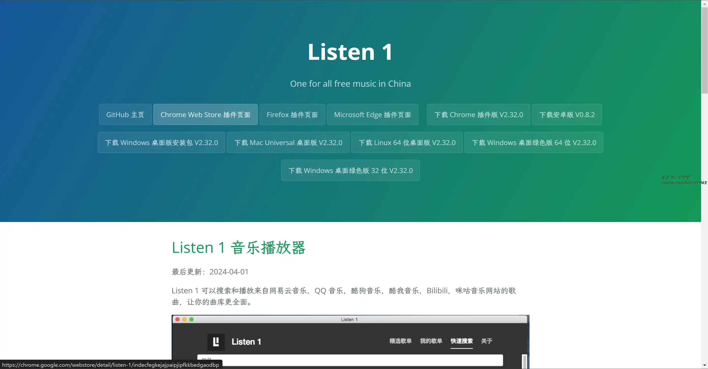
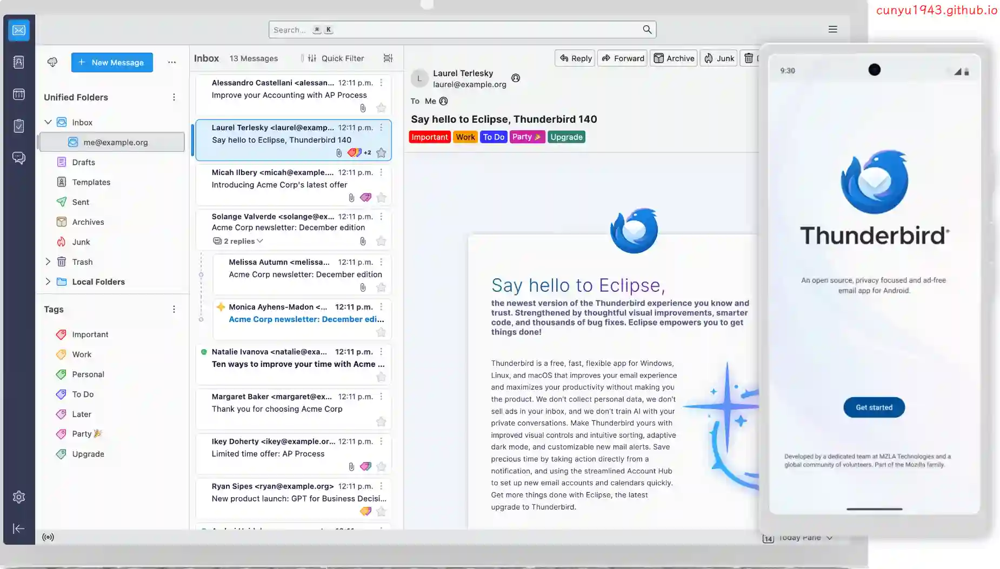
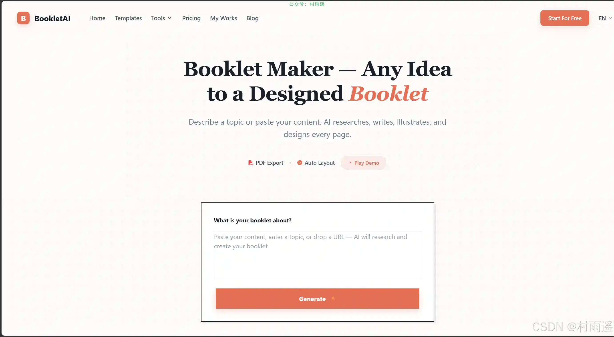
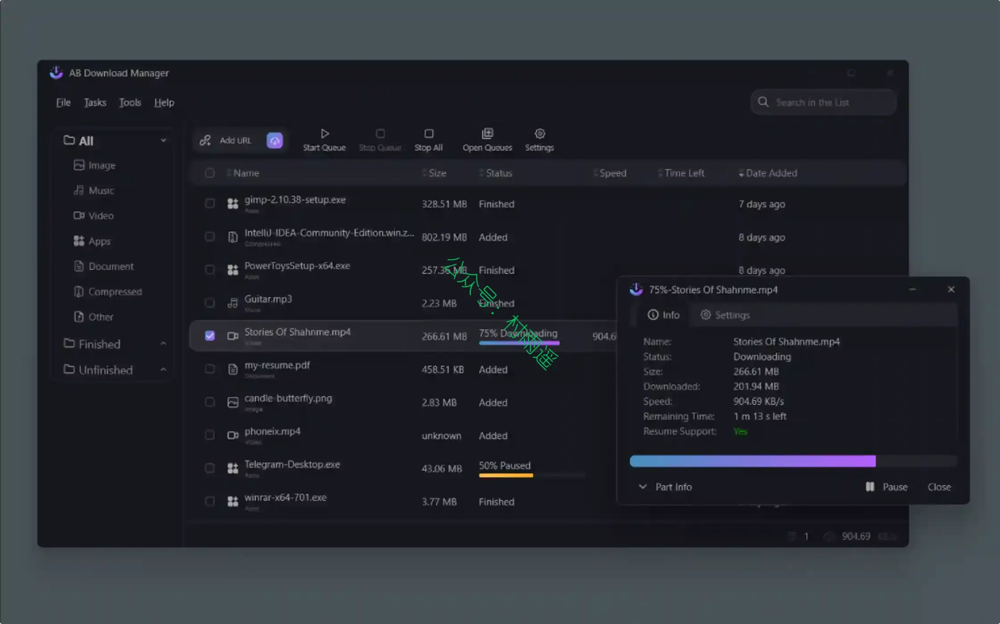
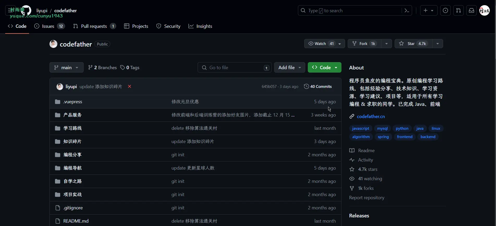
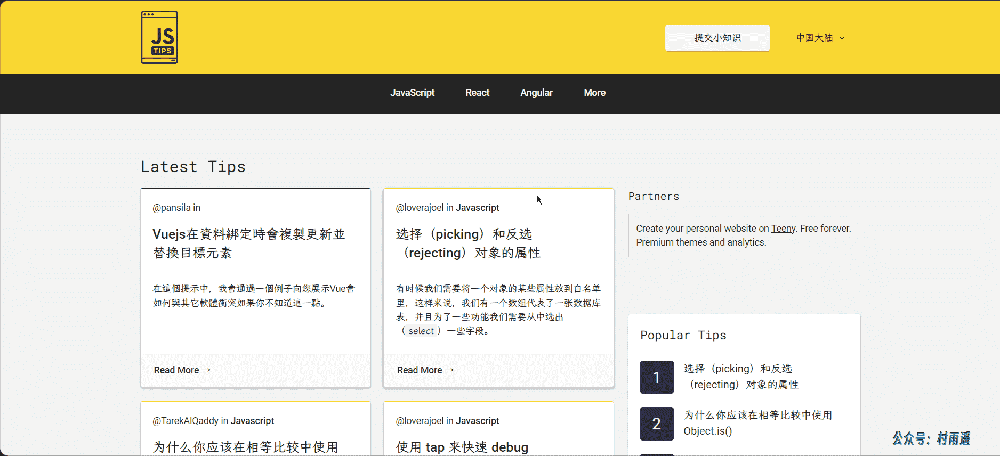

# 每日推荐 · 2026 年 11 月 25 日

> 作者：[村雨遥](https://github.com/cunyu1943)
> 
> 不要哀求，学会争取，若是如此，终有所获

## 🎈 号外 

最近，公众号之外，建立了微信交流群，不定期会在群里分享各种资源（影视、IT 编程、考试提升……）&知识。如果有需要，可以**扫码或者后台添加小编微信备注入群**。进群后**优先看群公告**，**呼叫群中【资源分享小助手】**，还能免费帮找资源哦～

## 一、项目

### 1. [DataRoom](https://gitee.com/gcpaas/DataRoom)

基于 Vue 的大屏可视化设计器，前后端一体化解决方案，几十种炫酷图表，支持多种数据来源接入，适用于大屏、低代码、BI 场景，使用简单，代码完全开源。

### 2. [Discovery](https://github.com/Nepxion/Discovery)

云原生微服务解决方案，支持蓝绿灰度发布、路由、限流、熔断、降级、隔离、追踪、流量染色、故障转移、多活。

### 3. [野火 IM 解决方案](https://github.com/wildfirechat/im-server)

一套通用的即时通讯和实时音视频组件，能够更加容易地赋予客户 IM 和 RTC 能力，使客户可以快速的在自有产品上添加聊天和通话功能或者直接使用野火提供的应用。使用野火可以替代云通讯产品或减少自研即时通讯和实时音视频的工作量，降低客户研发成本和难度。具有以下特性：

- 极致地硬件利用率，IM 服务最低 128M 内存即可运行，上不封顶。
- 协议先进，采用 MQTT+Protobuf 组合，流量和性能极致优化
- 性能强大，专业版 IM 服务支持百万在线和集群部署，业内顶尖性能水平，详情参考野火性能报告。
- 部署运维简单，依赖服务少，稍加配置一键启动。
- ……

## 二、软件

### 1. [Listen 1](https://github.com/listen1/listen1_desktop)

可以搜索和播放来自网易云音乐，QQ 音乐，酷狗音乐，酷我音乐，Bilibili，咪咕音乐网站的歌曲，让你的曲库更全面。

### 2. [灵动桌面](https://www.wallpaperplay.cn)

打造你的精美桌面，海量精品壁纸，超清动态壁纸任意换，搭配桌面组件打造个性桌面。

### 3. [ThunderBird](https://www.thunderbird.net)

借助这款迅捷的应用，来一站式查看邮件、日历、联系人，随心筛选和整理项目，并且可以选择是分别打理各个账户，还是合并到一个收件箱。

## 三、网站

### 1. [Cloudflare](https://www.cloudflare.com/zh-cn/)

一个全球性的云平台，它为世界各地的各种规模的企业提供广泛的网络服务，从而使企业更加安全，同时提高其关键互联网资产的性能和可靠性。

### 2. [Made A Pie](https://madeapie.com/#/)

Echarts 图表制作、案例分享、教程分享。汇聚了超多 Echarts 绘制案例，主要有以下类别：

### 3. [Booklet AI](https://bookletai.org/tools/booklet-maker.html)

一个通过对话创建专业小册子的 AI 工具。用户输入主题后，AI 会先追问受众、用途和风格，再自动联网调研、整理大纲，并逐页生成图文混排的 A4 小册子。

## 四、插件

### 1. [AB Download Manager](https://chromewebstore.google.com/detail/ab-download-manager-brows/bbobopahenonfdgjgaleledndnnfhooj)

一款免费开源 Chrome 下载管理扩展，可右键调用、自动捕获链接并识别音视频与 HLS 流，将下载任务交由客户端管理。

### 2. [Mailtrack 和邮件合并](https://chromewebstore.google.com/detail/gmail-的-mailtrack-和邮件合并/ndnaehgpjlnokgebbaldlmgkapkpjkkb?hl=zh-CN)

一款 Gmail 和 Inbox 电子邮件跟踪扩展程序，可是让你了解你发送的电子邮件是否为已读或未读。拥有超过 200 万活跃用户，免费且无限制。

### 3. [文字缩放与阅读模式](https://chromewebstore.google.com/detail/mamgplcihonkbopicdfhbadppehecgoahttps://chromewebstore.google.com/detail/mamgplcihonkbopicdfhbadppehecgoa)

根据自己的喜好定制浏览环境，从而提高可读性，减少干扰，优化加载速度。

## 五、资料

### 1. [鱼皮的编程宝典](https://github.com/liyupi/codefather)

程序员鱼皮的编程宝典。原创编程学习路线，包括经验分享、技术知识、学习资源、学习建议、项目等，适用于所有学习编程 & 求职的同学。

### 2. [Dive into LangGraph](https://github.com/luochang212/dive-into-langgraph)

LangGraph 是由 LangChain 团队开发的开源智能体框架，责工作流和状态管理，仓库着重介绍该框架的实践。

### 3. [Js Tips](https://www.jstips.co/)

每天一条 `JavaScript` 小技巧。只需要花上两分钟的时间，就能读到性能、框架、约定、技巧、面试问题等有助于提高编写代码效率的小技巧。

## ✍️ 说明

周刊专栏相关信息：

- **项目地址**：[Github](https://github.com/cunyu1943/weekly)，觉得不错麻烦给我一个**Star**，感谢 ❤️
- **浏览地址**：公众号 | [电子书](https://cunyu1943.github.io/weekly) | [语雀](https://yuque.com/cunyu1943/weekly) | [ima 知识库](https://ima.qq.com/wiki/?shareId=860487e32c6cc8d6c9070cd7f00caedf3cbf4102f695862d9c82f463b92417af)

如果你阅读到这里，说明我的工作没有白费。如果你想推荐项目/网站/软件/资源，欢迎提交 **[issue](https://github.com/cunyu1943/weekly/issues)** 或者添加我 **个人微信：coder_cunYu** 与我交流。

---

## ⏳ 联系

想解锁更多知识？不妨关注我的微信公众号：**村雨遥（id：JavaPark）**。

扫一扫，探索另一个全新的世界。

