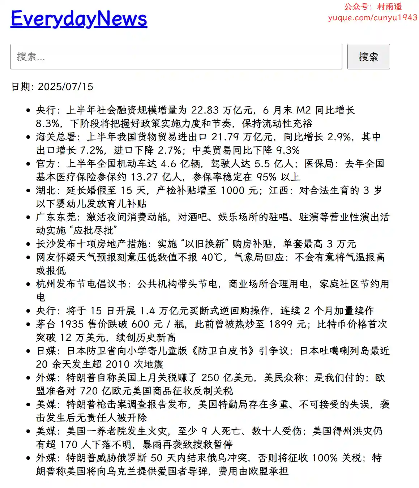
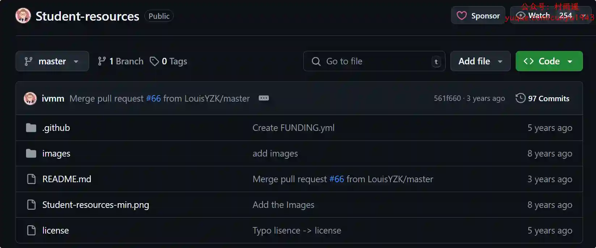
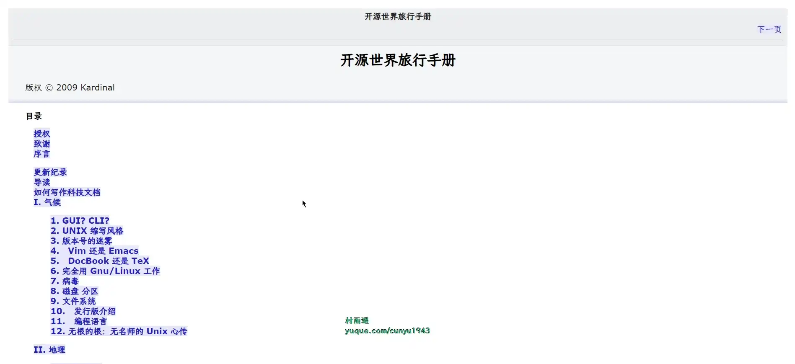
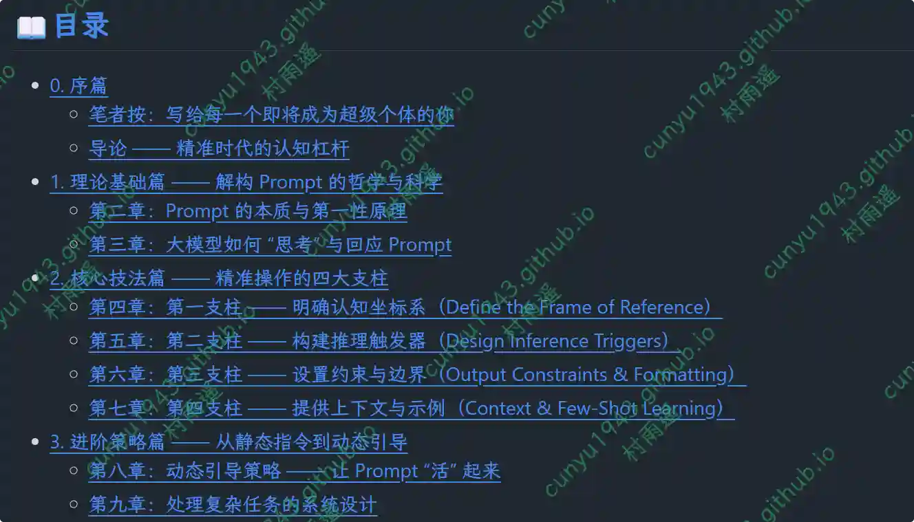

# 每日推荐 · 2026 年 11 月 24 日

> 作者：[村雨遥](https://github.com/cunyu1943)
> 
> 不要哀求，学会争取，若是如此，终有所获

## 🎈 号外 

最近，公众号之外，建立了微信交流群，不定期会在群里分享各种资源（影视、IT 编程、考试提升……）&知识。如果有需要，可以**扫码或者后台添加小编微信备注入群**。进群后**优先看群公告**，**呼叫群中【资源分享小助手】**，还能免费帮找资源哦～

## 一、项目

### 1. [Claude Code PM](https://github.com/automazeio/ccpm)

针对 Claude Code 的项目管理系统，使用 GitHub issue 和 Git 工作树进行并代理执行。

### 2. [Antigravity Tools](https://github.com/lbjlaq/Antigravity-Manager)

一个专为开发者和 AI 爱好者设计的全功能桌面应用。它将多账号管理、协议转换和智能请求调度完美结合，为您提供一个稳定、极速且成本低廉的 本地 AI 中转站。通过本应用，您可以将常见的 Web 端 Session (Google / Anthropic) 转化为标准化的 API 接口，彻底消除不同厂商间的协议鸿沟。

### 3. [Restful Fast Request](https://github.com/dromara/fast-request)

一个类似于 Postman 的 IDEA 插件。它是一个强大的 restful api 工具包插件，可以根据已有的方法帮助您快速生成 url 和 params。 Restful Fast Request = API调试工具 + API管理工具 + API搜索工具。 它有一个漂亮的界面来完成请求、检查服务器响应、存储你的 api 请求和导出 api 请求。插件帮助你在 IDEA 界面内更快更高效得调试你的 API。

对比于 HTTP Client，Fast Request 不仅拥有 HTTP Client 内置的功能，还提供了友好易懂直观的界面，让使用者调试 API 的时候能够更加方便、简捷。同时各种类型参数也提供了不同的定制方式，更加灵活。而且集成了搜索、Postman 集成，Swagger 支持等额外的功能。

## 二、软件

### 1. [Sequel Pro](https://sequelpro.com)

开源 MySQL 数据库管理工具，仅支持 macOS。界面简洁直观，管理高效便捷。

### 2. [Tiny Image](https://github.com/kyleduo/TinyPNG4Mac)

TinyPNG 的第三方客户端，使用它，无需打开浏览器即可压缩图片，专为 macOS 用户打造。

### 3. [AIdea](https://github.com/mylxsw/aidea-server)

一款支持 GPT 以及国产大语言模型通义千问、文心一言等，支持 Stable Diffusion 文生图、图生图、 SDXL1.0、超分辨率、图片上色的全能型 APP。

## 三、网站

### 1. [QR-艺术二维码](https://chenyating.github.io/art-qrcode/)

只需输入你要生成二维码的内容，点击开始生成即可生成你的艺术二维码。

### 2. [什么值得读](https://book.jiandan.link/)

专注于书单的好书推荐网站，内容包括书单、视频书、电子书下载导航、专栏好文。网站持续更新优质书单、读书笔记、读书心得、创业思考、资源网站等内容，包含名人推荐书单、知乎豆瓣高分好书、高分小说等。当你不知道读什么的时候，就来什么值得读吧，这里有高质量书籍推荐，也有超过 10万人的读书社群！在这里，你可以发现真正值得读的内容，找到你想读的那本书。

### 3. [EverydayNews](https://news.ravelloh.top)

在这里你能搜索到近 3 年的新闻历史记录的文字版内容。

## 四、插件

### 1. [Adblock Plus](https://chromewebstore.google.com/detail/adblock-plus-免费的广告拦截器/cfhdojbkjhnklbpkdaibdccddilifddb)

阻止 `YouTube™` 广告、弹出窗口并抵御恶意软件！

享受没有恼人广告的网络世界，插件会屏蔽以下内容

-   横幅 
-   `YouTube` 视频广告
-   `Facebook` 广告
-   弹出窗口
-   所有其他显眼的广告

### 2. [扩展管理器](https://chromewebstore.google.com/detail/扩展管理器/efolofldmcajcobffimbnokcnfcicooc)

快速轻松的开启、关闭、卸载扩展程序，查看卸载记录；自定义分组、设置别称或备注；支持置顶或收藏插件，并支持导出 `CSV`。最好用的插件管理工具，具有以下特色功能：

- 插件列表：漂亮的 `UI` 设计，列表展示所有插件内容、版本、分组、别称。同时显示一共有多少插件，多少开启和关闭的以及卸载的插件数量；
- 一键启用：在列表页，可以一键启用插件；
- 一键禁用：在列表页，可以一键禁用插件，同时也支持一键关闭所有的插件；
- 一键卸载：在列表页，可以一键卸载不需要的插件；
- 智能搜索：可以根据插件名称或者别称匹配到想要的插件；
- 卸载记录：可以查看已经卸载过的历史记录，并支持重新安装；
- 智能跳转：支持一键跳转官方主页、系统选项页；
- 备注别称：支持给插件设置别称或备注，方便查找，也可以通过搜索快速定位；
- 喜欢搜藏：支持收藏自己喜欢的插件，并在最前面显示；
- 更多点击：可以点击管理插件、快速去商城地址等；
- 智能分组：可以自定义创建分组，并且分组会在插件列表页展示；

### 3. [1Block](https://chromewebstore.google.com/detail/1block-best-adblocker-for/jajikjbellknnfcomfjjinfjokihcfoi?hl=zh-CN)

快速、高效、注重隐私的广告拦截器。

旨在与最新的 `Manifest V3` 架构无缝协作，是您的一站式解决方案，可提供更干净、更快、更愉快的浏览体验。

## 五、资料

### 1. [Student-resources](https://github.com/ivmm/Student-resources)

主要介绍利用学生、教职工身份可以享受到的相关学生优惠、教育优惠或教师优惠的权益。

### 2. [开源世界旅行手册](https://i.linuxtoy.org/docs/guide/index.html)

本书分为四个部分：气候、地理、景观、地质。

气候篇中的内容为课外读物，包括一些杂谈随笔，可以增长知识。

地理篇为必修课，它是这本书的核心，包含一些基本教程。这一部分的内容，建议熟读。

景观篇为选修课，里面的内容为实用的解决方案，但并不是每个人都需要。

地质篇的内容为开源运动史。

### 3. [AI 精准操作手册：从 Prompt 工程到认知导航](https://github.com/1Haschwalth/prompt-engineering)

书中汇集了作者操作 deepseek 等模型的一手经验，将看似神秘的“提示词技巧”系统化为可学习、可复用的方法论。无论你是学生、创作者、开发者还是企业家，这些方法都能帮你把AI转化为持续的竞争优势。

## ✍️ 说明

周刊专栏相关信息：

- **项目地址**：[Github](https://github.com/cunyu1943/weekly)，觉得不错麻烦给我一个**Star**，感谢 ❤️
- **浏览地址**：公众号 | [电子书](https://cunyu1943.github.io/weekly) | [语雀](https://yuque.com/cunyu1943/weekly) | [ima 知识库](https://ima.qq.com/wiki/?shareId=860487e32c6cc8d6c9070cd7f00caedf3cbf4102f695862d9c82f463b92417af)

如果你阅读到这里，说明我的工作没有白费。如果你想推荐项目/网站/软件/资源，欢迎提交 **[issue](https://github.com/cunyu1943/weekly/issues)** 或者添加我 **个人微信：coder_cunYu** 与我交流。

---

## ⏳ 联系

想解锁更多知识？不妨关注我的微信公众号：**村雨遥（id：JavaPark）**。

扫一扫，探索另一个全新的世界。

