# 每日推荐 · 2026 年 11 月 18 日

> 作者：[村雨遥](https://github.com/cunyu1943)
> 
> 不要哀求，学会争取，若是如此，终有所获

## 🎈 号外 

最近，公众号之外，建立了微信交流群，不定期会在群里分享各种资源（影视、IT 编程、考试提升……）&知识。如果有需要，可以**扫码或者后台添加小编微信备注入群**。进群后**优先看群公告**，**呼叫群中【资源分享小助手】**，还能免费帮找资源哦～

## 一、项目

### 1. [Twikoo](https://github.com/imaegoo/twikoo)

一个简洁、安全、免费的静态网站评论系统，具有以下特点：

-   简单
-   易用
-   安全
-   即时
-   个性
-   便捷管理

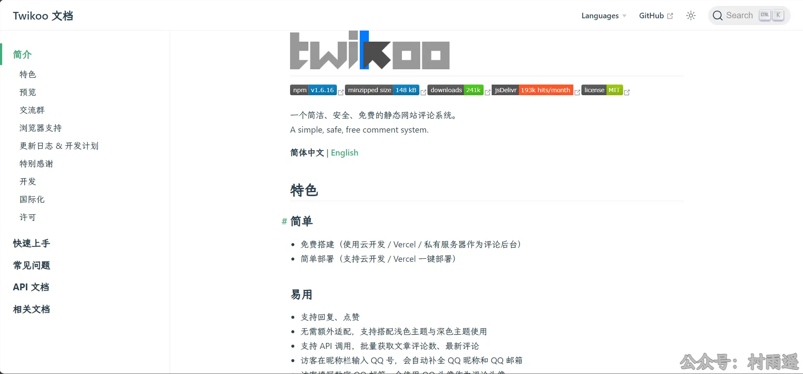

### 2. [Material Design User Interface](https://github.com/zdhxiong/mdui)

使用 Web Components 实现，遵循 Material You 设计规范的 Web 前端组件库。

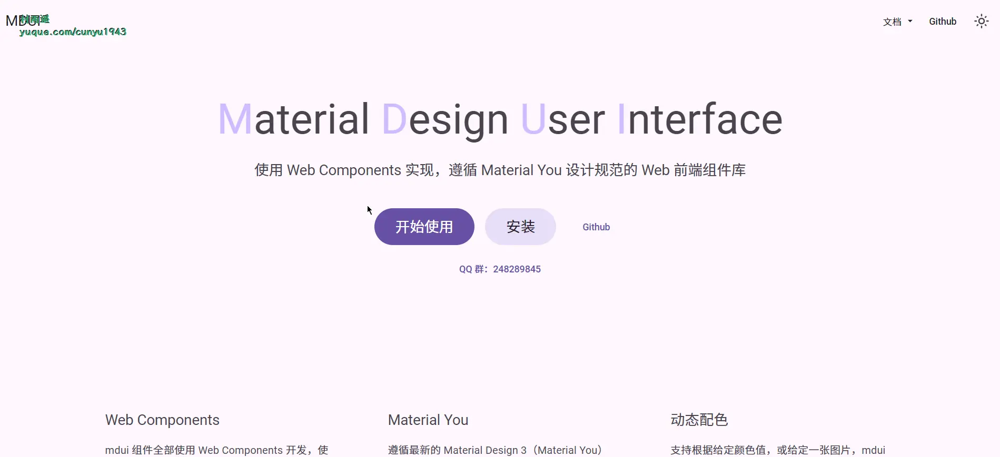

### 3. [Monolith](https://github.com/one-ea/Monolith)

一套运行在 Cloudflare 全球边缘网络上的现代化博客系统，前后端通过适配器模式解耦，零运维即可获得全球 < 50ms 的访问延迟。

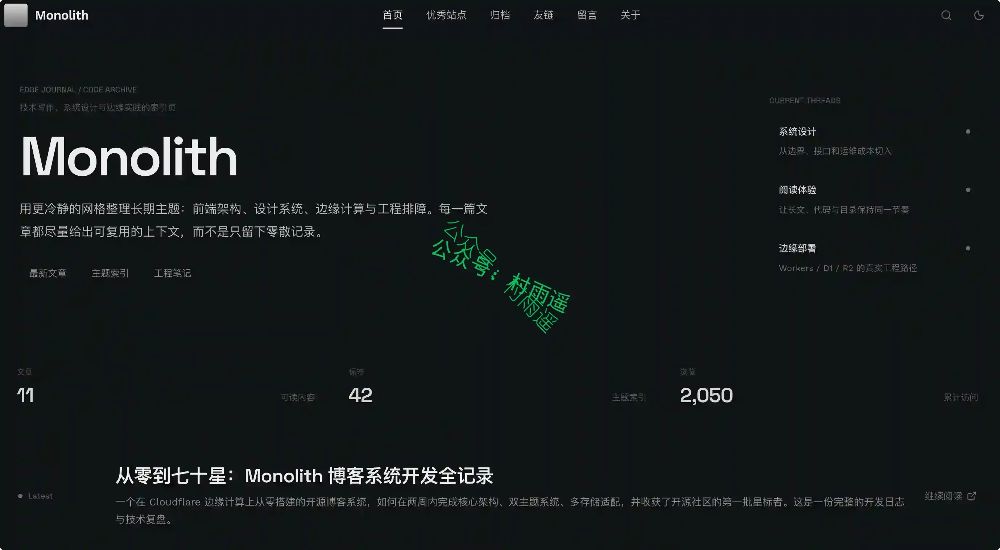

## 二、软件

### 1. [AidLux](https://github.com/aidlearning/AidLearning-FrameWork)

创新性的 Android / 鸿蒙 + Linux 融合架构与 AI 工具链，构建下一代 AIoT 解决方案，服务开发者探索新未来。

### 2. [Verse](https://verse.app.yinxiang.com/product)

新一代免费的 AI 生产力工具，支持多种场景内容智能生成，包括会议纪要、公文假条、小说作文、日报、新闻稿、广告创作等等高效产出。

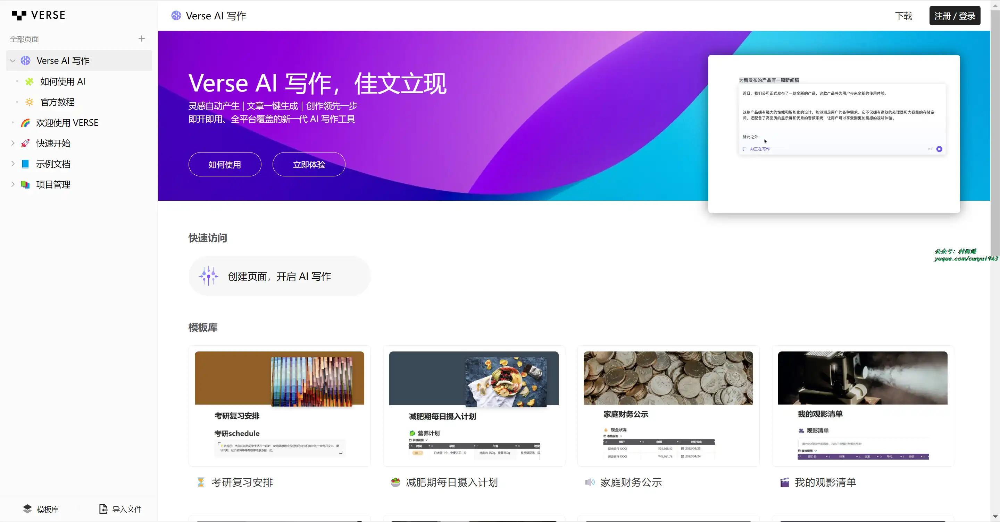

### 3. [剪存](https://github.com/snsogbl/clip-save)

一个基于 Wails + Vue 3 + TypeScript 的跨平台剪贴板历史管理工具。

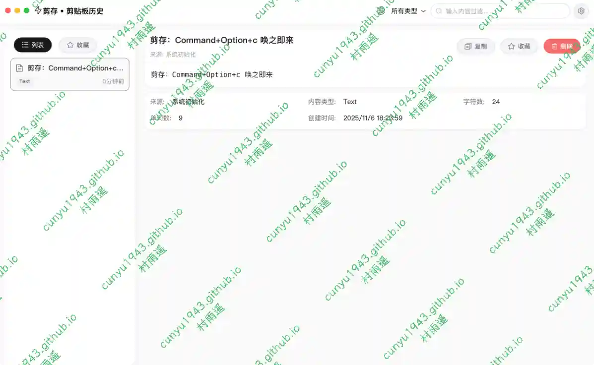

## 三、网站

### 1. [轻壁纸](https://qingbizhi.com)

高质量电脑壁纸分享，免费分享电脑壁纸、横屏壁纸、Bing 壁纸等等。

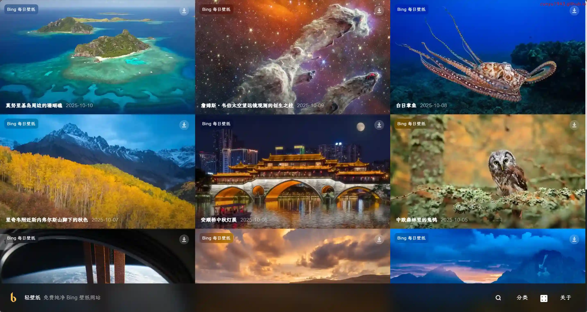

### 2. [PPT 超级市场](https://www.pptsupermarket.com/)

免费下载 `PPT` 模板与 `PPT` 作品，提供免费的 `PPT` 代做服务，提供一站式 `PPT`(模板、定制、工具、教程)服务，有了它，一切制作 `PPT` 的烦恼都将成为过去！

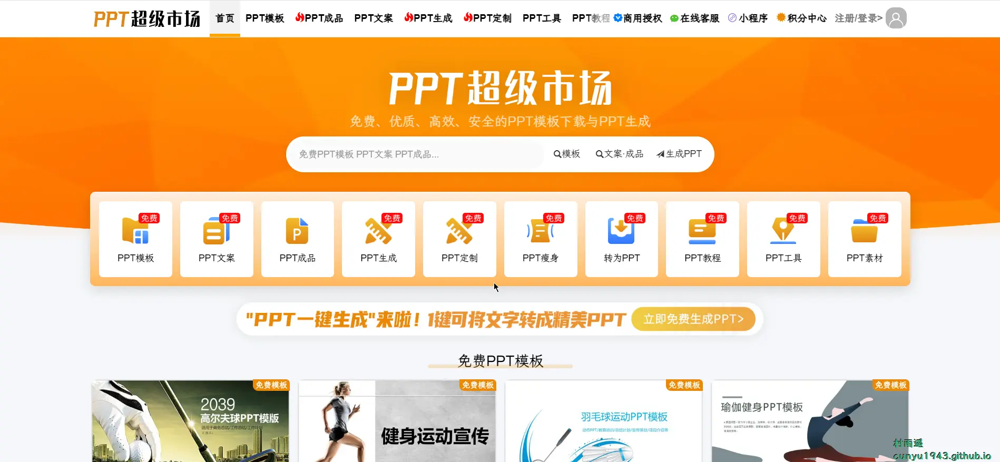

### 3. [Azure Text to Speech](https://tts.femoon.top/)

Azure 提供的在线文字转语音工具，支持多种语言、男女不同音色，多种风格随意切换，甚至还能调整语速语调。

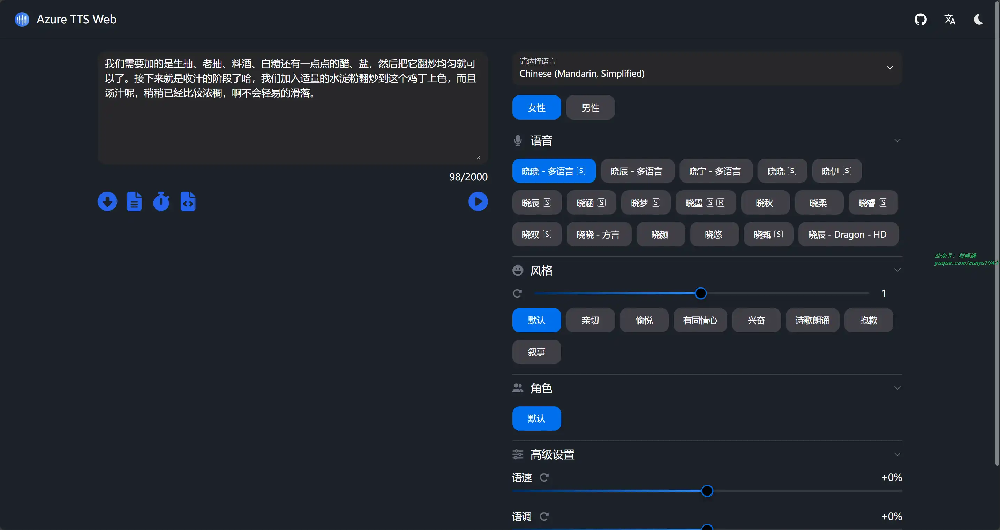

## 四、插件

### 1. [蔚蓝主页](https://microsoftedge.microsoft.com/addons/detail/蔚蓝主页/epgghbgfoacieppkngapakodnbkhpldj)

蔚蓝主页是一款浏览器主页/新标签页，主要为用户提供搜索服务、网址导航服务。

区别于传统的主页或网址导航，是一款独特、有所分别的产品。产品核心理念是简洁、存粹，采用了简洁的页面设计，对主要功能加以提炼，让用户能更纯粹的享受该浏览器主页插件所带来的便利。

### 2. [LanguageTool](https://languagetool.org/)

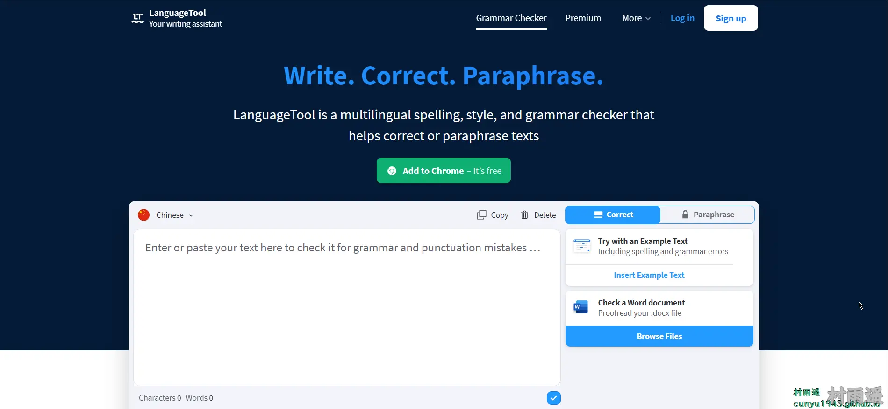

使用 LanguageTool 的语法检查器和释义工具立即增强您的文本，具有以下特点：

-   无需注册
-   支持超 25 种语言：英语、西班牙语、法语、德语、波兰语、俄语……
-   应用范围广，几乎包含所有网站

### 3. [Cesturefy](https://chromewebstore.google.com/detail/cesturefy/bifgfhokfobhebifcogneljkpaaloonp)

Firefox 热门扩展 *Robbendebiene/Gesturefy* 的 Chromium 移植版，将同样流畅的手势控制带到 Chrome、Edge 等浏览器。

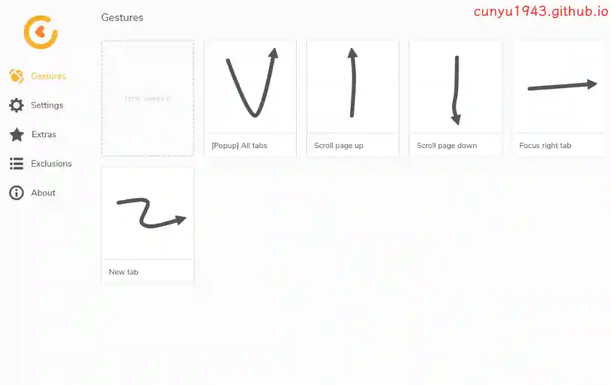

## 五、资料

### 1. [中文敏感词库](https://github.com/konsheng/Sensitive-lexicon)

一个持续更新的中文敏感词库，广泛覆盖政治、色情、暴力等敏感领域的词汇列表，帮助开发者和内容审核者快速识别并过滤不当文本。

### 2. [新概念学习笔记](https://github.com/andylee1890/NewConceptEnglish)

记录了作者从第 2 册开始学习新概念英语的学习笔记，记录整理后进行分享，方便大家一起学习。

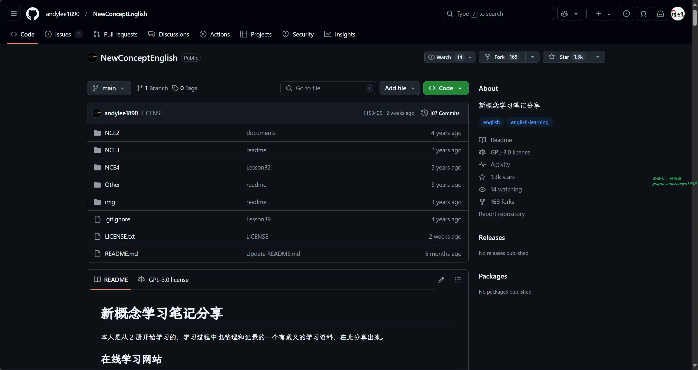

### 3. [Kuboard](https://kuboard.cn/)

`Kubernetes` 多集群管理界面，同时提供了 `Kubernetes` 教程，为使用 `Kubernetes`  落地 `Cloud` 微服务的任务提供实战经验。

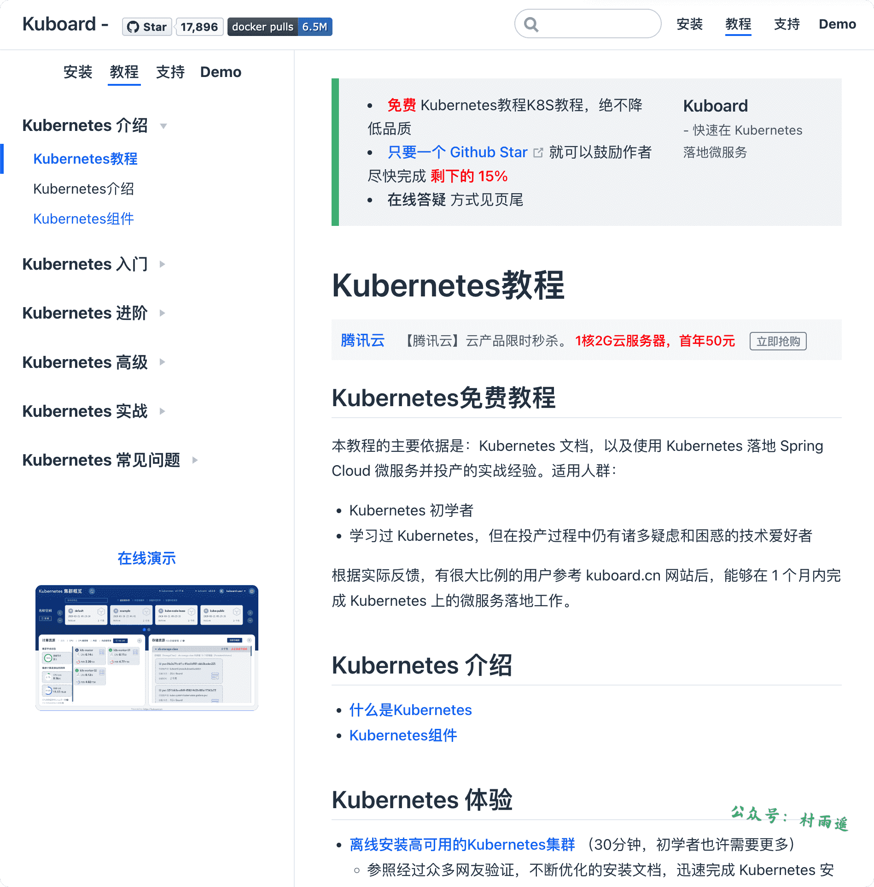

## ✍️ 说明

周刊专栏相关信息：

- **项目地址**：[Github](https://github.com/cunyu1943/weekly)，觉得不错麻烦给我一个**Star**，感谢 ❤️
- **浏览地址**：公众号 | [电子书](https://cunyu1943.github.io/weekly) | [语雀](https://yuque.com/cunyu1943/weekly) | [ima 知识库](https://ima.qq.com/wiki/?shareId=860487e32c6cc8d6c9070cd7f00caedf3cbf4102f695862d9c82f463b92417af)

如果你阅读到这里，说明我的工作没有白费。如果你想推荐项目/网站/软件/资源，欢迎提交 **[issue](https://github.com/cunyu1943/weekly/issues)** 或者添加我 **个人微信：coder_cunYu** 与我交流。

---

## ⏳ 联系

想解锁更多知识？不妨关注我的微信公众号：**村雨遥（id：JavaPark）**。

扫一扫，探索另一个全新的世界。

