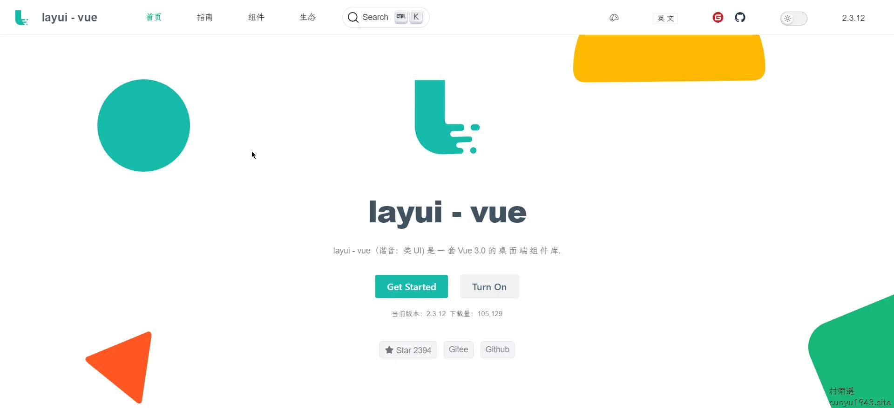
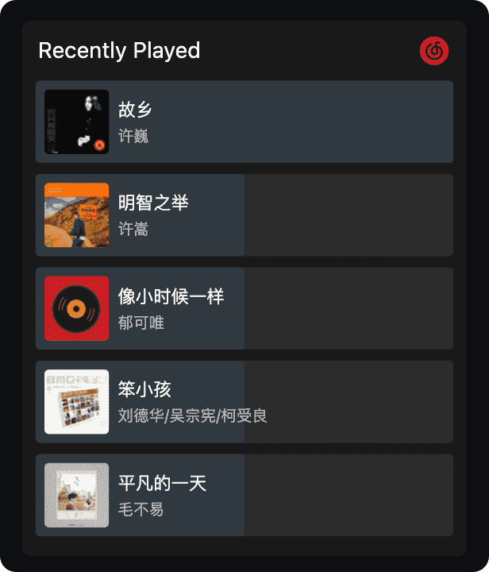
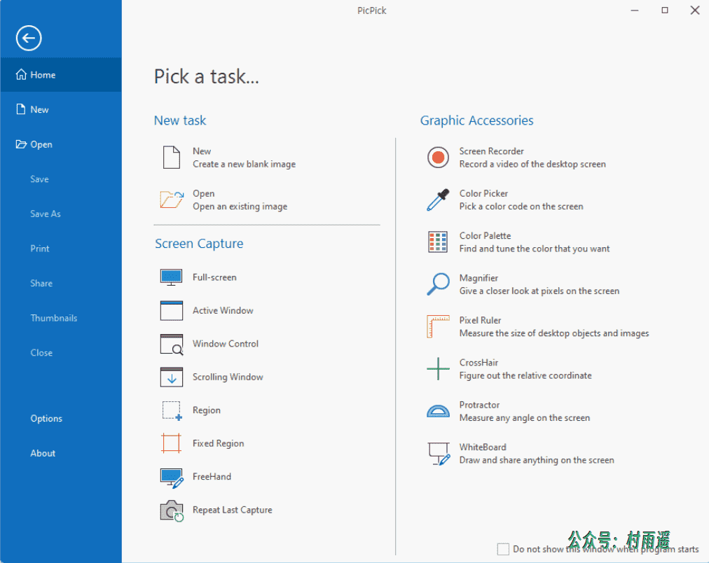
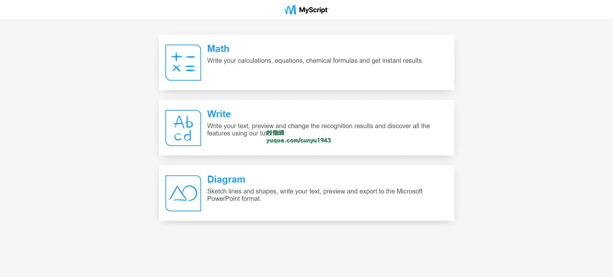
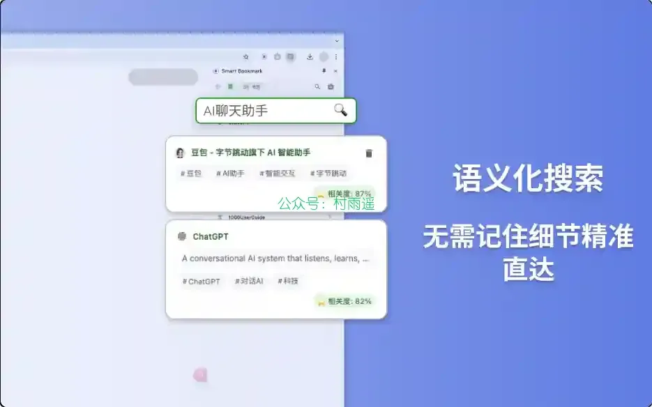
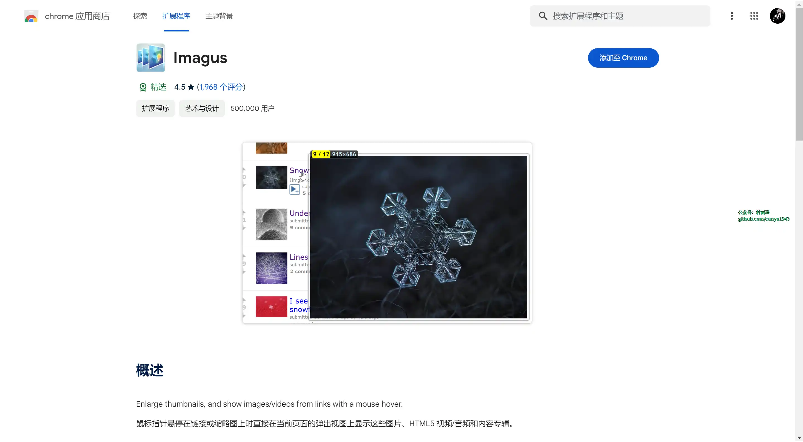
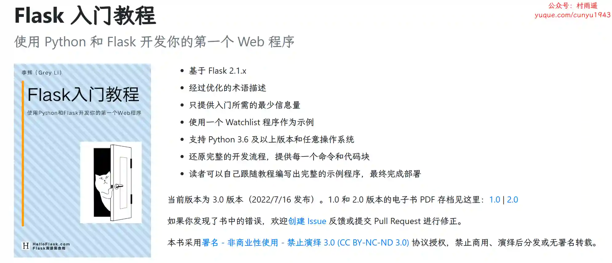
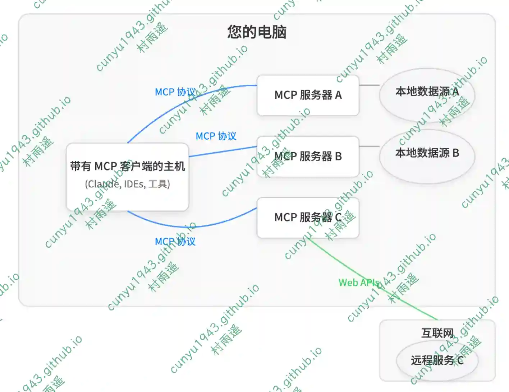
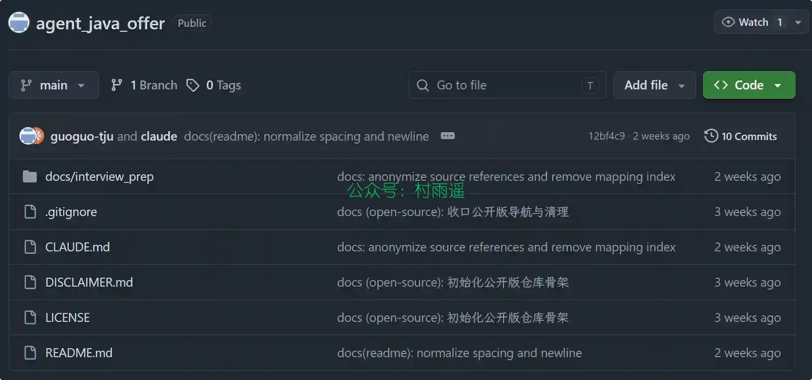

# 每日推荐 · 2026 年 11 月 23 日

> 作者：[村雨遥](https://github.com/cunyu1943)
> 
> 不要哀求，学会争取，若是如此，终有所获

## 🎈 号外 

最近，公众号之外，建立了微信交流群，不定期会在群里分享各种资源（影视、IT 编程、考试提升……）&知识。如果有需要，可以**扫码或者后台添加小编微信备注入群**。进群后**优先看群公告**，**呼叫群中【资源分享小助手】**，还能免费帮找资源哦～

## 一、项目

### 1. [layui-vue](https://gitee.com/layui/layui-vue)

一套 Vue 3.0 的桌面端组件库。

### 2. [Dax-Pay](https://gitee.com/dromara/dax-pay)

一款免费开源的支付系统，支持支付宝、微信、云闪付等通道，提供收单、退款、聚合支付、对账、分账等功能。通过 HTTP 方式进行调用，不与其他系统产生耦合关联，提供可视化界面进行管理。

### 3. [netease-recent-profile](https://github.com/zonemeen/netease-recent-profile)

通过使用该组件，可以在 `Github Profile` 上显示你在网易云音乐上的听歌记录。

## 二、软件

### 1. [悟空图像](https://www.photosir.com)

国内一款可以替代 AdobePhotoShop 的专业图像处理软件，采用全新的设计理念和人工智能算法，让每个用户都能快速上手、快速出图。悟空图像支持 50 亿像素级超大图片处理，双向兼容 PS 文件格式，更支持全平台运行。悟空图像提供海量素材与模板，让你的创作不再从 “0” 开始；多达一百多种各类画笔，让创意设计更加得心应手；超多种组合特色功能，能够准确高效地实现用户办公需求。

### 2. [Abu (阿布)](https://github.com/PM-Shawn/Abu-Cowork)

你的 AI 桌面办公搭子 — 交给阿布就行啦。本地运行的 AI 桌面办公助手，灵感来自 Claude Code 的 Cowork 模式。 你说需求，阿布干活 — 读文件、跑命令、写文档、做报表，全在本地完成。

### 3. [PicPick](https://picpick.app/zh/)

一款全能的设计工具，并且这款工具适宜每个人使用。

一个全功能的屏幕截图工具,直观的图像编辑器,颜色选择器,颜色调色板,像素标尺,量角器,瞄准线和白板等等。

## 三、网站

### 1. [WithoutAD](https://withoutad.com)

免费无广告，致力于帮助同学们搞定“学起来痛苦但需要掌握”的知识，青少年专属的益智游戏与趣味学习平台。

### 2. [XCloud 音乐](https://music.xcloudv.top)

在线听歌，跨平台音乐播放器，支持网易云、酷狗、酷我多平台！

### 3. [MyScript](https://webdemo.myscript.com/)

你还在苦恼复杂的数学公式和化学方程式没办法用电脑打出来吗？有了这个神器，就可以轻松地以手绘的方式画出来，交给电脑自动帮你转化。

## 四、插件

### 1. [手机模拟器](https://chromewebstore.google.com/detail/mobile-simulator-responsi/ckejmhbmlajgoklhgbapkiccekfoccmk)

在电脑上模拟智能手机和平板电脑，提供多种型号以测试您的移动网站和响应式网站。在多种设备上检查显示效果，为客户创建令人印象深刻的演示，并在测试中节省时间。

### 2. [Smart Bookmark](https://chromewebstore.google.com/detail/smart-bookmark/nlboajobccgidfcdoedphgfaklelifoa)

智能书签管家，AI 驱动，自动生成标签，语义化搜索，让整理和查找变得更简单。

### 3. [Imagus](https://chromewebstore.google.com/detail/imagus/immpkjjlgappgfkkfieppnmlhakdmaab)

浏览网站时，通过鼠标指针悬停在链接或者缩略图上即可在当前页弹出展示图片、`HTML5` 视频/音频和内容专辑。

## 五、资料

### 1. [Flask 入门教程](https://github.com/helloflask/flask-tutorial)

使用 Python 和 Flask 开发你的第一个 Web 程序，本书基于 Flask 2.1.x，支持 Python 3.6 及以上版本和全平台。

### 2. [Awesome-MCP-ZH](https://github.com/yzfly/Awesome-MCP-ZH)

一个专为中文用户打造的 MCP（模型上下文协议）资源合集！ 这里有 MCP 的基础介绍、玩法、客户端、服务器和社区资源，帮你快速上手这个 AI 界的 “万能插头”。

### 3. [Agent Offer](https://github.com/guoguo-tju/agent_java_offer)

一份面向后端转型到 AI Agent 的公开复习资料库。目的是把分散笔记重组为更适合复习、口述和追问深挖的结构化目录。

## ✍️ 说明

周刊专栏相关信息：

- **项目地址**：[Github](https://github.com/cunyu1943/weekly)，觉得不错麻烦给我一个**Star**，感谢 ❤️
- **浏览地址**：公众号 | [电子书](https://cunyu1943.github.io/weekly) | [语雀](https://yuque.com/cunyu1943/weekly) | [ima 知识库](https://ima.qq.com/wiki/?shareId=860487e32c6cc8d6c9070cd7f00caedf3cbf4102f695862d9c82f463b92417af)

如果你阅读到这里，说明我的工作没有白费。如果你想推荐项目/网站/软件/资源，欢迎提交 **[issue](https://github.com/cunyu1943/weekly/issues)** 或者添加我 **个人微信：coder_cunYu** 与我交流。

---

## ⏳ 联系

想解锁更多知识？不妨关注我的微信公众号：**村雨遥（id：JavaPark）**。

扫一扫，探索另一个全新的世界。

