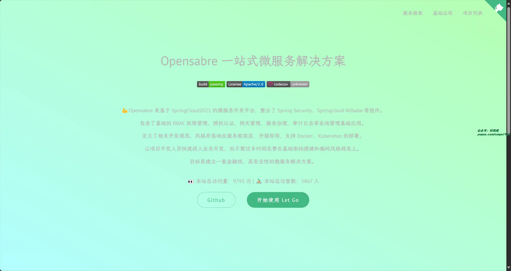
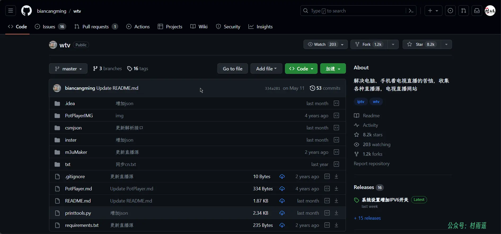
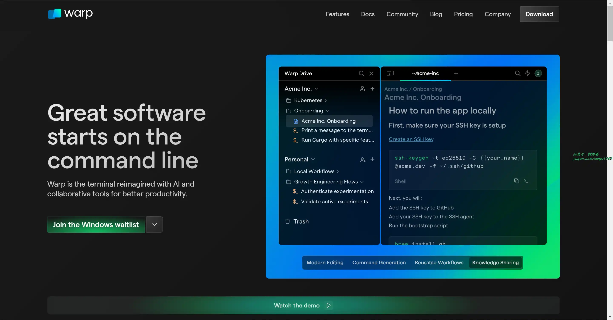
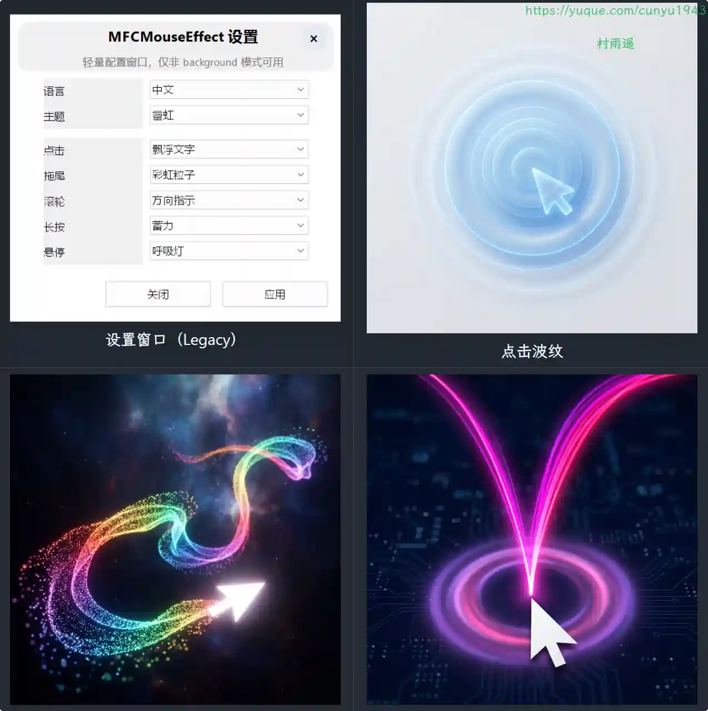
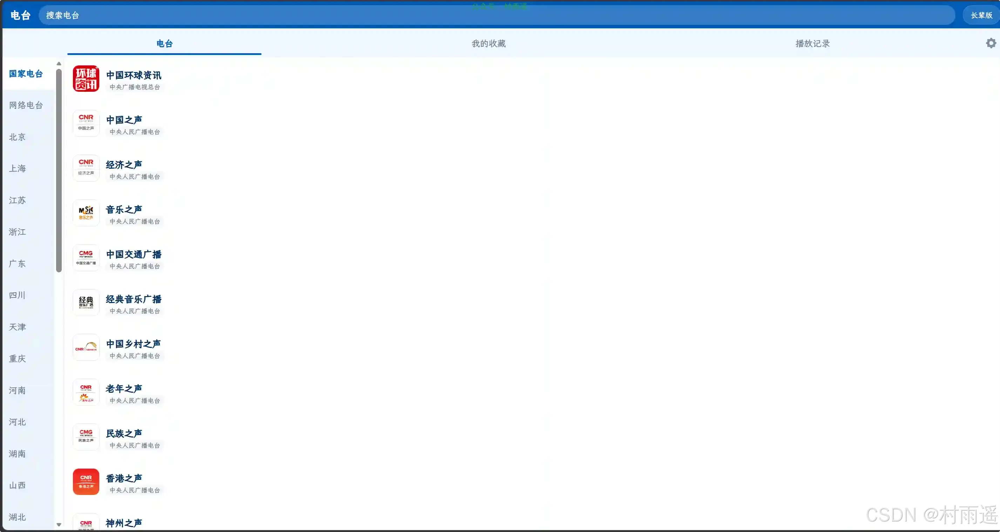
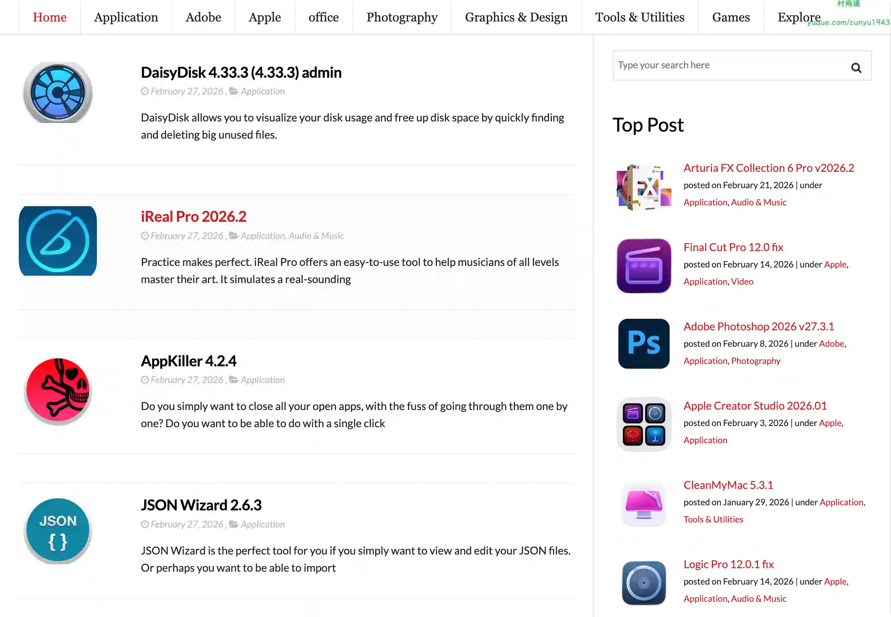
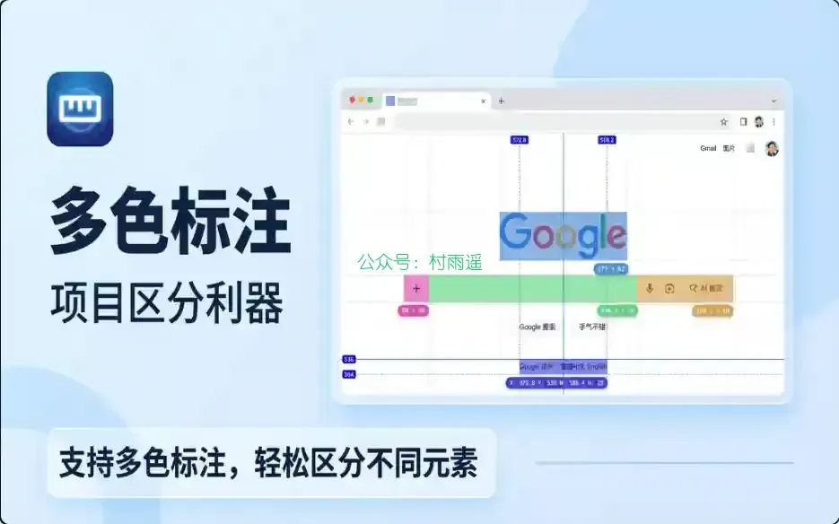
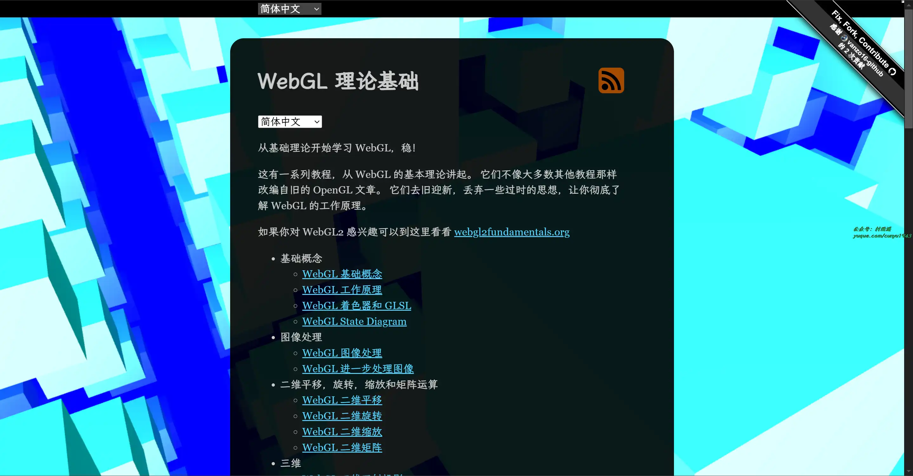
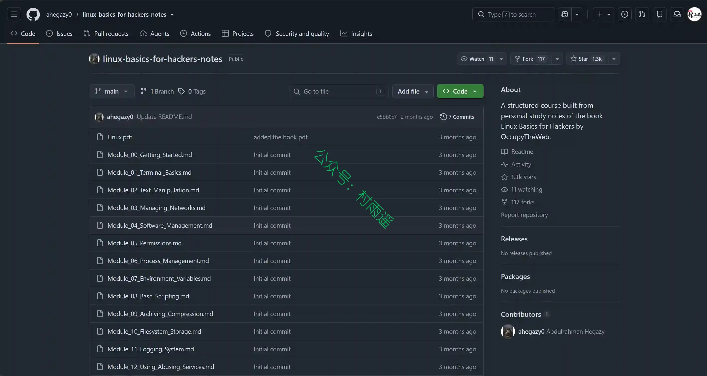
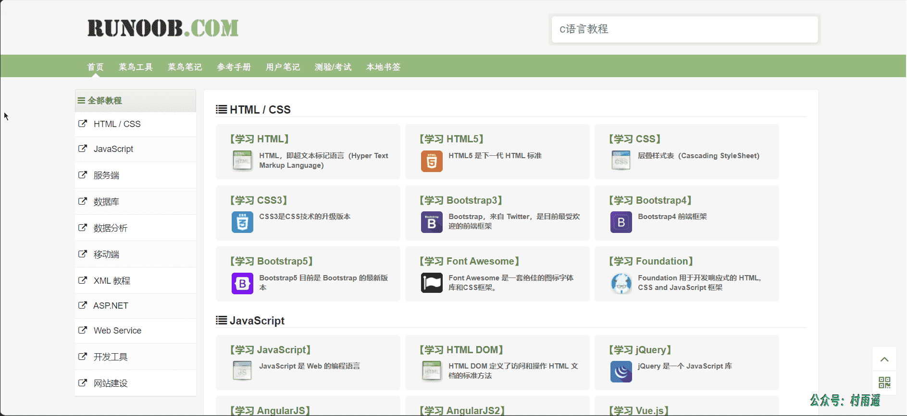

# 每日推荐 · 2026 年 11 月 13 日

> 作者：[村雨遥](https://github.com/cunyu1943)
> 
> 不要哀求，学会争取，若是如此，终有所获

## 🎈 号外 

最近，公众号之外，建立了微信交流群，不定期会在群里分享各种资源（影视、IT 编程、考试提升……）&知识。如果有需要，可以**扫码或者后台添加小编微信备注入群**。进群后**优先看群公告**，**呼叫群中【资源分享小助手】**，还能免费帮找资源哦～

## 一、项目

### 1. [Opensabre ](https://github.com/opensabre/opensabre-framework)

基于 SpringCloud2021 的微服务开发平台，整合了 Spring Security、Springcloud Alibaba 等组件。 包含了基础的 RBAC 权限管理、授权认证、网关管理、服务治理、审计日志等系统管理基础应用。 定义了相关开发规范、风格并落地在服务框架层，开箱即用，支持 Docker、Kubenetes 的部署。 让项目开发人员快速进入业务开发，而不需过多时间花费在基础架构搭建和编码风格规范上。 目标是建立一套金融级、高安全性的微服务解决方案。

### 2. [wtv](https://github.com/biancangming/wtv)

解决电脑、手机看电视直播的苦恼，收集各种直播源，电视直播网站。

最新 `IPTV` 直播源 `m3u8` 下载，电视直播网站推荐，以中文频道为主。

### 3. [PakePlus](https://github.com/Sjj1024/PakePlus)

轻松将任意网站/Vue/React 等项目构建为轻量级多端桌面应用和手机应用，仅需几分钟即可搞定。

## 二、软件

### 1. [Tai](https://github.com/Planshit/Tai)

在 Windows 上统计软件使用时长和网站浏览时长，帮助你了解自己把时间花在了什么地方，从而更好地做一些计划。或者，为了每周回顾自己的摸鱼成果。

### 2. [Warp](https://www.warp.dev/)

一个通过人工智能和协作工具重新设计的终端，能够有效提高生产效率。

### 3. [MFCMouseEffect](https://github.com/sqmw/MFCMouseEffect)

一款轻量、高性能的 Windows 桌面特效工具，为点击、拖尾、滚轮、长按、悬停提供实时视觉反馈（波纹、粒子、文字等）。

## 三、网站

### 1. [网络收音机](https://fm365.space)

网络收音机，在线即可收听全国各地的上千个 FM 广播电台。

### 2. [字体搬运工](https://font.sucai999.com)

一个免费公益性的字体网站，致力于收录可商用的免费字体。无需登录注册，随时随地都可以自由下载。

### 3. [Mac Torrents](https://www.torrentmac.net)

专为 macOS 用户打造的种子文件搜索引擎与下载平台。

## 四、插件

### 1. [Better Ruler](https://chromewebstore.google.com/detail/better-ruler/ilcnadaaninblgbekoaihdhoiecaflie)

一款网页测量工具，支持吸附测量。为前端开发和 UI 设计提供便利。

### 2. [TextCortex](https://chromewebstore.google.com/detail/textcortex：个人ai助手ai作家/hahkojdegblcccihngmgndhdfheheofe)

一款旨在了解您和您的写作需求的 AI 伴侣：它会主动提供有关如何使您的内容更真实的选项，并从头到尾在您的创作过程中为您提供帮助。是专业人士、营销人员、作家、开发人员和学生的理想选择。

### 3. [为什么你们就是不能加个空格呢？](https://chromewebstore.google.com/detail/为什么你们就是不能加个空格呢？/paphcfdffjnbcgkokihcdjliihicmbpd)

自动在网页中所有的中文字和半形的英文、数字、符号之间插入空白。

## 五、资料

### 1. [WebGL 理论基础](https://github.com/gfxfundamentals/webgl-fundamentals)

包含了 WebGL 的一系列教程，从 WebGL 的基本理论讲起。不像大多数其他教程那样改编自旧的 OpenGL 文章。内容去旧迎新，丢弃一些过时的思想，让你彻底了解 WebGL 的工作原理。

### 2. [Linux Basics for Hackers](https://github.com/ahegazy0/linux-basics-for-hackers-notes)

基于 OccupyTheWeb 所著书籍《黑客Linux基础》的个人学习笔记整理而成的结构化课程。每个模块都用通俗易懂的语言拆解核心概念、命令以及实操示例——对新手足够浅显易懂，内容详实也具备实际使用价值。

### 3. [菜鸟教程](https://www.runoob.com/)

菜鸟教程提供了编程的基础技术教程, 介绍了 `HTML`、`CSS`、`Javascript`、`Python`、`Java`、`Ruby`、`C`、`PHP`、`MySQL` 等各种编程语言的基础知识。

---

## ✍️ 说明

周刊专栏相关信息：

- **项目地址**：[Github](https://github.com/cunyu1943/weekly)，觉得不错麻烦给我一个**Star**，感谢 ❤️
- **浏览地址**：公众号 | [电子书](https://cunyu1943.github.io/weekly) | [语雀](https://yuque.com/cunyu1943/weekly) | [ima 知识库](https://ima.qq.com/wiki/?shareId=860487e32c6cc8d6c9070cd7f00caedf3cbf4102f695862d9c82f463b92417af)

如果你阅读到这里，说明我的工作没有白费。如果你想推荐项目/网站/软件/资源，欢迎提交 **[issue](https://github.com/cunyu1943/weekly/issues)** 或者添加我 **个人微信：coder_cunYu** 与我交流。

---

## ⏳ 联系

想解锁更多知识？不妨关注我的微信公众号：**村雨遥（id：JavaPark）**。

扫一扫，探索另一个全新的世界。

