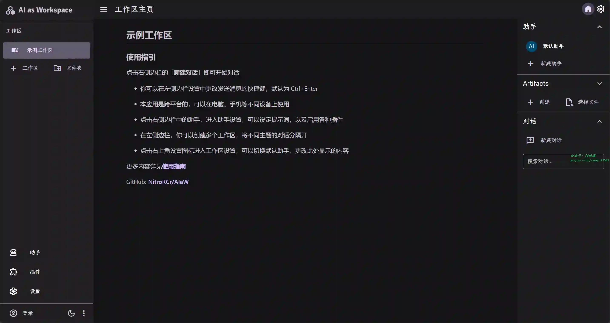
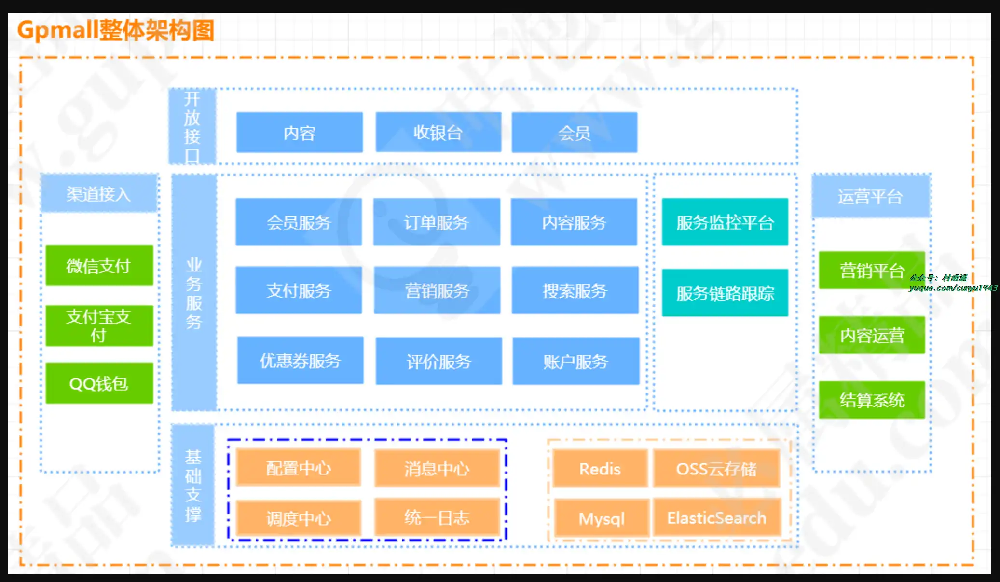
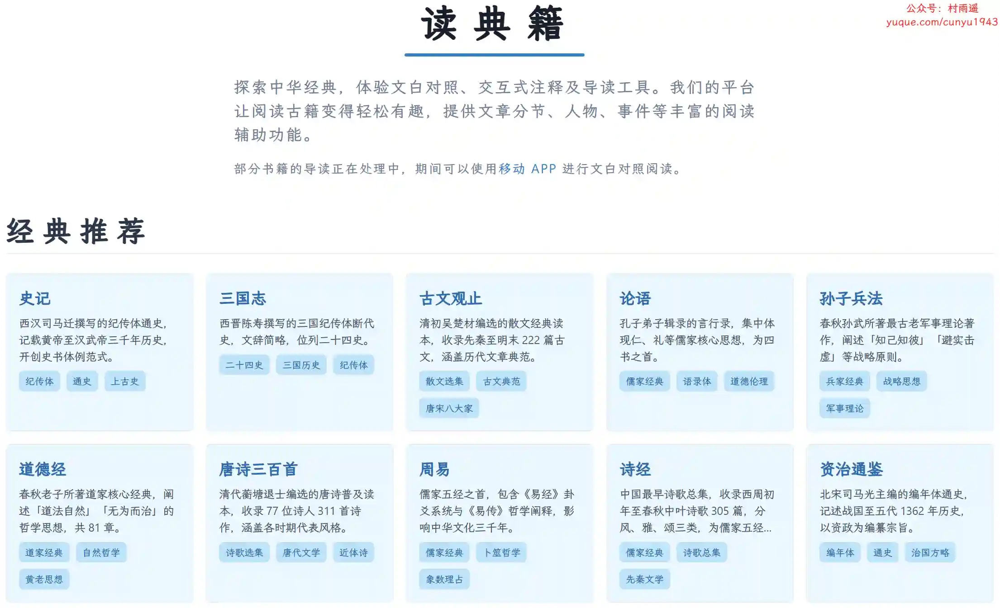
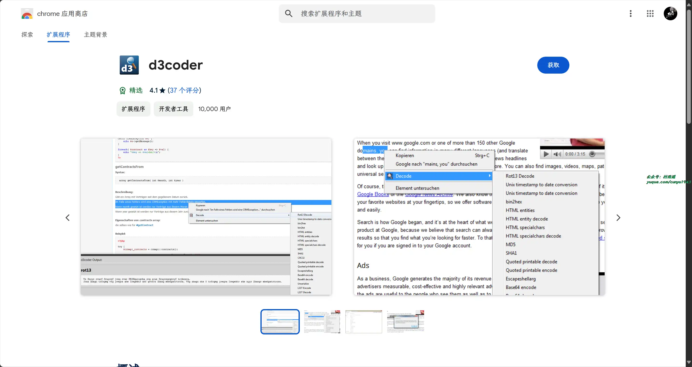
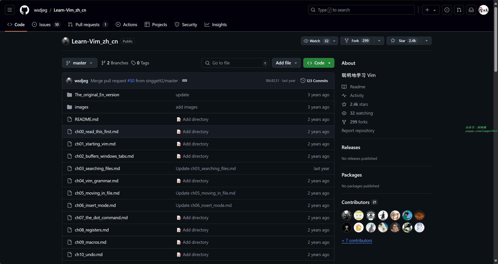
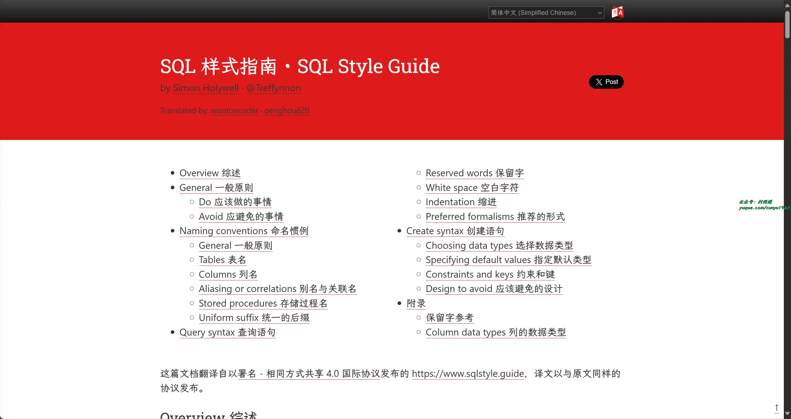
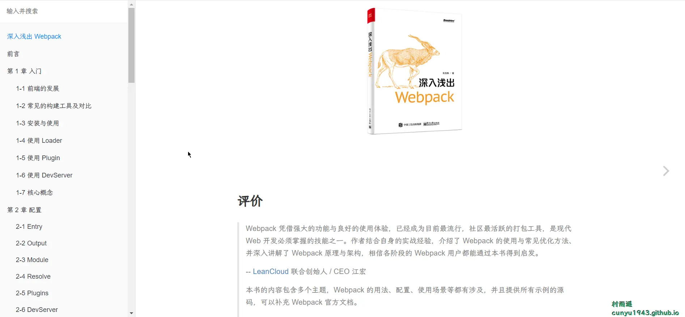

# 每日推荐 · 2026 年 11 月 28 日

> 作者：[村雨遥](https://github.com/cunyu1943)
> 
> 不要哀求，学会争取，若是如此，终有所获

## 🎈 号外 

最近，公众号之外，建立了微信交流群，不定期会在群里分享各种资源（影视、IT 编程、考试提升……）&知识。如果有需要，可以**扫码或者后台添加小编微信备注入群**。进群后**优先看群公告**，**呼叫群中【资源分享小助手】**，还能免费帮找资源哦～

## 一、项目

### 1. [Kirara AI](https://github.com/lss233/kirara-ai)

一款支持主流大语言模型、主流聊天平台的聊天的机器人！支持快速接入微信、 QQ、Telegram 等聊天平台。支持 DeepSeek、Grok、Claude、Ollama、Gemini、OpenAI 等大模型，具备工作流系统、网页搜索、AI 画图、人设调教、虚拟女仆、语音对话等功能。

### 2. [AI as Workspace](https://github.com/NitroRCr/AIaW)

精心设计的 AI (LLM) 客户端。 全功能，轻量级；支持多工作区、插件系统、跨平台、本地优先 + 实时云同步、Artifacts。

### 3. [咕泡学院](https://github.com/2227324689/gpmall)

基于 SpringBoot+Dubbo 构建的电商平台，包含了微服务架构、商城、电商、微服务、高并发、kafka、Elasticsearch 等一系列技术。

## 二、软件

### 1. [重启还原](https://www.huanyuan.cn)

一款免费的虚拟系统还原软件，不影响电脑性能，不占 CPU 使用率，真正做到零内存占用，全程使用无感知进入，虚拟系统速度和普通系统速度相差无几!

### 2. [Abu (阿布)](https://github.com/PM-Shawn/Abu-Cowork)

你的 AI 桌面办公搭子 — 交给阿布就行啦。本地运行的 AI 桌面办公助手，灵感来自 Claude Code 的 Cowork 模式。 你说需求，阿布干活 — 读文件、跑命令、写文档、做报表，全在本地完成。

### 3. [享咖小记](https://coffee-note.xiangshikeji.com/)

从咖啡豆、冲煮器具、研磨器三个基础数据再配合上冲煮过程中使用的各个器材的设置、水温、时长、注水量等参数，系统的记录下每一杯咖啡的冲煮过程。

## 三、网站

### 1. [官网下](https://guanwangxia.com)

官网下人工核验软件厂商的官方 HTTPS 下载来源，快速找到 Windows、macOS、Linux 和移动端软件的官方下载入口。

### 2. [RantBase](https://rantbase.app)

AI 驱动的 App Store 评论分析工具。查看任意应用的真实用户吐槽、缺失功能和实际问题。

### 3. [读典籍](https://dudianji.com)

提供丰富的中华经典阅读体验，包括文白对照、交互式注释及导读工具。平台让阅读古籍变得轻松有趣，提供文章分节、人物、事件等丰富的阅读辅助功能。

## 四、插件

### 1. [超级复制](https://chromewebstore.google.com/detail/supercopy-超级复制/onepmapfbjohnegdmfhndpefjkppbjkm)

在禁止复制、禁止右键、禁止选择的站点，一键复制，一键粘贴，一键选择，启用右键，启用复制，启用选择，启用粘贴。

主要特性：

1、一键破解 `js` 方式的禁止复制网站。

2、一键破解 `css` 方式的禁止复制网站。

3、具有记忆功能，下次打开相同页面自动破解禁止复制。

4、具有联想功能，打开同站点其他页面自动破解禁止复制。

### 2. [d3coder](https://chromewebstore.google.com/detail/d3coder/gncnbkghencmkfgeepfaonmegemakcol)

编码/解码插件，支持包括 base64，rot13 或 unix timestamp 编码的转换。

### 3. [Infinity Pro](https://microsoftedge.microsoft.com/addons/detail/infinity-新标签页-pro/hajlmbnnniemimmaehcefkamdadpjlfa?hl=zh-CN)

全球上百万用户选择的最佳新标签页，功能包括：网站图标，搜索引擎，高清壁纸，书签管理、天气、笔记、待办事项、扩展管理、历史记录等。
`Infinity` 新标签页 (`Pro`) 是一款基于 `html5` 开发的扩展程序，它能够替换浏览器的起始页与新标签页，提升其美观性与生产力。

`Infinity` 独创了多种强大且实用的功能，可以让您以任何喜欢的方式来打造新标签页。

## 五、资料

### 1. [Learn-Vim](https://github.com/wsdjeg/Learn-Vim_zh_cn)

Vim 学习之道翻译版本，初学者和高级用户均可适用。从简单的概念入手，然后落在特殊的、进阶的技巧上。

### 2. [SQL 样式指南](https://www.sqlstyle.guide/)

教你如何写出规范的 SQL 语句，用于规范项目中代码的一致性，使得代码简单、可读和易于维护，从一定程度上提高代码质量。

### 3. [深入浅出 Webpack](https://github.com/gwuhaolin/dive-into-webpack)

本书是国内第一本系统全面讲解 `Webpack` 的图书，涵盖了 `Webpack` 的入门、配置、实战、优化、原理。

-   第 1 章教你从 0 开始学会使用 `Webpack`；
-   第 2 章详细的讲解了 `Webpack` 提供的常用配置项；
-   第 3 章结合实际项目中常见的场景给出最佳实践；
-   第 4 章罗列出了各种优化 `Webpack` 的手段；
-   第 5 章剖析了 `Webpack` 原理以及如何开发 `Plugin` 和 `Loader`。

除了深入讲解 `Webpack`，本书还附带介绍了 `ES6`、`TypeScript`、`PostCSS`、`Prepack`、离线缓存、单页应用、`CDN` 等 `Web` 开发相关的技能。

无论是对 `Webpack` 一无所知的初学者，还是经验丰富的工程师，相信都能通过本书进一步提高对 `Webpack` 的理解，让你在 `Web` 开发中更加熟练的运用 `Webpack`。

## ✍️ 说明

周刊专栏相关信息：

- **项目地址**：[Github](https://github.com/cunyu1943/weekly)，觉得不错麻烦给我一个**Star**，感谢 ❤️
- **浏览地址**：公众号 | [电子书](https://cunyu1943.github.io/weekly) | [语雀](https://yuque.com/cunyu1943/weekly) | [ima 知识库](https://ima.qq.com/wiki/?shareId=860487e32c6cc8d6c9070cd7f00caedf3cbf4102f695862d9c82f463b92417af)

如果你阅读到这里，说明我的工作没有白费。如果你想推荐项目/网站/软件/资源，欢迎提交 **[issue](https://github.com/cunyu1943/weekly/issues)** 或者添加我 **个人微信：coder_cunYu** 与我交流。

---

## ⏳ 联系

想解锁更多知识？不妨关注我的微信公众号：**村雨遥（id：JavaPark）**。

扫一扫，探索另一个全新的世界。

