# 每日推荐 · 2026 年 11 月 21 日

> 作者：[村雨遥](https://github.com/cunyu1943)
> 
> 不要哀求，学会争取，若是如此，终有所获

## 🎈 号外 

最近，公众号之外，建立了微信交流群，不定期会在群里分享各种资源（影视、IT 编程、考试提升……）&知识。如果有需要，可以**扫码或者后台添加小编微信备注入群**。进群后**优先看群公告**，**呼叫群中【资源分享小助手】**，还能免费帮找资源哦～

## 一、项目

### 1. [book-to-skill](https://github.com/virgiliojr94/book-to-skill)

将任意技术类书籍PDF转化为Claude Code技能，可随时用于学习、查阅以及工作实操。

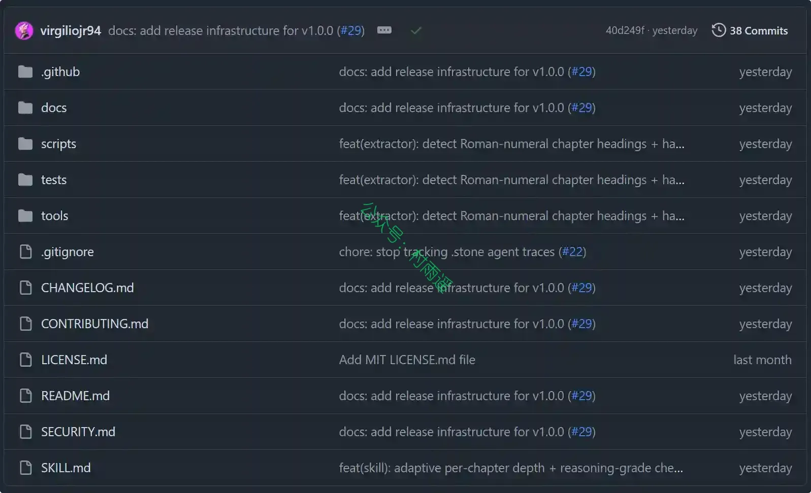

### 2. [SQLE](https://github.com/actiontech/sqle)

一个支持多种不同类型数据库，覆盖事前控制、事后监督、标准发布场景，帮助您建立质量规范的 SQL 全生命周期质量管理平台。

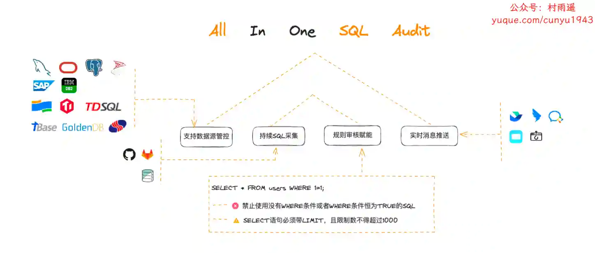

### 3. [一个字的一生](https://github.com/Ivan666jjj/yigezi)

展示了一个字从甲骨文 → 小篆 → 繁体 → 简体的演变过程，看一个汉字三千年中的样子。

## 二、软件

### 1. [千问输入法](https://ime.qianwen.com)

阿里出品的语音输入法，最快 300 字 / 分，AI 自动润色，说话秒变工整文字。支持 9 种方言，纯净无广告。

### 2. [Cursor](https://www.cursor.com/)

基于 GPT3.5 的 AI 代码编辑器，支持智能编码、聊天、自动生成测试和注释、查看代码 Diff 等功能。

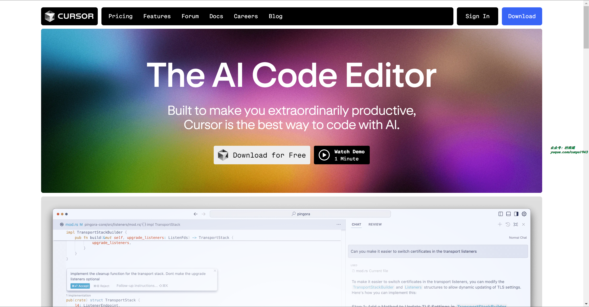

### 3. [Moeli 阅读](https://reader.moeli.top)

一款多功能本地书籍阅读软件，支持多种功能，提供完善的阅读体验。

## 三、网站

### 1. [HDQwalls](https://hdqwalls.com/)

高质量壁纸汇聚地，有 `4K`、`5K`、`8K` 等清晰度的壁纸下载，而且完全免费，更有各种尺寸壁纸供你选择。

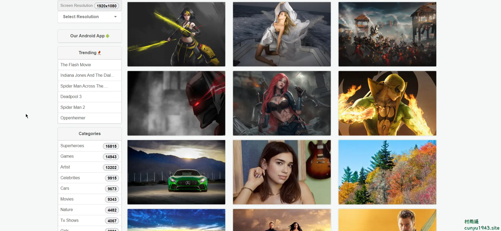

### 2. [发票提取助手](https://airegex.cn)

在线的免费的发票提取工具，支持电子发票一键批量提取到 Excel 表中。

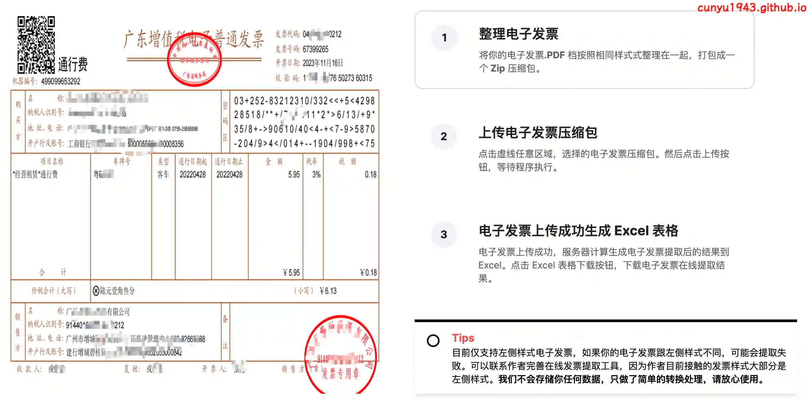

### 3. [cvbee.ai](https://cvbee.ai/zh-CN)

您的智能简历助手，使用 AI 技术，轻松创建、优化您的简历，为你的求职保驾护航。

## 四、插件

### 1. [极速翻译](https://chromewebstore.google.com/detail/极速翻译/pmjagijikomfjjoafjbdeojcinngkcpe?hl=zh-CN)

一款专业的翻译扩展，支持划词翻译、全文翻译、在线翻译、截图翻译、翻译发音，修复谷歌翻译在中国大陆无法使用的问题，自动识别语言，支持上百种语言互译，帮助用户无障碍阅读外文文献。

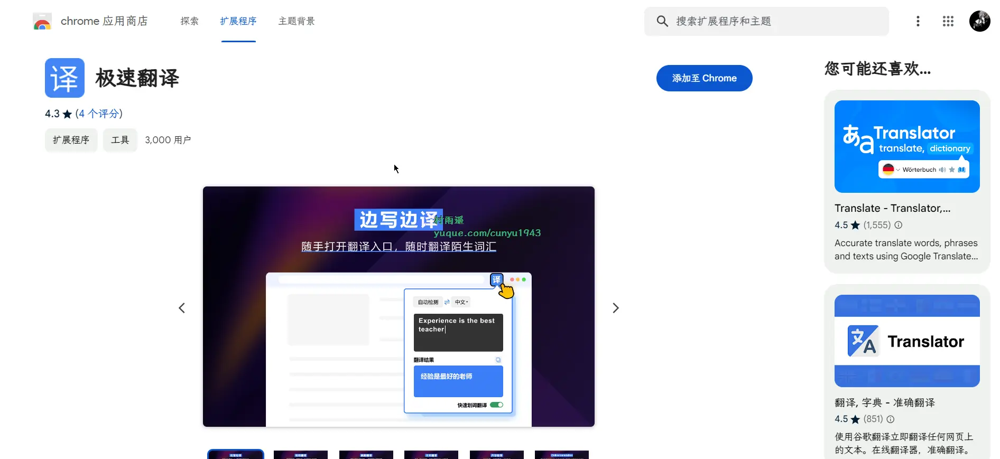

### 2. [在云端](https://chromewebstore.google.com/detail/在云端-ai-阅读助手/icdjfbhmnnheggmifcelflcdpnbdcnfm)

由阿里云开发者社区的一群开发者设计开发的一款多功能浏览器插件。新标签页美，体现了摄影美学、专注力以及先进云技术资讯。我们力求可以通过这项工作使得大家在这个快节奏信息爆炸的时代可以保持领先的同时获得内心的一份平静与祥和。AI 阅读助手采用通义前文大语言模型协助用户进行日常网页浏览，高效获取信息。

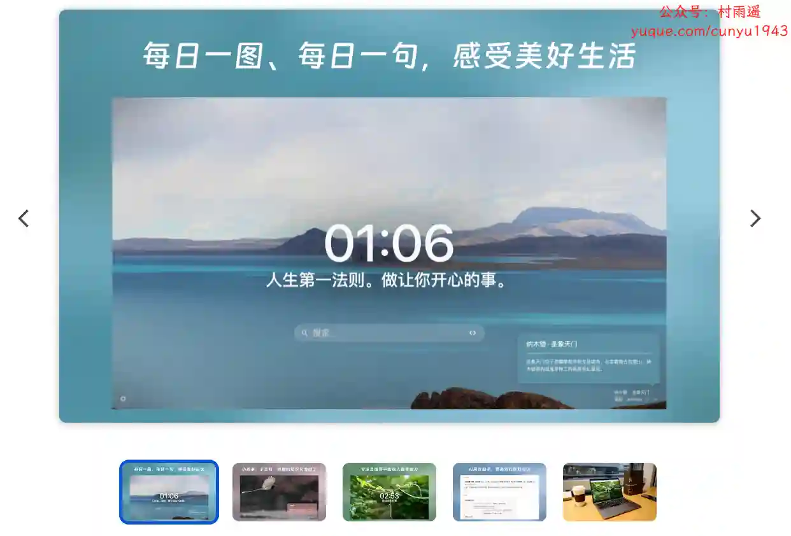

### 3. [歪脖子新标签页](https://chromewebstore.google.com/detail/ackimleclkemolnfcfajficenpbnaiba)

一款可以预防颈椎病的新标签页扩展。具有如下功能：

- 活动脖子，预防颈椎病
- 三种模式支持，强度自己选择
- 休息日指南，快速知晓下一个休息日
- 当季蔬果提示，健康饮食每一天
- 历史上的今天，回顾历史长河

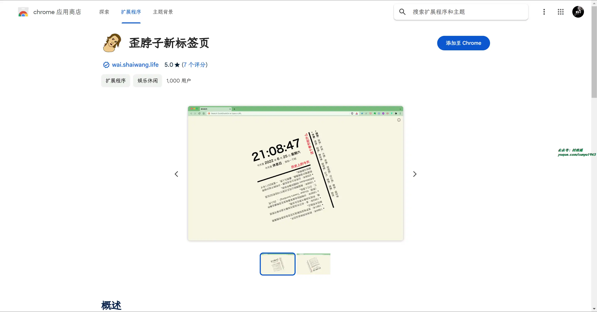

## 五、资料

### 1. [JavaScript 工程师的 Python 指南](https://github.com/luckrnx09/python-guide-for-javascript-engineers)

一本基于 `abook` 编写的开源电子书，涵盖了从 `Python` 环境安装到项目开发的方方面面。本书通过大量案例对比 `JavaScript` 和 `Python` 语言的异同，帮助 `JavaScript` 工程师快速掌握 `Python` 语言。

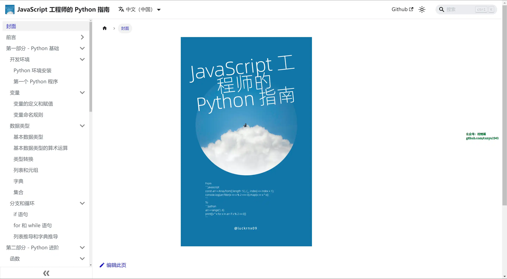

### 2. [Effective-Resouirces](https://github.com/wususu/effective-resourses)

学习资源合集，主要包含大数据、Java、Python、JavaScript、PHP、网络、数据库、Linux 等方面的优秀博客、论文、电子书等资源。

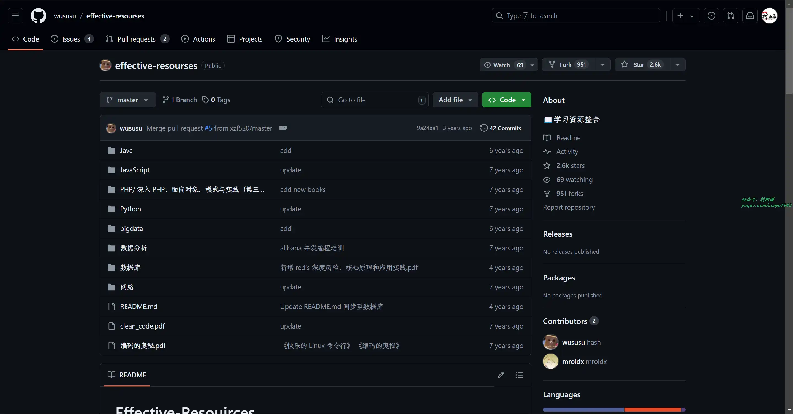

### 3. [掘金翻译计划](https://github.com/xitu/gold-miner)

可能是世界最大最好的英译中技术社区，最懂读者和译者的翻译平台。

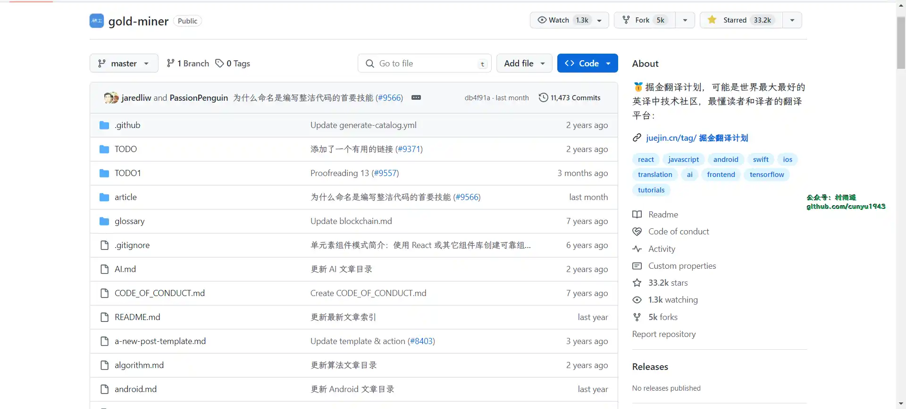

## ✍️ 说明

周刊专栏相关信息：

- **项目地址**：[Github](https://github.com/cunyu1943/weekly)，觉得不错麻烦给我一个**Star**，感谢 ❤️
- **浏览地址**：公众号 | [电子书](https://cunyu1943.github.io/weekly) | [语雀](https://yuque.com/cunyu1943/weekly) | [ima 知识库](https://ima.qq.com/wiki/?shareId=860487e32c6cc8d6c9070cd7f00caedf3cbf4102f695862d9c82f463b92417af)

如果你阅读到这里，说明我的工作没有白费。如果你想推荐项目/网站/软件/资源，欢迎提交 **[issue](https://github.com/cunyu1943/weekly/issues)** 或者添加我 **个人微信：coder_cunYu** 与我交流。

---

## ⏳ 联系

想解锁更多知识？不妨关注我的微信公众号：**村雨遥（id：JavaPark）**。

扫一扫，探索另一个全新的世界。

