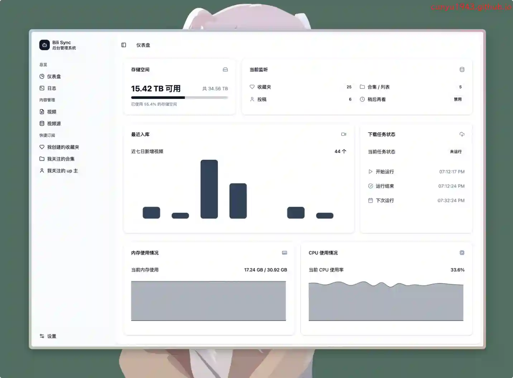
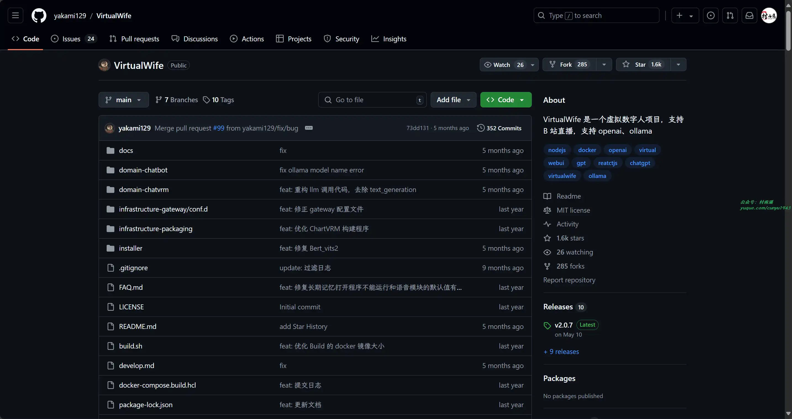
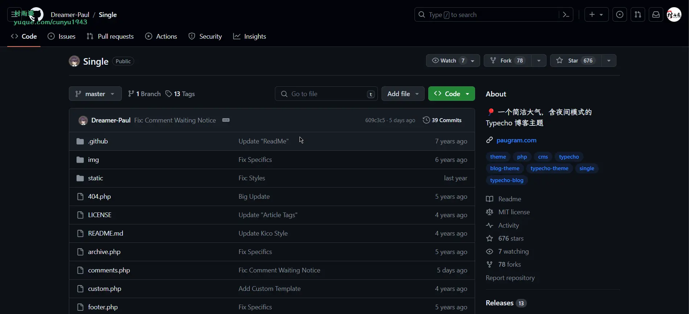
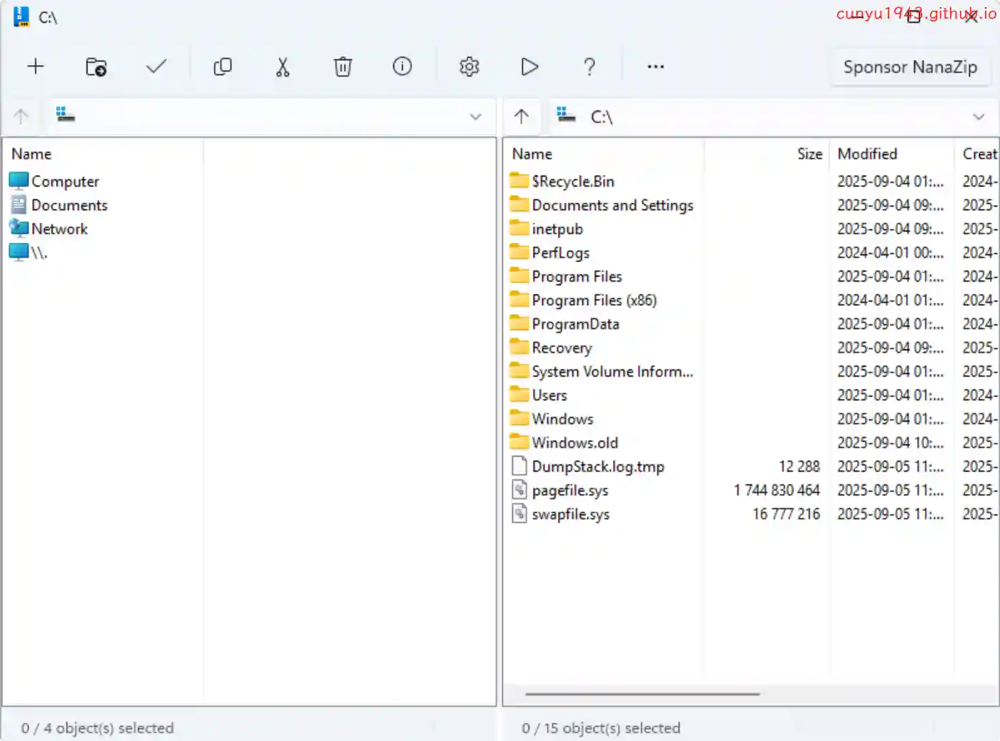
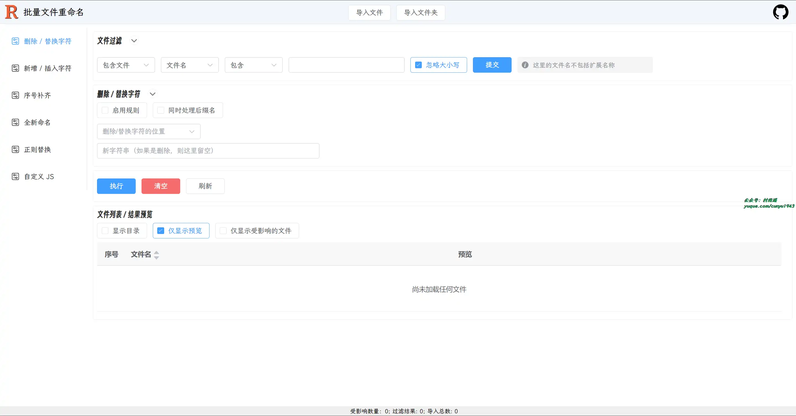
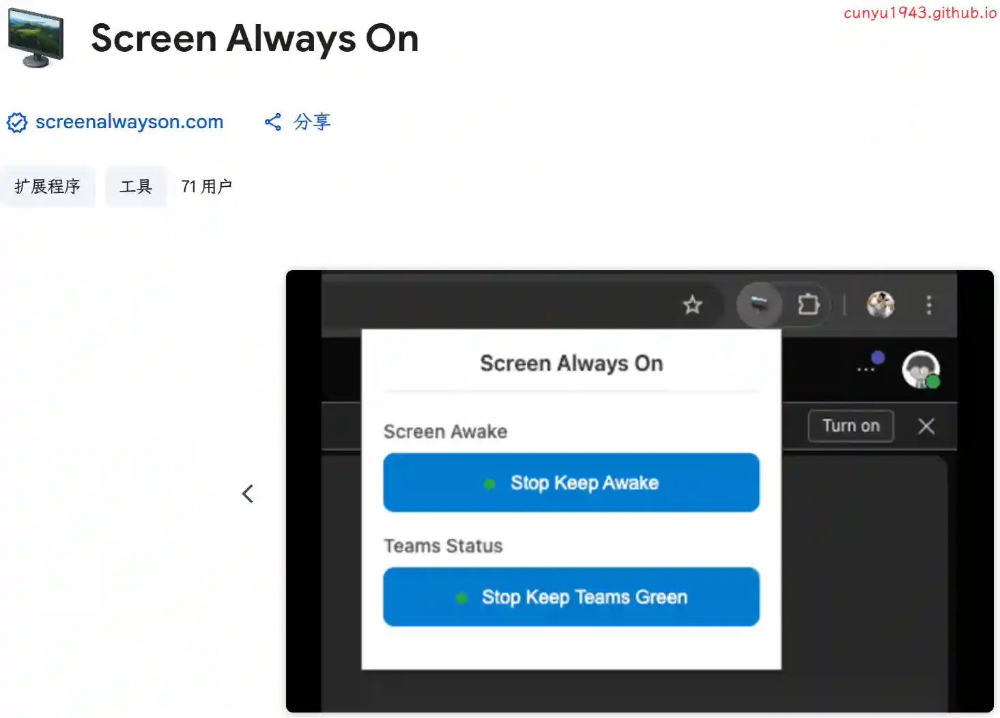
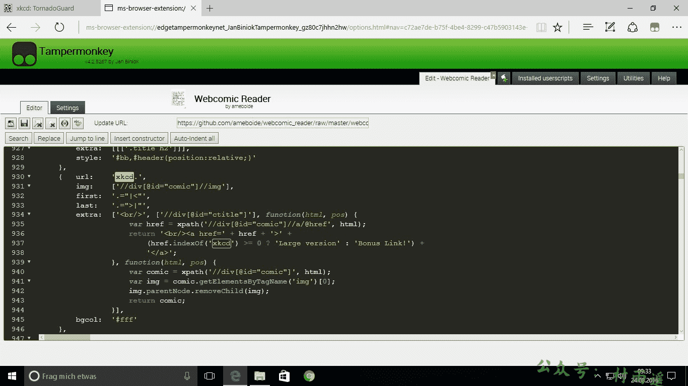
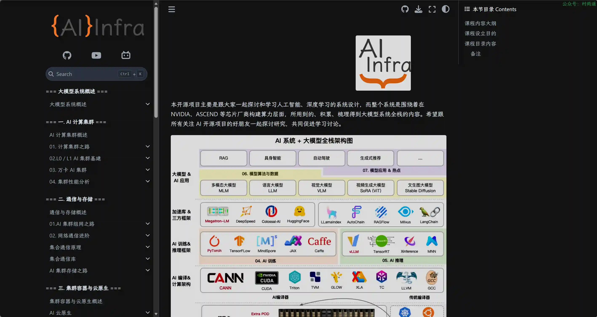
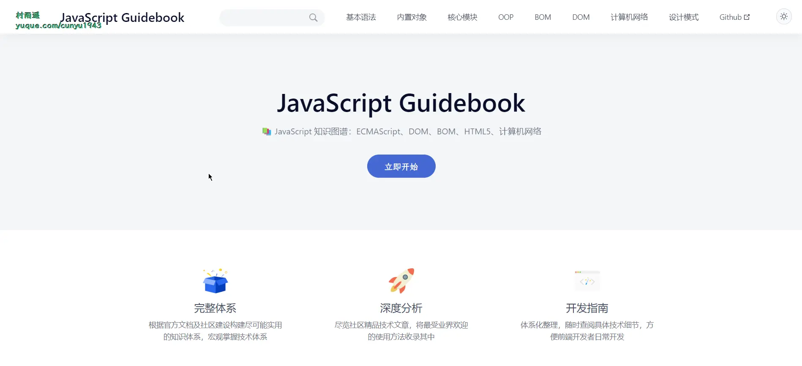
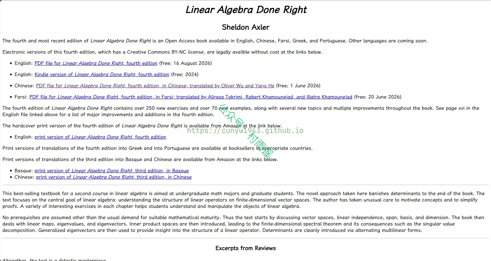

# 每日推荐 · 2026 年 11 月 19 日

> 作者：[村雨遥](https://github.com/cunyu1943)
> 
> 不要哀求，学会争取，若是如此，终有所获

## 🎈 号外 

最近，公众号之外，建立了微信交流群，不定期会在群里分享各种资源（影视、IT 编程、考试提升……）&知识。如果有需要，可以**扫码或者后台添加小编微信备注入群**。进群后**优先看群公告**，**呼叫群中【资源分享小助手】**，还能免费帮找资源哦～

## 一、项目

### 1. [bili-sync](https://github.com/amtoaer/bili-sync)

一款专为 NAS 用户编写的哔哩哔哩同步工具，由 Rust & Tokio 驱动。

### 2. [VirtualWife](https://github.com/yakami129/VirtualWife)

一个虚拟数字人项目，支持 B 站直播，支持 Openai、ollama。具有以下特点：

- 支持一键通过 Docker 快速部署
- 支持在 Linux/Windows/MacOS 系统进行部署
- 支持自定义角色设定
- 支持更换角色模型，可从 VRM 模型市场 Vroid 下载
- 支持长短期记忆功能
- 支持多 LLM 模型切换，并且支持私有化模型（ollama），具体使用说明请查阅 FAQ
- 支持文字驱动表情，文字驱动动作
- 支持 B 站进行直播，具体使用说明请查阅 FAQ
- 支持通过中文进行语音对话
- 支持 Edge（微软）、Bert-VITS2 语音切换
- 流式传输数据，拥有更快的响应速度

### 3. [Single](https://github.com/Dreamer-Paul/Single)

一个简洁大气，含夜间模式的 Typecho 博客主题。具有简洁大气、夜间模式、文章目录、图片灯箱、代码高亮、平滑滚动、无 JQ 库的特点。

## 二、软件

### 1. [Fiime 浏览器](https://lite.fiime.cn)

更低内存占用、更优 CPU 调度、更顺滑的透明化窗口体验。支持 Chrome 书签导入、窗口置顶等桌面级能力。

### 2. [Worktile](https://worktile.com/)

深度整合项目与任务管理、`OKR`、网盘、在线沟通等应用，支持丰富的自定义功能，满足各行业各场景的个性化工作需求，助力企业提高管理效能。

### 3. [NanaZip](https://github.com/M2Team/NanaZip)

基于 7-zip 开发的解压软件，更适合 Windows 11，UI 更加现代化！

## 三、网站

### 1. [EZ 在线工具箱](https://ezwebtools.net)

新一代网页版视频处理解决方案，一键解析、转换、播放，免下载的极速视频处理体验，无需下载，轻松快捷！

### 2. [PPTer 吧](https://www.ppter8.com/)

提供免费 `PPT` 模板、`PPT` 课件及国外 `PPT` 模版，相关 `PPT` 素材全部免费（`PNG` 免抠图、`PPT` 背景图片、`PPT` 专用的背景音乐、3D 模型、图标）。这里的 `PPT` 模板免费下载，致力成为受 `PPTer` 喜爱的 `PPT` 模板网站。

### 3. [在线文件批量重命名工具](https://github.com/JasonGrass/rename)

提供常用的文件批量重命名操作，无需下载安装，即用即走。

## 四、插件

### 1. [Screen Always On](https://chromewebstore.google.com/detail/screen-always-on/jejajoajhlohemcppmakjilhcnmabdel?utm_source=item-share-cb)

保持 Teams 常绿，让你在家 / 远程工作和办公室摸鱼小憩时无忧。同时保持屏幕常亮不休眠，防止屏幕锁定和自动睡眠，确保工作流程不被中断。

### 2. [JetBrains Grazie](https://chromewebstore.google.com/detail/jetbrains-grazie-ai-writi/fonaoompfjljjllgccccgjnhnoghohgc)

Grazie 是一款面向科技专业人士的人工智能写作助手，由 JetBrains 开发支撑，帮助你提高你的写作与校对，摘要，自动完成，重新措辞的能力。

### 3. [Tampermonkey](https://microsoftedge.microsoft.com/addons/detail/tampermonkey/iikmkjmpaadaobahmlepeloendndfphd)

中文名又叫油猴，是一个用户脚本管理器。它本身是无法为我们发挥什么作用的，它主要依靠各大社区编写的扩展脚本（`JavaScript` 代码）运行在浏览器上，来改变被访问网页的功能，提升我们的网页浏览体验 。

## 五、资料

### 1. [AIInfra](https://github.com/Infrasys-AI/AIInfra)

跟大家一起探讨和学习人工智能、深度学习的系统设计，而整个系统是围绕着在 NVIDIA、ASCEND 等芯片厂商构建算力层面，所用到的、积累、梳理得到大模型系统全栈的内容。

### 2. [JavaScript Guidebook](https://github.com/tsejx/javascript-guidebook)

JavaScript 前端知识图谱，整理自各大技术社区和权威书籍的前端技术图谱。

### 3. [线性代数应该这样学](https://linear.axler.net)

《线性代数应该这样学》第四版，新增 250 + 习题、70 + 示例，加入若干新主题，全书多处内容优化。面向数学专业本科生与研究生，适合线性代数进阶课程。

## ✍️ 说明

周刊专栏相关信息：

- **项目地址**：[Github](https://github.com/cunyu1943/weekly)，觉得不错麻烦给我一个**Star**，感谢 ❤️
- **浏览地址**：公众号 | [电子书](https://cunyu1943.github.io/weekly) | [语雀](https://yuque.com/cunyu1943/weekly) | [ima 知识库](https://ima.qq.com/wiki/?shareId=860487e32c6cc8d6c9070cd7f00caedf3cbf4102f695862d9c82f463b92417af)

如果你阅读到这里，说明我的工作没有白费。如果你想推荐项目/网站/软件/资源，欢迎提交 **[issue](https://github.com/cunyu1943/weekly/issues)** 或者添加我 **个人微信：coder_cunYu** 与我交流。

---

## ⏳ 联系

想解锁更多知识？不妨关注我的微信公众号：**村雨遥（id：JavaPark）**。

扫一扫，探索另一个全新的世界。

