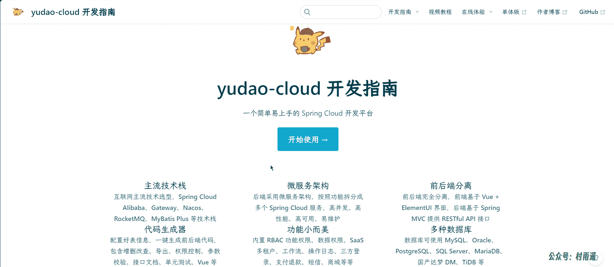
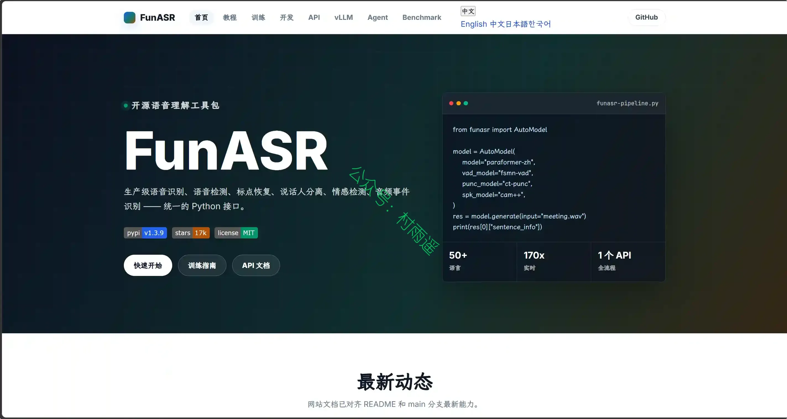
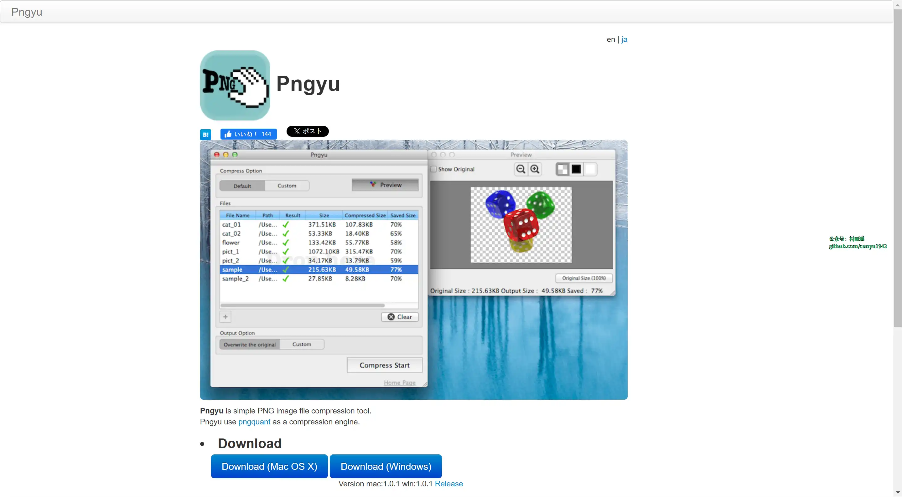
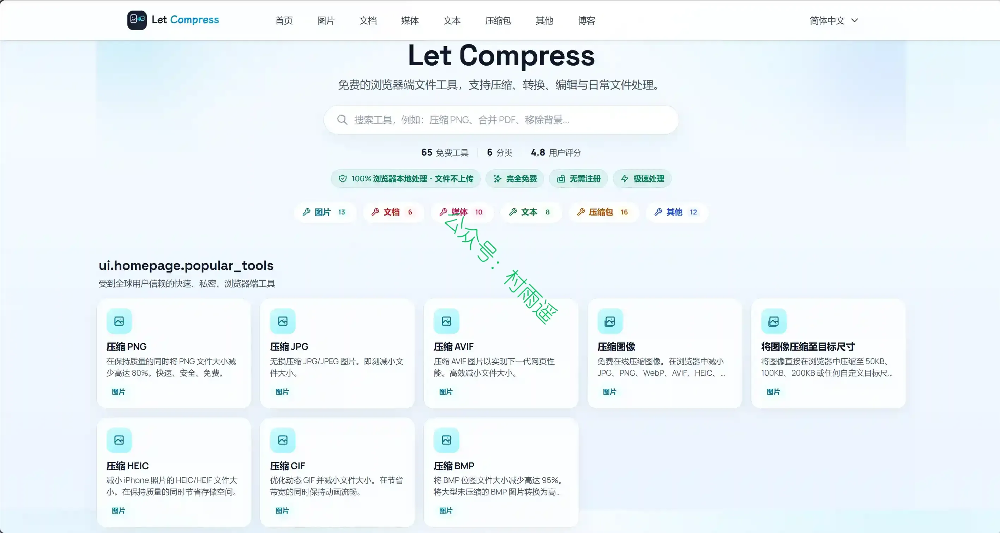
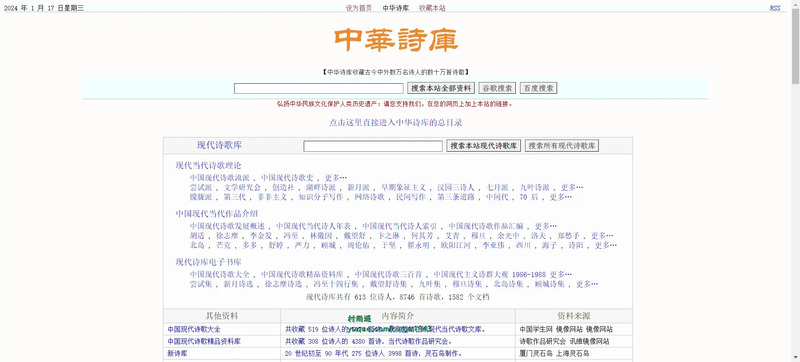
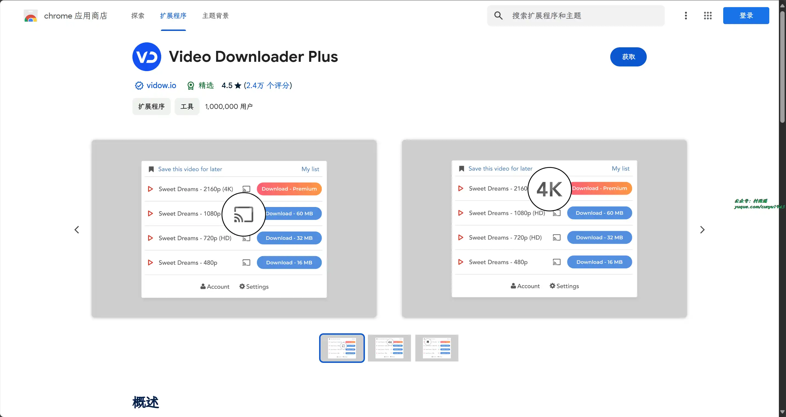
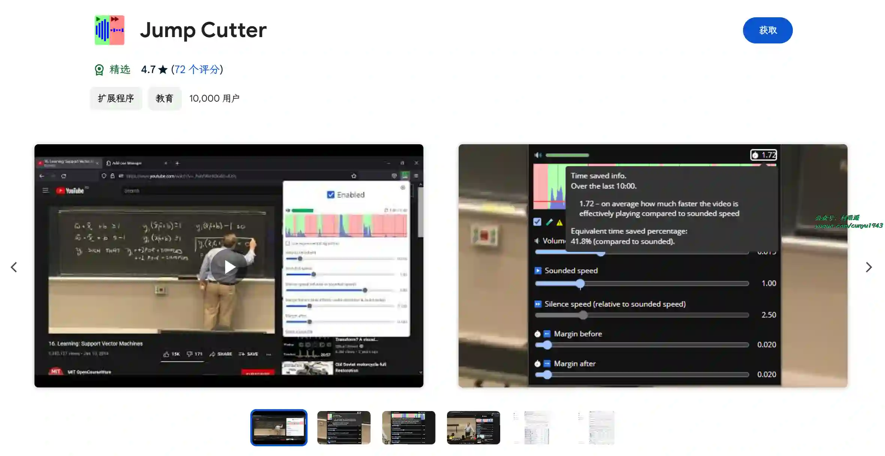
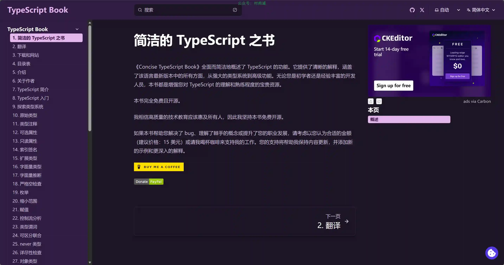
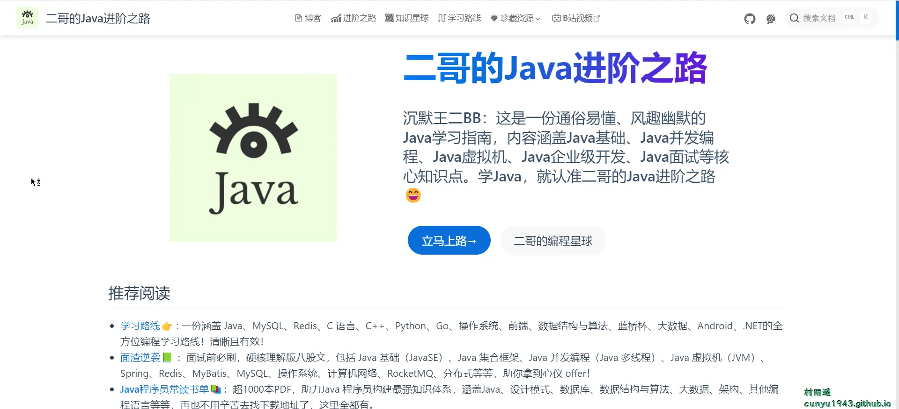

# 每日推荐 · 2026 年 11 月 20 日

> 作者：[村雨遥](https://github.com/cunyu1943)
> 
> 不要哀求，学会争取，若是如此，终有所获

## 🎈 号外 

最近，公众号之外，建立了微信交流群，不定期会在群里分享各种资源（影视、IT 编程、考试提升……）&知识。如果有需要，可以**扫码或者后台添加小编微信备注入群**。进群后**优先看群公告**，**呼叫群中【资源分享小助手】**，还能免费帮找资源哦～

## 一、项目

### 1. [菠萝博客](https://github.com/adlered/bolo-solo)

基于 Java 的菠萝博客系统，简单易部署，精致主题，贴心服务，专为程序员设计。

### 2. [yudao-cloud](https://github.com/YunaiV/yudao-cloud)

`ruoyi-vue-pro` 全新 `Cloud` 版本，优化重构所有功能。基于 `Spring Cloud Alibaba + MyBatis Plus + Vue & Element` 实现的后台管理系统 + 用户小程序，支持 `RBAC` 动态权限、多租户、数据权限、工作流、三方登录、支付、短信、商城等功能。

### 3. [FunASR](https://github.com/modelscope/FunASR)

开源语音理解工具包，支持生产级语音识别、语音检测、标点恢复、说话人分离、情感检测、音频事件识别。

## 二、软件

### 1. [字由](https://www.hellofont.cn/)

免费的字体管理工具，为您提供 900+ 字体免费商用，支持在 PS、AI、ID、XD、Figma、Sketch、CDR 等设计软件中一键应用字体，提供 AI 识字、字体特效等实用功能，为您的设计提质加速。

### 2. [Pngyu](https://nukesaq88.github.io/Pngyu/)

免费 `png` 图片压缩工具，同时支持 `Windows` 和 `macOS` 平台。

### 3. [Leawo 免费屏幕录像机](https://www.leawo.org/zh-CN/free-screen-recorder/)

免费屏幕录像机组合，可记录屏幕活动、记录网络摄像头内容、记录系统声音和/或麦克风声音，以保存为屏幕截图、音频和/或最多 4K 免费无水印的屏幕录制视频。

## 三、网站

### 1. [唐韵诗词](https://www.chinesepoems.org/)

探索中国古典诗词之美，提供诗词，古书等内容的赏析、注释、翻译，在线学习中国传统诗词文化。

### 2. [LetCompress](https://letcompress.com)

免费在线压缩、转换、编辑和优化文件。支持图片、PDF、媒体、文本和压缩包，所有处理都在浏览器中完成，文件不会离开您的设备。无需注册、无需上传，可不限次数使用。

### 3. [中华诗库](http://www.shiku.org/)

中华诗库是免费提供中国诗歌作品的网络资料库及在线阅读公益图书馆。收藏有古今中外数万名诗人的数十万首诗歌作品。

## 四、插件

### 1. [Video Downloader Plus](https://chromewebstore.google.com/detail/video-downloader-plus/hkdmdpdhfaamhgaojpelccmeehpfljgf)

下载视频的最佳方式，无广告，简单快捷。允许从许多热门视频网站下载高清、标清及 4K 的多个版本。

### 2. [Jump Cutter](https://chromewebstore.google.com/detail/jump-cutter/lmppdpldfpfdlipofacekcfleacbbncp)

通过缩短句子之间的停顿时间，加快语速，从而提高观看讲座的速度。

### 3. [Gmail 重复发送邮件](https://chromewebstore.google.com/detail/gmail重复发送邮件/nfkkaahokibjkbmoieakdcihjkifhfdo)

一款注重隐私的 Chrome 扩展，允许您通过 Gmail 延迟发送您的邮件，一次或每 X 个小时/天/月/年重复发送。无追踪、无广告、无横幅和无臃肿软件。

## 五、资料

### 1. [TypeScript 简洁之书](https://github.com/gibbok/typescript-book)

全面而简洁地概述了 TypeScript 的功能。它提供了清晰的解释，涵盖了该语言最新版本中的所有方面，从强大的类型系统到高级功能。无论您是初学者还是经验丰富的开发人员，本书都是增强您对 TypeScript 的理解和熟练程度的宝贵资源。

### 2. [Go 语言爱好者周刊](https://github.com/polaris1119/golangweekly)

随着 Go 受到越来越多的关注，相关的文章、软件、资源也越来越多。Go 语言爱好者周刊旨在为大家分享一周值得了解、学习的 Go 语言相关内容。每周日发布。

周刊自 2019 年开始发布，截止目前已经持续到了 198 期。

### 3. [toBeBetterJavaer](https://github.com/itwanger/toBeBetterJavaer)

一份通俗易懂、风趣幽默的 `Java` 学习指南，内容涵盖 `Java` 基础、`Java` 并发编程、`Java` 虚拟机、`Java` 企业级开发、`Java` 面试等核心知识点。

## ✍️ 说明

周刊专栏相关信息：

- **项目地址**：[Github](https://github.com/cunyu1943/weekly)，觉得不错麻烦给我一个**Star**，感谢 ❤️
- **浏览地址**：公众号 | [电子书](https://cunyu1943.github.io/weekly) | [语雀](https://yuque.com/cunyu1943/weekly) | [ima 知识库](https://ima.qq.com/wiki/?shareId=860487e32c6cc8d6c9070cd7f00caedf3cbf4102f695862d9c82f463b92417af)

如果你阅读到这里，说明我的工作没有白费。如果你想推荐项目/网站/软件/资源，欢迎提交 **[issue](https://github.com/cunyu1943/weekly/issues)** 或者添加我 **个人微信：coder_cunYu** 与我交流。

---

## ⏳ 联系

想解锁更多知识？不妨关注我的微信公众号：**村雨遥（id：JavaPark）**。

扫一扫，探索另一个全新的世界。

