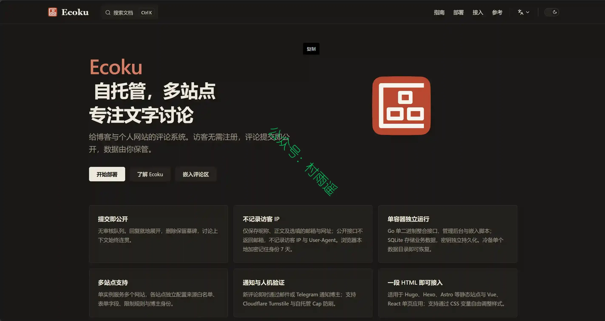
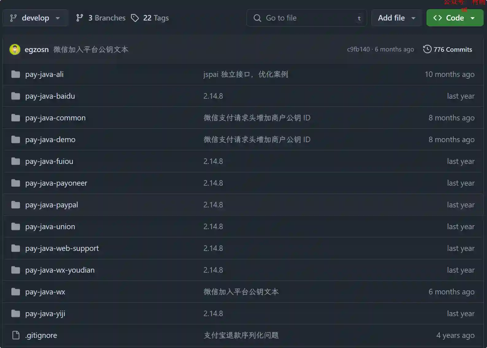
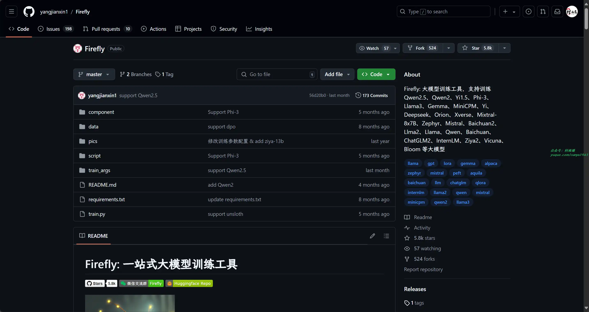
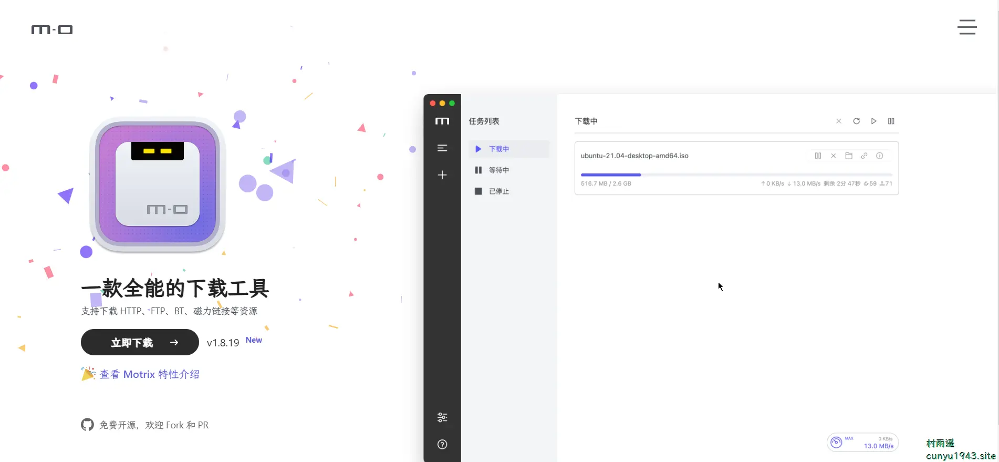
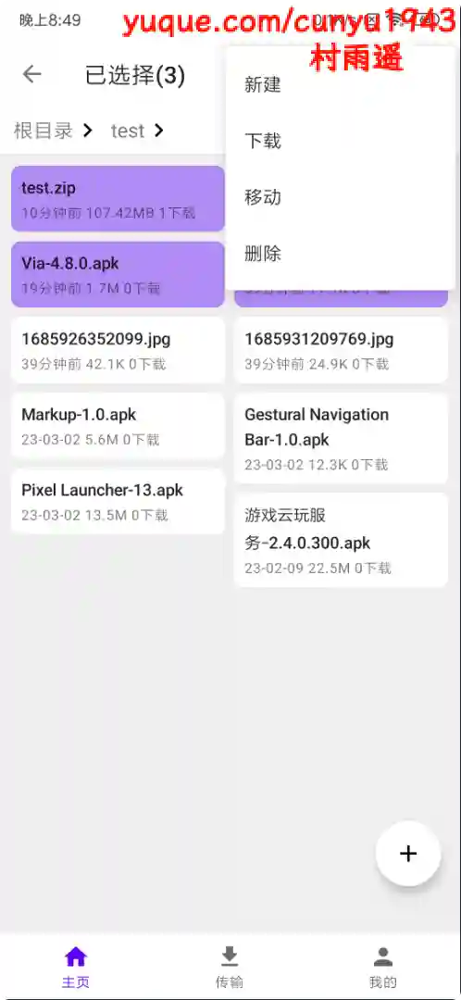
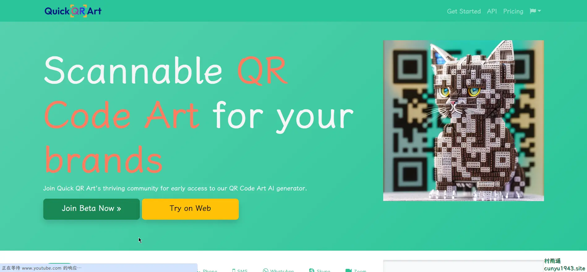
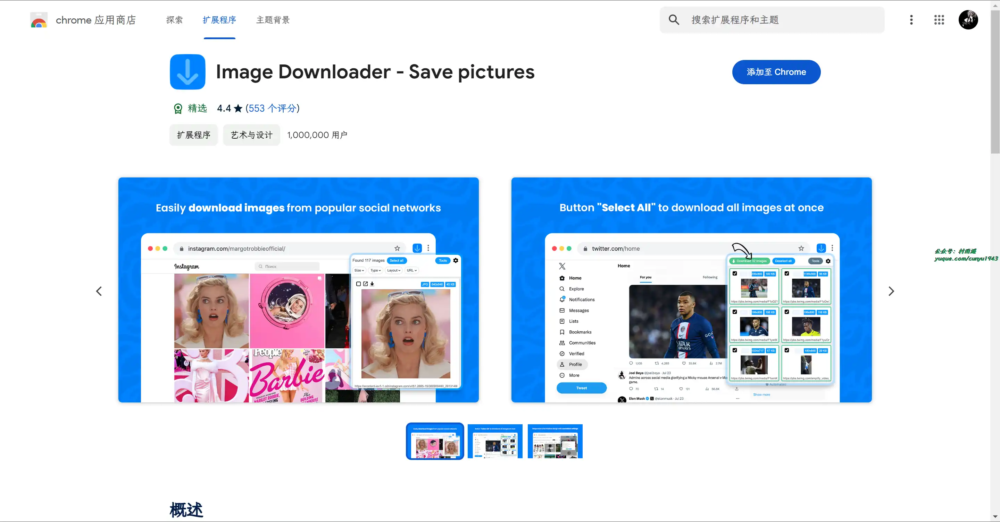
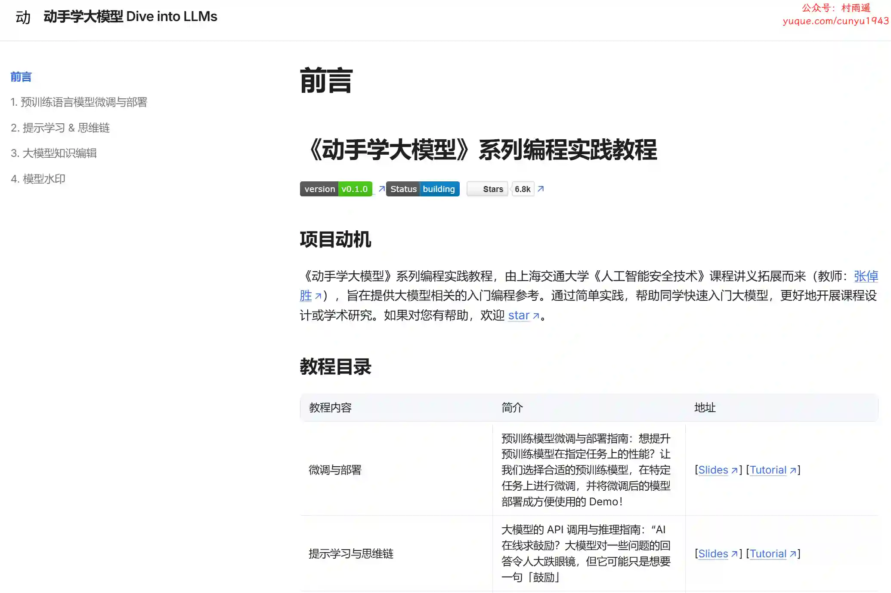
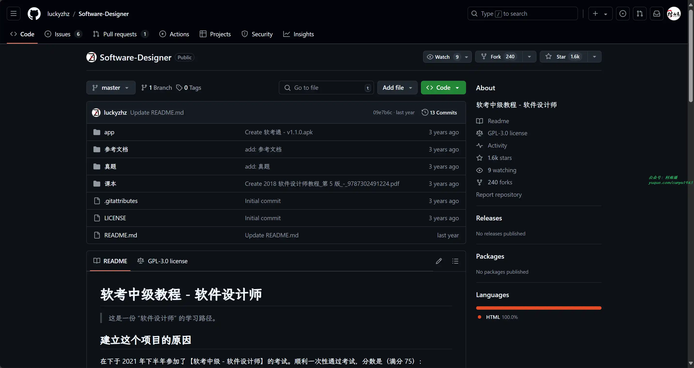
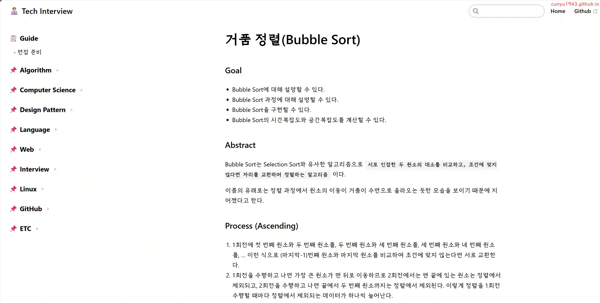

# 每日推荐 · 2026 年 11 月 26 日

> 作者：[村雨遥](https://github.com/cunyu1943)
> 
> 不要哀求，学会争取，若是如此，终有所获

## 🎈 号外 

最近，公众号之外，建立了微信交流群，不定期会在群里分享各种资源（影视、IT 编程、考试提升……）&知识。如果有需要，可以**扫码或者后台添加小编微信备注入群**。进群后**优先看群公告**，**呼叫群中【资源分享小助手】**，还能免费帮找资源哦～

## 一、项目

### 1. [Ecoku](https://github.com/DejavuMoe/Ecoku)

自托管，多站点。专注文字讨论。给博客与个人网站的评论系统，访客无需注册，评论提交即公开，数据由你保管。

### 2. [pay-java-parent](https://github.com/egzosn/pay-java-parent)

全能第三方支付对接 Java 开发工具包。优雅的轻量级支付模块集成支付对接支付整合（微信，支付宝，银联，友店，富友，跨境支付 paypal，payoneer (P 卡派安盈) 易极付）app，扫码，网页支付刷卡付条码付刷脸付转账红包服务商模式，微信分账，合并支付、支持多种支付类型多支付账户，支付与业务完全剥离，简单几行代码即可实现支付，简单快速完成支付模块的开发，可轻松嵌入到任何系统。

### 3. [Firefly](https://github.com/yangjianxin1/Firefly)

一站式大模型训练工具，一个开源的大模型训练项目，支持对主流的大模型进行预训练、指令微调和 DPO，包括但不限于 Qwen2、Yi-1.5、Llama3、Gemma、Qwen1.5、MiniCPM、Llama、InternLM、Baichuan、ChatGLM、Yi、Deepseek、Qwen、Orion、Ziya、Xverse、Mistral、Mixtral-8x7B、Zephyr、Vicuna、Bloom 等。支持全量参数训练、LoRA、QLoRA 高效训练，支持预训练、SFT、DPO。

## 二、软件

### 1. [Motrix](https://motrix.app/zh-CN/)

一款全能的下载工具，支持下载 `HTTP`、`FTP`、`BT`、磁力链接等资源。最最重要的是，他完全跨平台且免费。

软件界面设计简约清新，方便实用。用户可轻松监控、管理下载任务，并自由更改下载路径和速度限制。此外，还支持多点续传和流媒体下载，同时提供暂停、恢复、取消等快捷功能。

### 2. [SplitLanzou](https://github.com/Yu2002s/SplitLanzou)

第三方蓝奏云客户端。双面板快速管理文件，突破上传文件限制，分割上传文件。

### 3. [Listen 1](https://github.com/listen1/listen1_desktop)

可以搜索和播放来自网易云音乐，QQ 音乐，酷狗音乐，酷我音乐，Bilibili，咪咕音乐网站的歌曲，让你的曲库更全面。

## 三、网站

### 1. [Quick QR Art](https://quickqr.art/)

一款借助 `AI` 模型来生成艺术二维码的工具，原理是利用了 `Stable Diffusion` 中的 `Control Net` 模型。仅需几步，就能创建属于自己定制的艺术二维码。

### 2. [国家数据](https://data.stats.gov.cn/)

数据源于国家统计局，包含了我国经济民生等多个方面的数据，包含普查数据、地区数据、部门数据、国际数据等多方面内容，并且在月度、季度、年度都有覆盖，十分全面。

### 3. [物言卡片](https://mono.cards/)

将任何内容转化为精美的视觉卡片，在社交媒体上更出众、更抓眼，包括链接、音乐、文章、文字、代码等。

## 四、插件

### 1. [XApi](https://chromewebstore.google.com/detail/xapi-http-client-api-test/ilcnglohbiokfdcokfceihebobkpeaij)

支持自动捕获当前页面的 Fetch 与 XHR 网络请求，还能改写 Cookie、Origin、Referer 等字段信息，开发调试神器。

### 2. [FetchV](https://chromewebstore.google.com/detail/fetchv-m3u8hls视频下载器/imleiiaoeclikefimmcdkjabjbpcdgaj)

通用的网页视频下载器，免费、安全、简单易用。帮助你轻松将 `m3u8`、直播、`mp4`、`webm` 等在线视频下载到本地。支持多线程下载模式，在视频服务器和你的带宽条件允许之下，一个约 `1GB` 的视频可以在约十分钟内下载完成。

### 3. [Image Downloader](https://chromewebstore.google.com/detail/image-downloader-save-pic/daeljdgmllhgmbdkpgnaojldjkdgkbjg)

一个可以帮助您找到发布在网页上的图像。这是一个免费的工具，无需注册，只需点击几下，就可以让图像在几秒钟内保存到您的本地。

## 五、资料

### 1. [动手学大模型](https://github.com/Lordog/dive-into-llms)

《动手学大模型》系列编程实践教程，由上海交通大学 2024 年春季《人工智能安全技术》课程（NIS3353）讲义拓展而来，旨在提供大模型相关的入门编程参考。本教程属公益性质、完全免费。通过简单实践，帮助同学们快速入门大模型，更好地开展课程设计或学术研究。

### 2. [软考中级教程](https://github.com/luckyzhz/Software-Designer)

一份“软件设计师”的学习路径，含有 APP、真题、课本、参考文档等内容。

### 3. [tech-interview-for-developer](https://github.com/gyoogle/tech-interview-for-developer)

面向入门开发者的专业知识与技术面试百科，不过是韩文的，适合能读懂韩文的朋友。

## ✍️ 说明

周刊专栏相关信息：

- **项目地址**：[Github](https://github.com/cunyu1943/weekly)，觉得不错麻烦给我一个**Star**，感谢 ❤️
- **浏览地址**：公众号 | [电子书](https://cunyu1943.github.io/weekly) | [语雀](https://yuque.com/cunyu1943/weekly) | [ima 知识库](https://ima.qq.com/wiki/?shareId=860487e32c6cc8d6c9070cd7f00caedf3cbf4102f695862d9c82f463b92417af)

如果你阅读到这里，说明我的工作没有白费。如果你想推荐项目/网站/软件/资源，欢迎提交 **[issue](https://github.com/cunyu1943/weekly/issues)** 或者添加我 **个人微信：coder_cunYu** 与我交流。

---

## ⏳ 联系

想解锁更多知识？不妨关注我的微信公众号：**村雨遥（id：JavaPark）**。

扫一扫，探索另一个全新的世界。

